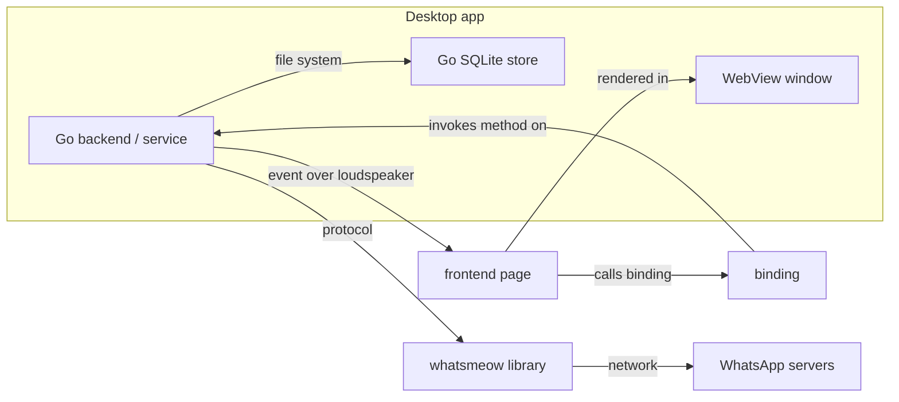

# Vocabulary

> **In one line:** This page names each piece of the app once, in the order you need the names, and points every name at the exact file and line where it really lives.

## Why this page exists

A newcomer can read a line like `app.RegisterService(application.NewService(api))` and understand every keyword except the ones that matter. The words are borrowed from desktop app development, web development, and the WhatsApp protocol library at the same time. Guessing what they mean leads to the wrong mental model — for example, assuming there is only one "store" in this project, when there are two very different ones.

This page removes that guessing. Each definition ends with a real pointer into the checked-in source, so you can verify the explanation instead of trusting it.

## The idea, in plain words

Picture a small shop. There is a back room where the actual work happens, a front room where customers are served, a serving hatch between them, and a noticeboard for announcements. The app works the same way: a compiled desktop program does the heavy work, a web-style page is what the user sees, a generated bridge lets the page dial functions in the back room, and named announcements carry news back to the page.

Read the definitions below in order. Later ones build on earlier ones.

### Go backend

The compiled program that starts the desktop window, talks to WhatsApp, and owns the databases. It is the "back room" of the shop: the user never sees it directly, but nothing works without it. The entry point is `main`, which hands off to the command layer.

→ In this repo: `main.go:23`, `cmd/run.go:43`.

### frontend

The React + TypeScript web page rendered inside the desktop window. Its source lives under `frontend/`, and its scripts (`dev`, `build`, `test`) are declared in a JSON file. It is the "front room": buttons, chat list, settings.

→ In this repo: `wails.json:4`, `frontend/package.json:6`.

### WebView

The embedded browser engine that draws the frontend inside the desktop window — a browser frame with no address bar. In this framework it is represented by a `WebviewWindow` object created when the app starts. A Linux-specific setting forces software rendering because mixed graphics drivers can crash the GPU process.

→ In this repo: `cmd/run.go:78`, `cmd/run.go:88`.

### Wails v3

The framework that connects the two halves: it starts the desktop window, manages the Go service lifecycle, generates the callable bridge, and carries announcements between Go and the frontend. It is the translator standing at the serving hatch, fluent in both "Go" and "browser". Version 3 is a major rewrite; older v2 examples do not apply.

→ In this repo: `go.mod:14`, `wails.json:2`.

### binding

A generated TypeScript function that, when called from the frontend, invokes an exported Go method. Think of it as a phone number you dial to reach one specific function in the back room; you never need to know how the call is routed. Generated bindings are imported from a `bindings/` directory, not the old `wailsjs/` directory.

→ In this repo: `frontend/src/App.tsx:2`, `build/Taskfile.yml:60`.

### event

A named announcement sent by one half and heard by the other. It is an announcement over a loudspeaker: the sender does not need to know who is listening, and listeners do not need to poll. The frontend subscribes with `EventsOn`; Go emits with `Event.Emit`. Event names in this app are strings like `wa:qr` and `wa:status`.

→ In this repo: `api/api.go:621`, `frontend/src/App.tsx:118`, `frontend/src/lib/wailsRuntime.ts:12`.

### service

A Go object whose startup and shutdown the framework manages. It holds the app's long-lived dependencies — the WhatsApp client, the databases, the caches — and exposes the methods that become bindings. It is the kitchen manager: opens the shop in `ServiceStartup`, locks up in `ServiceShutdown`.

→ In this repo: `cmd/run.go:93`, `api/api.go:502`, `api/api.go:416`.

### Store (Go / SQLite)

The persistent, on-disk database layer written in Go. It is the filing cabinet: messages and settings survive closing the app. It is opened during service startup and closed during shutdown.

→ In this repo: `internal/store/message.go`, `api/api.go:544`.

### Store (frontend / Zustand)

The in-memory React state container. It is the whiteboard behind the counter: fast to read and write while the shop is open, but wiped when the page reloads. There are several separate ones (chat list, messages, UI screen, settings). Do not confuse it with the filing cabinet above.

→ In this repo: `frontend/src/store/index.ts:1`, `frontend/src/App.tsx:20`.

### whatsmeow

A third-party Go library that implements the WhatsApp Web protocol: connecting, logging in, encryption, and protocol-level events. It is the telephone company that lets this app speak WhatsApp's language; the app configures it but does not implement the protocol itself.

→ In this repo: `go.mod:16`, `api/api.go:42`.

### QR / pairing

The first-time link flow. Go asks the protocol library for a QR code, announces it as an event, the frontend draws it on a canvas, and the user's phone scans it to link the device. It is like handing the phone a "pair me" badge. On later launches a saved session is used instead.

→ In this repo: `api/api.go:599`, `api/api.go:620`, `frontend/src/App.tsx:118`.

### session

The saved login credentials, kept in a local SQLite file so the app reconnects without scanning a QR code again. It is the stored keycard. Its file permissions are tightened on every start because it holds long-lived credentials.

→ In this repo: `api/api.go:523`, `api/api.go:538`.

### state

Any value the app remembers while it is running, such as which screen is showing or whether the window is focused. State can live in the frontend whiteboard or in a Go field (often guarded by a lock or an atomic value because several threads touch it).

→ In this repo: `frontend/src/App.tsx:20`, `api/api.go:58`.

### hook

A React function that lets a component run setup and cleanup around rendering, or react to changing state. It is a standing instruction pinned to the wall: "when the door opens, do this; when it closes, undo it." The classic example is `useEffect`.

→ In this repo: `frontend/src/App.tsx:30`, `frontend/src/hooks/useWailsEvents.ts`.

### component

A reusable React UI unit — a function that returns markup. It is a prefabricated counter section you can drop into different screens. The top-level `App` is a component, and so are the login, chat, and settings screens it renders.

→ In this repo: `frontend/src/App.tsx:19`, `frontend/src/App.tsx:293`.

### build tags

Labels passed to the Go compiler with a `-tags` flag by the build tasks, used to select a build variant. At the time of writing there are no `//go:build` lines in the checked-in Go files, so treat this as a task-level convention rather than a source-level switch — the flags are supplied by the platform build recipes.

→ In this repo: `build/windows/Taskfile.yml:26`, `build/linux/Taskfile.yml:22`.

### CGO

Go's bridge to C libraries. It must be enabled here because the SQLite driver used for the session database is backed by C code. It is like borrowing a tool from the shed: you need the C compiler present on the machine, not just the Go toolchain. Windows builds therefore require a working GCC from MSYS2 ucrt64 on the path.

→ In this repo: `go.mod:9`, `build/windows/Taskfile.yml:33`.

### How the pieces fit together



The bridge in the middle is the framework described above. A binding is a question asked of the back room; an event is an answer (or an unsolicited announcement) shouted back.

## The code, line by line

Three short excerpts are enough to see the vocabulary in its natural habitat. The frontend assets are embedded into the binary, the service is registered with the framework, and the frontend wraps the event API in a small compatibility shim.

```go
// main.go:12-13
//go:embed all:frontend/dist
var assets embed.FS
```

```go
// cmd/run.go:92-93
api := apiPkg.New(app, window)
app.RegisterService(application.NewService(api))
```

```ts
// frontend/src/lib/wailsRuntime.ts:12-13
export function EventsOn(name: string, cb: EventCallback): Unsubscribe {
  return Events.On(name, (event) => cb(event.data))
}
```

| Line | What it does |
|---|---|
| `main.go:12` | Tells Go to bake the built frontend files into the executable. |
| `main.go:13` | Declares `assets` as an embedded file system passed down to the command layer. |
| `cmd/run.go:92` | Constructs the service with the app and window injected. |
| `cmd/run.go:93` | Registers it so the framework manages its lifecycle and exposes its methods. |
| `wailsRuntime.ts:12` | Defines the frontend's event-subscription helper. |
| `wailsRuntime.ts:13` | Delegates to the v3 runtime and unwraps `event.data` for legacy callers. |

## What can go wrong

> **There are two stores.** If you "fix a bug" in the frontend Zustand store expecting data to persist, it will vanish on reload. Durable data is in the Go SQLite store. Compare `frontend/src/store/index.ts:1` with `api/api.go:544`.

> **Old v2 examples mislead.** A v2 tutorial will tell you to import from `wailsjs/` and call a global emit function. This repo imports from `frontend/bindings/` (`frontend/src/App.tsx:2`) and listens through the v3 runtime shim (`frontend/src/lib/wailsRuntime.ts:7`). The integration report records integrity checks for exactly these stale patterns (`provenance-docs/INTEGRATION_REPORT.md:8`).

> **"Enable a build tag" is not a thing you can verify in source here.** The flags exist in the Taskfiles, but no checked-in Go file declares a matching `//go:build` line. Do not assume a tag switches code paths; check the compiler flags first (`build/windows/Taskfile.yml:26`).

> **A missing C compiler looks like a Go error.** On Windows, a failing SQLite/CGO build usually means MSYS2 ucrt64 GCC is not on the path, not that the Go code is wrong (`build/windows/Taskfile.yml:32`).

> **Linux graphics crashes are a WebView issue.** The config forces software rendering (`WebviewGpuPolicyNever`) to avoid WebKitGTK GPU-process crashes on mixed driver setups; do not "optimise" it away without testing (`cmd/run.go:86-88`).

## Where to next

- [Quickstart: install the tools and run the app](quickstart.md)
- [Landing page and reading order](../index.md)
- Later, once these names are comfortable: System map (planned, DOC-002, `../01-architecture/system-map.md`) and Wails bindings contract (planned, DOC-005, `../03-api-integration/wails-bindings.md`)
