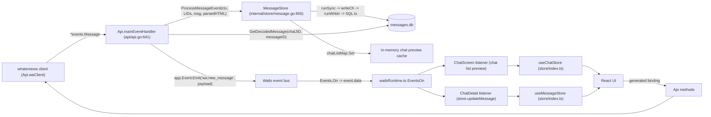
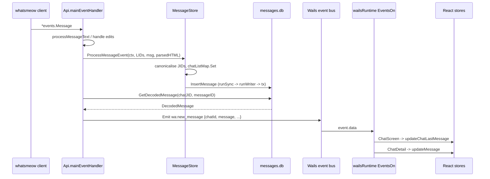
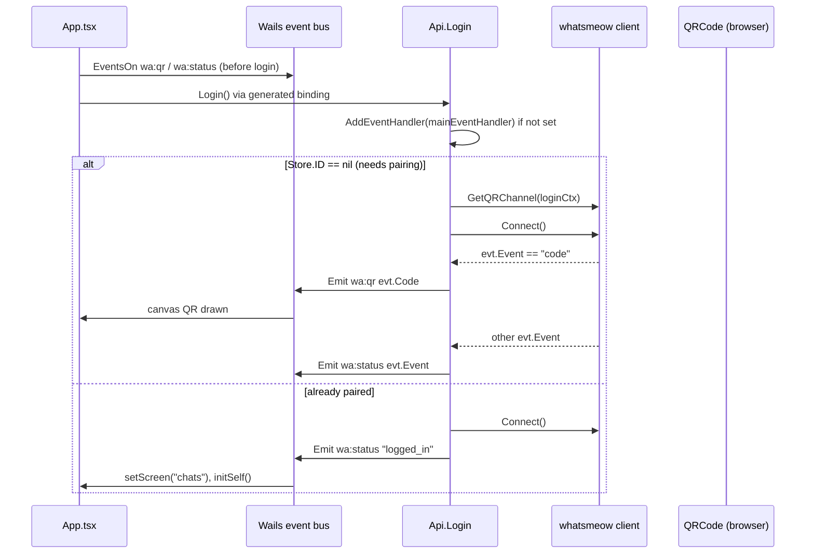

# Data flow: from WhatsApp to the screen

> **In one line:** A WhatsApp event lands in `Api.mainEventHandler`, is written to `messages.db` by `MessageStore`, is re-read as a `DecodedMessage`, and crosses to React as the `wa:new_message` event; login and downloads use the same one-way event bridge with the exact names `wa:qr` and `download:complete`.

## Why this page exists

The system map shows the boxes. This page shows the **arrows**. It follows three flows that a junior developer will touch first:

1. an incoming chat message (the hot path),
2. a QR-code login (the path that decides which screen you see), and
3. a media download (the path that proves the app can call Go methods and hear back).

Every event name, method name and payload key below is copied from source. Where a name looks odd (for example `wa:new_message` used for poll-card refreshes too), the code is the authority.

## The idea, in plain words

Imagine a **post office with a noticeboard**:

- The WhatsApp library is the mail carrier. It drops an envelope (`*events.Message`) into a single sorting desk: `Api.mainEventHandler`.
- The sorting desk does not put the letter straight on the wall. It sends it to the archive clerk (`MessageStore.ProcessMessageEvent`), who writes it into a ledger (`messages.db`) through a single writing desk (`runWriter`).
- Only after the letter is archived does the desk take a **clean copy back out** (`GetDecodedMessage`) and pin a notice on the board: `app.Event.Emit("wa:new_message", ...)`.
- The React side is a reader with a subscription (`EventsOn`). The shim `wailsRuntime.ts` converts each notice into a plain callback, and the reader files it into a Zustand store (`useMessageStore`, `useChatStore`). React re-renders because the store changed.

The trick to remember: **the database is the source of truth, the event is only a notification.** The event carries enough data to update a preview or insert a row, but the UI still asks Go for full pages of history through bindings.



## The code, line by line

### Flow 1 — incoming WhatsApp message → store → `wa:new_message` → UI

**Step 1: the handler is registered on first login.**

```go
// api/api.go:580-583
if !a.eventHandlerSet {
	a.eventHandlerID = a.waClient.AddEventHandler(a.mainEventHandler)
	a.eventHandlerSet = true
}
```

| Line | What it does |
|---|---|
| `api/api.go:581` | `mainEventHandler` is added to the one `whatsmeow.Client`; the ID is remembered so shutdown can remove it. |

**Step 2: the event is parsed and persisted, then re-read.**

```go
// api/api.go:641-681 (faithful excerpt; long comments condensed as ...)
func (a *Api) mainEventHandler(evt any) {
	a.eventMu.RLock()
	defer a.eventMu.RUnlock()
	if a.isShuttingDown() {
		return
	}
	switch v := evt.(type) {
	case *events.Message:
		// Poll vote messages: insert a system message and skip normal processing
		if v.Message.GetPollUpdateMessage() != nil {
			a.startBackground(func() { a.handlePollVoteEvent(v) })
			return
		}

		parsedHTML := a.processMessageText(v.Message)

		// Handle message edits: re-parse the edited content
		if protoMsg := v.Message.GetProtocolMessage(); protoMsg != nil && protoMsg.GetType() == waE2E.ProtocolMessage_MESSAGE_EDIT {
			newContent := protoMsg.GetEditedMessage()
			if newContent != nil {
				parsedHTML = a.processMessageText(newContent)
			}
		}

		messageID := a.messageStore.ProcessMessageEvent(a.ctx, a.waClient.Store.LIDs, v, parsedHTML)

		// If a message was processed (inserted or updated), emit the decoded message from DB
		if messageID != "" {
			updatedMsg, err := a.messageStore.GetDecodedMessage(v.Info.Chat.String(), messageID)
			if err == nil {
				a.app.Event.Emit("wa:new_message", map[string]any{
					"chatId":      v.Info.Chat.String(),
					"message":     updatedMsg,
					"messageText": parsedHTML,
					"timestamp":   v.Info.Timestamp.Unix(),
					"sender":      v.Info.PushName,
					"isFromMe":    v.Info.IsFromMe,
				})
			} else if !errors.Is(err, sql.ErrNoRows) {
				log.Println("Failed to get decoded message after processing:", err)
			}
		}
```

| Line | What it does |
|---|---|
| `api/api.go:642-643` | Holds a read lock so shutdown cannot close stores while an event is in flight. |
| `api/api.go:644-646` | Drops events once shutdown has begun. |
| `api/api.go:650-653` | Poll votes leave the normal path and go to `handlePollVoteEvent` on the worker pool. |
| `api/api.go:655` | `processMessageText` (defined at `api/message.go:61`) produces HTML text. |
| `api/api.go:658-663` | Edits replace `parsedHTML` with the edited message's text. |
| `api/api.go:665` | `ProcessMessageEvent` returns a message ID, or `""` when nothing was stored (reaction, revoked, protocol noise). |
| `api/api.go:669` | `GetDecodedMessage` re-reads the stored row so the frontend gets a stable shape. |
| `api/api.go:671-678` | Emits `wa:new_message` with exactly six keys: `chatId`, `message`, `messageText`, `timestamp`, `sender`, `isFromMe`. |

**Step 3: the store canonicalises, writes, and caches.**

```go
// internal/store/message.go:656-739 (excerpt)
func (ms *MessageStore) ProcessMessageEvent(ctx context.Context, sd store.LIDStore, msg *events.Message, parsedHTML string) string {
	ms.migrateChatlist(ctx, sd, msg.Info.Chat)

	updateCanonicalJID(ctx, sd, &msg.Info.Chat)
	updateCanonicalJID(ctx, sd, &msg.Info.Sender)
	...
	if ShouldSkipMessage(msg.Message) && msg.Message.GetPinInChatMessage() == nil {
		return ""
	}
	chat := msg.Info.Chat.User
	var messageText string
	if parsedHTML != "" {
		messageText = parsedHTML
	} else {
		messageText = ExtractMessageText(msg.Message)
	}
	chatMsg := ChatMessage{
		JID:         msg.Info.Chat,
		MessageText: messageText,
		MessageTime: msg.Info.Timestamp.Unix(),
		Sender:      msg.Info.Sender.String(),
		IsFromMe:    msg.Info.IsFromMe,
	}

	ms.chatListMap.Set(chat, chatMsg)

	err := ms.InsertMessage(&msg.Info, msg.Message, parsedHTML)
	if err != nil {
		log.Println("Failed to insert message:", err)
		return ""
	}
	return msg.Info.ID
}
```

```go
// internal/store/message.go:311-331 (writer excerpt)
func (ms *MessageStore) runWriter() {
	defer close(ms.writerDone)
	for req := range ms.writeCh {
		func() {
			defer func() {
				if r := recover(); r != nil { ... }
			}()
			tx, err := ms.db.BeginTx(context.Background(), nil)
			if err == nil {
				defer func() { _ = tx.Rollback() }()
				err = req.job(tx)
				if err == nil {
					err = tx.Commit()
				}
			}
```

| Line | What it does |
|---|---|
| `message.go:657-660` | Migrates a new LID chat to its phone number and canonicalises chat/sender JIDs before storage. |
| `message.go:663-709` | Reactions, edits, revokes and protocol noise are handled or skipped; they do not create a normal row. |
| `message.go:732` | The in-memory `chatListMap` preview is updated first, so the chat list can be instant. |
| `message.go:734` | `InsertMessage` enqueues the real SQL write via `runSync`. |
| `message.go:311-331` | `runWriter` is the **single** goroutine that begins and commits each transaction, with panic recovery. |

**Step 4: two React listeners consume the same event.**

```ts
// frontend/src/screens/ChatScreen.tsx:1068-1114 (excerpt)
const unsubNewMessage = EventsOn(
  "wa:new_message",
  (data: {
    chatId: string
    messageText: string
    timestamp: number
    sender: string
    reaction?: string
    isFromMe?: boolean
  }) => {
    // Mark an incoming message unread unless it belongs to the chat that's
    // currently open. Read state via getState() to avoid a stale closure.
    if (!data.isFromMe && useChatStore.getState().selectedChatId !== data.chatId) {
      useChatStore.getState().incrementUnreadCount(data.chatId)
    }
    ...
    // Update only this specific chat - no full re-fetch needed!
    updateChatLastMessage(
      data.chatId,
      previewText,
      data.timestamp,
      senderForUpdate,
      Boolean(data.isFromMe),
    )
```

```ts
// frontend/src/screens/ChatDetail.tsx:728-758 (excerpt)
const unsub = EventsOn(
  "wa:new_message",
  (data: { chatId: string; message: Message; clientTempId?: string }) => {
    if (data?.chatId === chatId && data.message?.Info?.ID) {
      // Use getState to avoid depending on messages array and causing re-subscriptions
      const currentMessages = useMessageStore.getState().messages[chatId] || []
      const hasPendingMessage = currentMessages.some(m => m.isPending)
      ...
      updateMessage(data.chatId, data.message)
    }
  },
)
```

| Line | What it does |
|---|---|
| `ChatScreen.tsx:1069` | Subscribes to `wa:new_message` for the chat **list**, using `messageText` as the preview. |
| `ChatScreen.tsx:1080-1082` | Increments unread count for incoming messages not in the open chat. |
| `ChatScreen.tsx:1103-1109` | Calls `updateChatLastMessage` — one chat is patched, no full re-fetch. |
| `ChatDetail.tsx:729` | A second subscriber for the **open chat**, using the `message` object. |
| `ChatDetail.tsx:731` | Guards on `chatId` and `message.Info.ID` so unrelated chats are ignored. |
| `ChatDetail.tsx:754` | `updateMessage` writes into `useMessageStore`; React re-renders the bubble list. |



### Flow 2 — QR login → `wa:qr` → canvas

The frontend registers listeners **before** calling `Login()`, because an already-paired session can emit `logged_in` almost immediately.

```ts
// frontend/src/App.tsx:117-124, 126-129, 186-193 (excerpt)
useEffect(() => {
  const unsubQR = EventsOn("wa:qr", async (qr: string) => {
    if (!canvasRef.current) return
    await QRCode.toCanvas(canvasRef.current, qr, {
      width: 300,
      color: { dark: "#000000", light: "#ffffff" },
    })
  })

  const unsubStatus = EventsOn("wa:status", (status: string) => {
    setStatus(status)
    if (status === "logged_in" || status === "success") {
      useUIStore.getState().setScreen("chats")
      void initSelf()
```

```ts
// frontend/src/App.tsx:186-193 (excerpt)
// Register all status listeners before starting login. Existing sessions
// can complete quickly enough to otherwise lose the "logged_in" event.
if (!loginStartedRef.current) {
  loginStartedRef.current = true
  // Never render a raw backend error: it can contain proxy URLs with credentials
  // or filesystem paths. Details stay in the backend logs only.
  void Login().catch(() => setStatus("error: Unable to sign in. Please try again."))
}
```

```go
// api/api.go:587-626 (excerpt)
if client.Store.ID == nil {
	loginCtx, cancel := context.WithCancel(a.ctx)
	a.lifecycleMu.Lock()
	a.loginCancel = cancel
	a.lifecycleMu.Unlock()
	defer func() {
		cancel()
		a.lifecycleMu.Lock()
		a.loginCancel = nil
		a.lifecycleMu.Unlock()
	}()

	qrChan, err := client.GetQRChannel(loginCtx)
	if err != nil {
		return fmt.Errorf("create QR login channel: %w", err)
	}
	...
	err = client.Connect()
	if err != nil {
		return err
	}

	for {
		select {
		case <-loginCtx.Done():
			return loginCtx.Err()
		case evt, ok := <-qrChan:
			if !ok {
				return nil
			}
			if evt.Event == "code" {
				a.app.Event.Emit("wa:qr", evt.Code)
			} else {
				a.app.Event.Emit("wa:status", evt.Event)
			}
		}
	}
}
```

```go
// api/api.go:627-637 (already-paired branch)
} else {
	// Already logged in, connect before announcing readiness.
	err := client.Connect()
	if err != nil {
		return err
	}
	if a.isShuttingDown() {
		return context.Canceled
	}
	a.app.Event.Emit("wa:status", "logged_in")
}
```

| Line | What it does |
|---|---|
| `App.tsx:118-124` | `wa:qr` draws the QR string into the `<canvas>` with `QRCode.toCanvas` at 300 px. |
| `App.tsx:126-129` | `wa:status` with `logged_in`/`success` switches to the `chats` screen and calls `initSelf()`. |
| `App.tsx:136-154` | `reconnecting`, `disconnected` and `logged_out` drive toast notifications and screen changes. |
| `App.tsx:188-192` | `Login()` is invoked exactly once (`loginStartedRef`) after all listeners are installed. |
| `api/api.go:587` | `Store.ID == nil` is the signal that a QR pairing is needed (client created from `container.GetFirstDevice` in `wa/client.go:16`). |
| `api/api.go:588-591` | A cancellable login context is stored in `a.loginCancel`. |
| `api/api.go:599` | `client.GetQRChannel(loginCtx)` opens the QR event channel. |
| `api/api.go:607` | `client.Connect()` starts the connection; QR codes arrive on `qrChan`. |
| `api/api.go:620-624` | `"code"` → `wa:qr` with the code; every other event → `wa:status`. |
| `api/api.go:636` | A paired device emits `wa:status`, `"logged_in"` to announce readiness. |



### Flow 3 — media download → `download:complete`

```go
// api/media.go:640-681 (excerpt)
func (a *Api) DownloadMediaToFile(messageID string) error {
	if a.messageStore == nil {
		return fmt.Errorf("message store is not ready")
	}
	msg, err := a.messageStore.GetMessageWithMediaByID(messageID)
	...
	if msg.Media == nil {
		return fmt.Errorf("message %s has no downloadable media", messageID)
	}
	if a.waClient == nil {
		return fmt.Errorf("WhatsApp client is not ready")
	}
	...
	// Stream to a temp file first so downloads never balloon memory.
	tmp, err := os.CreateTemp("", "whats4linux-dl-*")
	...
	if dlErr := a.waClient.DownloadToFile(a.ctx, msg.Media, tmp); dlErr != nil {
		return fmt.Errorf("failed to download media: %w", dlErr)
	}
```

```go
// api/media.go:700-712 (excerpt)
out, err := os.Create(filePath)
...
if _, err := io.Copy(out, tmp); err != nil {
	_ = os.Remove(filePath)
	return fmt.Errorf("failed to write destination file: %w", err)
}

a.app.Event.Emit("download:complete", filePath)
_ = beeep.Notify("whats4linux", "Downloaded: "+filePath, "")
playBeep()
return nil
```

```ts
// frontend/src/App.tsx:157-168
const unsubDownload = EventsOn("download:complete", (filePath: string) => {
  // The backend emits an absolute filesystem path. Show only the basename
  // so the user's directory layout (and username) never leaks into a toast.
  const name = (typeof filePath === "string" ? filePath : "")
    .split(/[\\/]/)
    .pop()
    ?.trim()
  const notificationId = addNotification(`Downloaded: ${name || "file"}`)
  setTimeout(() => {
    removeNotification(notificationId)
  }, 3000)
})
```

| Line | What it does |
|---|---|
| `api/media.go:644` | Loads the message and its media metadata from `messages.db`. |
| `api/media.go:666` | Creates a temp file; the payload is streamed, never fully held in memory. |
| `api/media.go:679` | `waClient.DownloadToFile` decrypts directly into the temp file. |
| `api/media.go:683-688` | `app.Dialog.SaveFile()` asks the user where to save; empty path means cancel. |
| `api/media.go:710` | Emits `download:complete` with the absolute path. |
| `App.tsx:157` | Subscribes to `download:complete` and shows only the basename in the toast. |
| `api/media.go:638-639, 676-678` | `media:download_progress` was deliberately removed because no frontend listener consumes it — do not reintroduce it as a "fix". |

## What can go wrong

> **An empty message ID means "nothing happened".** `ProcessMessageEvent` returns `""` for reactions, edits, revokes and protocol noise (`message.go:663-709`), and `mainEventHandler` only emits `wa:new_message` when the ID is non-empty (`api.go:668`). If a message seems missing from the UI, check which branch it took before assuming the event bus failed.

> **The UI can miss a fast login.** The comment at `App.tsx:186-187` is a real constraint: listeners must be registered before `Login()`. Moving `Login()` into an earlier effect can lose `logged_in`.

> **`GetDecodedMessage` is a read through the writer queue.** It uses `runSync` (`message.go:2039-2040`) so it sees pending writes, but that also means a busy writer delays the event payload. The event is emitted only after the re-read succeeds (`api.go:669-681`).

> **Two listeners share one event with different shapes.** `ChatScreen` reads `messageText` as a string preview, while `ChatDetail` reads `message.Info.ID` as an object (`ChatScreen.tsx:1070-1077`, `ChatDetail.tsx:730-731`). Changing the payload in Go without updating both listeners breaks one of the two views silently.

> **Own-vote echoes arrive as poll updates.** `refreshPollCard` emits both `wa:poll_vote_update` and a `wa:new_message` with `"pollUpdate": true` (`api/polls.go:396-413`). Handle polls through that path rather than assuming every `wa:new_message` is a fresh chat message.

> **The QR code is not a password to log in the UI.** The browser only draws `evt.Code` on a canvas (`App.tsx:118-124`); pairing happens inside whatsmeow. Do not store or forward the QR string anywhere else.

## Where to next

- [System map](system-map.md) — the owners behind each arrow on these diagrams.
- [Decisions](decisions.md) — why the bridge is events-plus-bindings rather than direct shared state.
- [Vocabulary](../00-start-here/vocabulary.md) — definitions of JID, LID, binding and event.
- [Quickstart](../00-start-here/quickstart.md) — how to run the app and regenerate bindings.
- [Docs index](../index.md) — the full reading order.
