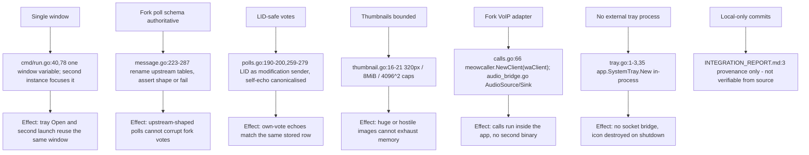

# Decisions: why the code looks like this

> **In one line:** Six of the seven decisions here are enforced by code you can read (single window, fork poll schema, LID-safe votes, bounded thumbnails, fork VoIP adapter, in-process tray); the seventh — local-only commits — is recorded in `provenance-docs` and cannot be verified from source.

## Why this page exists

Source tells you *what* the app does; it rarely tells you *why*. This page connects a handful of non-obvious shapes to the decision behind them, and — just as importantly — says **how strong the evidence is**. A code-enforced decision can be checked by reading a file. A decision that lives only in a report is labelled as such, because a report can drift away from the code.

The rule used throughout: **if source and provenance disagree, source wins.** Provenance files were read for historical context only, never as a source of code facts.

## The idea, in plain words

Think of these decisions as **the rules written on the back of the architect's drawing**:

- Some rules are **bolted on**: you can see the bolt. "One window" is bolted on because there is literally one `window` variable and every tray action points at it. "Fork poll schema" is bolted on because startup refuses to continue unless the fork's table shape is present.
- Some rules are **habits written into a recipe**: "LID-safe votes" and "bounded thumbnails" are choices inside functions — use the LID when encrypting a poll vote; refuse to decode an image larger than 8 MiB. They are visible, but only if you read the function.
- One rule is **only in the meeting notes**: "no push / local-only" appears in a report, not in a line of Go or TypeScript. It is recorded here, clearly marked, so nobody mistakes it for something the compiler enforces.

You can think of the evidence levels as **bolt** (enforced and visible), **recipe** (visible choice inside code), and **note** (provenance only).



## The code, line by line

### Decision 1 — Single window *(code-enforced)*

```go
// cmd/run.go:38-41
// The second-instance callback is installed before the window exists;
// capture the variable and guard against an early notification.
var window *application.WebviewWindow
var systray *tray.Tray
```

```go
// cmd/run.go:54-60
OnSecondInstanceLaunch: func(_ application.SecondInstanceData) {
	if window == nil {
		return
	}
	window.UnMinimise()
	window.Show()
	window.Focus()
},
```

```go
// cmd/run.go:78-90 (excerpt)
window = app.Window.NewWithOptions(application.WebviewWindowOptions{
	Title:  misc.AppName,
	Width:  1024,
	Height: 768,
	...
})
```

```go
// internal/tray/tray.go:41-45
menu.Add("Open").OnClick(func(_ *application.Context) {
	window.UnMinimise()
	window.Show()
	window.Focus()
})
menu.Add("Hide").OnClick(func(_ *application.Context) {
	window.Hide()
})
```

| Line | What it does |
|---|---|
| `cmd/run.go:40` | Exactly one `window` pointer exists and is captured by callbacks. |
| `cmd/run.go:54-60` | A second instance does not open a new window; it revives and focuses the existing one. |
| `cmd/run.go:78` | There is one `NewWithOptions` call for the whole app. |
| `tray.go:41-48` | Tray "Open"/"Hide" act on that same window. |
| `WAILS3_MIGRATION_PLAN.md:11` | *(provenance)* Records "Window decision: SINGLE window (chat app)" — corroborates the code, does not establish it. |

### Decision 2 — Fork poll schema is authoritative *(code-enforced)*

```go
// internal/store/message.go:223-254 (excerpt; long comment condensed)
// The fork poll schema is authoritative. A database created by upstream
// has incompatible polls/poll_votes tables, against which the fork's
// CREATE TABLE IF NOT EXISTS would silently no-op. Detect and move such
// tables aside BEFORE the fork CREATEs; the data is backfilled from the
// backups after this transaction commits ...
pollsUpstream, votesUpstream, err := pollTablesHaveUpstreamShape(tx)
if err != nil {
	return err
}
if pollsUpstream {
	if _, err := tx.Exec(`ALTER TABLE polls RENAME TO ` + pollsBackupTable); err != nil {
		return err
	}
}
if votesUpstream {
	if _, err := tx.Exec(`ALTER TABLE poll_votes RENAME TO ` + votesBackupTable); err != nil {
		return err
	}
	// The fork index must be created fresh on the new fork table.
	if _, err := tx.Exec(`DROP INDEX IF EXISTS idx_poll_votes_poll`); err != nil {
		return err
	}
}
_, err = tx.Exec(query.CreatePollsTable)
...
_, err = tx.Exec(query.CreatePollVotesTable)
```

```go
// internal/store/message.go:275-287
// Restore any upstream-shaped poll data the init transaction moved aside,
// then drop the backups. This is a no-op on fresh/fork-shaped databases.
if err := ms.maybeBackfillPollTables(); err != nil {
	_ = ms.Close()
	return nil, err
}

// Fail fast if the authoritative fork schema is not actually installed:
// continuing with an upstream-shaped table would corrupt future votes.
if err := assertPollSchemaShape(ms.db); err != nil {
	_ = ms.Close()
	return nil, err
}
```

| Line | What it does |
|---|---|
| `message.go:223-228` | States the decision and why `CREATE TABLE IF NOT EXISTS` alone is unsafe. |
| `message.go:229-246` | Detects upstream-shaped tables, renames them aside, drops the old index. |
| `message.go:247-254` | Creates the fork's fresh `polls` / `poll_votes` tables. |
| `message.go:277` | Backfills old data from the backups. |
| `message.go:284-287` | Fails fast with `assertPollSchemaShape` if the fork shape is not installed. |
| `INTEGRATION_REPORT.md:15` | *(provenance)* Lists "Schema authoritative + migration, LID-safe votes" for upstream cluster C3. |

### Decision 3 — LID-safe votes *(code-enforced)*

```go
// api/polls.go:184-200 (excerpt)
// buildPollVoteLID builds a poll vote message using the LID (falling back to
// the plain JID when no LID migration has happened) as the modification
// sender. whatsmeow's BuildPollVote uses the plain JID whenever the poll
// creator is a non-LID user, which breaks decryption on LID-migrated devices
// that see our message sender as our LID. Reactions always use the LID, so we
// mirror that here.
func (a *Api) buildPollVoteLID(ctx context.Context, pollInfo *types.MessageInfo, optionNames []string) (*waE2E.PollUpdateMessage, error) {
	plaintext, err := proto.Marshal(&waE2E.PollVoteMessage{
		SelectedOptions: whatsmeow.HashPollOptions(optionNames),
	})
	if err != nil {
		return nil, fmt.Errorf("failed to marshal poll vote protobuf: %w", err)
	}
	ownID := a.waClient.Store.GetLID()
	if ownID.IsEmpty() {
		ownID = a.waClient.Store.GetJID()
	}
```

```go
// api/polls.go:255-279 (excerpt)
// pollVoteSelfJID reports whether sender is one of our own identities
// (canonical PN, LID lookalike, or reversed LID→PN lookup) ...
func (a *Api) pollVoteSelfJID(sender types.JID) string {
	if a.waClient.Store.ID == nil {
		return ""
	}
	ownJID := canonicalUserJID(a.ctx, a.waClient, a.waClient.Store.GetJID()).String()
	if canonicalUserJID(a.ctx, a.waClient, sender).String() == ownJID {
		return ownJID
	}
	agent := sender.ActualAgent()
	if agent != types.LIDDomain && agent != types.HostedLIDDomain {
		return ""
	}
	ownLID := a.waClient.Store.GetLID()
	if ownLID.User != "" && ownLID.User == sender.User && ownLID.Server == sender.Server {
		return ownJID
	}
	...
}
```

```go
// api/polls.go:322-329
// Own votes echo back with our LID or PN depending on the device. Always
// store them under the canonical PN JID used by GetPollVotes so HasVoted
// and re-votes keep matching the same row.
voter := canonicalUserJID(a.ctx, a.waClient, v.Info.Sender).String()
if own := a.pollVoteSelfJID(v.Info.Sender); own != "" {
	voter = own
}
if err := a.messageStore.UpsertPollVote(chatJID, pollMessageID, voter, indices); err != nil {
```

| Line | What it does |
|---|---|
| `polls.go:184-189` | Explains the failure being avoided: upstream's vote builder uses the PN and breaks decryption on LID-migrated devices. |
| `polls.go:197-200` | Uses `Store.GetLID()`, falling back to `GetJID()` when there is no LID. |
| `polls.go:259-279` | Recognises our own vote from a canonical PN, a LID/hosted-LID, or a reverse LID→PN lookup. |
| `polls.go:325-328` | Writes own-vote echoes under one canonical PN so tally and `HasVoted` stay consistent. |
| `INTEGRATION_REPORT.md:15` | *(provenance)* Records "LID-safe votes" as the remediated outcome of cluster C3. |

### Decision 4 — Thumbnails are bounded *(code-enforced)*

```go
// api/thumbnail.go:16-29 (excerpt)
const (
	thumbnailMaxDim         = 320
	thumbnailMaxSourceBytes = 8 << 20
	thumbnailMaxPixels      = 4096 * 4096
	thumbnailJPEGQuality    = 60
)

// thumbnailUnavailable is stored when generation failed so GetThumbnail
// short-circuits instead of re-decoding the same file on every open.
var thumbnailUnavailable = []byte{0}
```

```go
// api/thumbnail.go:33-50 (excerpt)
func generateThumbnail(data []byte, mime string) []byte {
	if len(data) == 0 || len(data) > thumbnailMaxSourceBytes {
		return nil
	}
	if mime != "" && !isImageMime(mime) {
		return nil
	}

	thumbnailDecodeMu.Lock()
	defer thumbnailDecodeMu.Unlock()

	cfg, _, err := image.DecodeConfig(bytes.NewReader(data))
	if err != nil || cfg.Width <= 0 || cfg.Height <= 0 {
		return nil
	}
	if int64(cfg.Width)*int64(cfg.Height) > thumbnailMaxPixels {
		return nil
	}
```

```go
// api/media.go:207-210
const (
	maxCachedImageBatchItems = 8
	maxCachedImageBatchBytes = 2 << 20
)
```

```go
// api/media.go:363-366
// maxAvatarBytes caps how much of a profile photo we read into memory. Avatar
// URLs are remote and untrusted, so an unbounded ReadAll is a memory-exhaustion
// risk (D-AUD-003g).
const maxAvatarBytes = 10 << 20 // 10 MiB
```

| Line | What it does |
|---|---|
| `thumbnail.go:17-20` | Hard caps: 320 px longest side, 8 MiB source, 4096×4096 pixels, JPEG quality 60. |
| `thumbnail.go:34-39` | Refuses empty, oversized or non-image input before decoding. |
| `thumbnail.go:48-50` | Refuses a huge pixel count even if the byte count is small (a decompression-bomb guard). |
| `thumbnail.go:25-29` | A one-byte sentinel prevents repeated failed decodes on every open. |
| `media.go:208-209` | Batched image reads capped at 8 items / 2 MiB of encoded data. |
| `media.go:366` | Remote avatars are capped at 10 MiB. |
| `INTEGRATION_REPORT.md:14` | *(provenance)* Records "C2 media thumbnails ... 17-column upsert, MIME guards" for the upstream comparison. |

### Decision 5 — Fork-owned VoIP adapter (`meowcaller`) *(code-enforced)*

```go
// api/calls.go:59-68
// initMeowcaller initializes the WhatsApp VoIP extension library
func (a *Api) initMeowcaller() {
	if a.waClient == nil {
		log.Println("[Calls] WhatsApp client not initialized, skipping meowcaller")
		return
	}

	a.callClient = meowcaller.NewClient(a.waClient, meowcaller.WithLogger(
		zerolog.New(zerolog.ConsoleWriter{Out: os.Stderr}),
	))
```

```go
// api/calls.go:75-78
offerHandlerID := a.waClient.AddEventHandler(func(evt any) {
	offer, ok := evt.(*events.CallOffer)
	if !ok || offer.GroupJID.IsEmpty() {
		return
	}
```

```go
// api/api.go:555-556
// Initialize VoIP extension
a.initMeowcaller()
```

| Line | What it does |
|---|---|
| `calls.go:61-64` | The adapter is skipped when there is no WhatsApp client yet. |
| `calls.go:66-68` | `meowcaller.NewClient` is built **on top of** the existing `waClient` — a fork adapter, not a second connection. |
| `calls.go:75-78` | A separate `CallOffer` handler patches group JIDs onto active calls. |
| `api.go:556` | The adapter is initialised during `ServiceStartup`, after the client and stores. |
| `api.go:466` | `cleanupMeowcaller()` runs in `closeResources()` during shutdown. |
| `INTEGRATION_REPORT.md:16` | *(provenance)* Records "C4 VoIP ... fork-owned adapter direction" and that it was re-scoped after a Critic failure. |

### Decision 6 — No external tray process *(code-enforced)*

```go
// internal/tray/tray.go:1-3
// Package tray hosts the in-process system tray. Wails v3 owns the tray icon
// inside the application process, replacing the old external tray binary and
// its unix-socket bridge.
```

```go
// internal/tray/tray.go:34-38
func New(app *application.App, window *application.WebviewWindow, api *apiPkg.Api) *Tray {
	systray := app.SystemTray.New()
	systray.SetIcon(trayIcon)
	systray.SetLabel("amazingwhats")
	systray.SetTooltip("Lantern")
```

```go
// cmd/run.go:63-68 (excerpt)
// Closing the window keeps the app alive in the tray so Open can
// restore it (v2 behaviour via the external systray process).
// v3 exposes this per platform, not on application.Options.
Windows: application.WindowsOptions{
	DisableQuitOnLastWindowClosed: true,
},
```

| Line | What it does |
|---|---|
| `tray.go:1-3` | Declares the decision explicitly: in-process, replacing an external binary + socket bridge. |
| `tray.go:35` | The icon is created by `app.SystemTray.New()` inside the Wails app. |
| `cmd/run.go:66-75` | Last-window-close is disabled on each platform so the tray remains useful. |
| `cmd/run.go:46-48` | `OnShutdown` destroys the native icon. |
| `WAILS3_MIGRATION_PLAN.md:10,19` | *(provenance)* Describes the old external tray/socket design and slice D6 that replaces it. |

### Decision 7 — Local-only commits *(decision recorded in provenance-docs, not verifiable from source)*

> **Decision recorded in provenance-docs, not verifiable from source.** No Go, TypeScript, YAML or JSON file enforces "never push". There is no remote configuration, CI gate or code path that proves it; only the report states it.

```text
// provenance-docs/INTEGRATION_REPORT.md:3 (excerpt)
Date: 2026-11-23. Repo: `C:\Users\sugee\Github\SugeethJSA\amazingwhats`. Fork baseline `cc72bab`; upstream mother `lugvitc/whats4linux` at merge base `aeb9e474`. No push performed (local-only, per user decision).
```

| Line | What it does |
|---|---|
| `INTEGRATION_REPORT.md:3` | Records the decision and the fact that no push was performed at the time of writing. |
| `INTEGRATION_REPORT.md:6` | Says the ~27 commits were on local `master` — still a report claim, not source. |
| *(no source line)* | There is no file in this repository whose contents prove a no-push rule. Treat this as a social/process decision to be re-confirmed with the owner. |

## What can go wrong

> **Do not "fix" the single window by opening a second one.** The second-instance callback (`cmd/run.go:54-60`), tray Open/Hide (`tray.go:41-48`) and the injected `window` field (`api/api.go:40`) all assume one target. A new window leaves those paths pointing at the old one.

> **Skipping the poll-schema assertion is dangerous.** `assertPollSchemaShape` (`message.go:284`) exists because `CREATE TABLE IF NOT EXISTS` silently accepts an incompatible upstream table. Remove the assertion and votes can be written into the wrong shape with no error at startup.

> **A poll vote built with the plain JID fails on LID devices.** `buildPollVoteLID` (`polls.go:190`) is a deliberate replacement for upstream's builder. Reverting to `whatsmeow.BuildPollVote` reintroduces decryption failures that look like "votes disappeared".

> **Thumbnail caps are a security boundary, not a style choice.** The 8 MiB / 4096×4096 checks (`thumbnail.go:34-50`) and the 10 MiB avatar cap (`media.go:366`) stop hostile or accidental huge inputs from exhausting memory. Dropping them turns a thumbnails feature into a denial-of-service path.

> **VoIP teardown must unregister its handler.** `initMeowcaller` stores `callOfferHandlerID` (`calls.go:75-115`) precisely so cleanup can remove the closure; otherwise it fires on the WhatsApp client after shutdown. `cleanupMeowcaller` also tracks active calls (`api.go:466`).

> **A tray icon created outside `app.SystemTray` reintroduces the bridge this code removed.** There is no socket package in the current source; adding one means re-adding a second process and a new failure mode.

> **Do not present "no push" as a code guarantee.** It is a process decision in a report. If a release actually needs a push, the report is not an enforcement mechanism — ask the owner.

## Where to next

- [System map](system-map.md) — the ownership graph these decisions shape.
- [Data flow](data-flow.md) — the message, login and download paths that rely on them.
- [Vocabulary](../00-start-here/vocabulary.md) — JID, LID, binding, event and other terms used above.
- [Quickstart](../00-start-here/quickstart.md) — commands from this repo, no guessed flags.
- [Docs index](../index.md) — the full reading order; every wing is ready.
