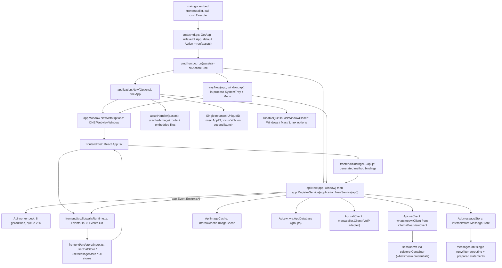

# System map: who owns what

> **In one line:** A single Go process embeds the React build, opens exactly one Wails window, registers exactly one `Api` service that owns the WhatsApp client and the databases, and hosts the system tray inside the same process.

## Why this page exists

The repository looks like two projects glued together: a Go command-line-shaped program (`main.go`, `cmd/`, `api/`, `internal/`) and a TypeScript frontend (`frontend/`). A newcomer usually asks two questions that this page answers: *what actually runs when I launch the app?* and *which object owns the long-lived things (the socket, the databases, the tray icon)?*

This map is built only from checked-in source. It deliberately names no service that is not registered in `cmd/run.go`, and no process that does not exist. Reports in `provenance-docs/` describe intent; the code below describes what happens.

## The idea, in plain words

Think of the app as **one shop with a single front window**:

- The **Go process** is the whole building. It is opened by `main()`, which hands the embedded website and build info to the command layer (`cmd`).
- The **window** is the shopfront: one webview that displays the React UI. There is only one, and the tray's "Open" action and a second app launch both point at that same window.
- The **`Api` service** is the shop manager. Wails calls its `ServiceStartup` when the process starts and `ServiceShutdown` when it ends. Everything long-lived (the WhatsApp connection, the message database, the image cache, the call client, a worker pool) is a field on this one manager.
- The **whatsmeow client** is the phone line to WhatsApp; it is created from a session container and kept inside the manager.
- The **two SQLite stores** are the filing cabinets: `session.wa` (WhatsApp credentials, owned by whatsmeow's `sqlstore` container) and `messages.db` (the app's chat history, owned by `MessageStore`, which funnels all writes through one writer goroutine).
- The **tray** is a bell on the outside of the building. It is created in-process (no second executable, no socket bridge) and its menu actions call the same window and the same `Api`.
- The **React frontend** is the display in the shopfront. It calls generated bindings to reach the manager and listens for events to learn what changed.

If you remember one sentence: **nothing here is a separate process — it is one process with one window and one service object.**



## The code, line by line

### 1. Entry point and command shell

```go
// main.go:12-13
//go:embed all:frontend/dist
var assets embed.FS
```

```go
// main.go:23-34
func main() {
	os.Exit(runMain(os.Args, run))
}

func run(args []string) error {
	return cmd.Execute(args, assets, cmd.BuildArgs{
		Version:   version,
		Commit:    commit,
		Date:      date,
		BuildType: buildType,
	})
}
```

```go
// cmd/cmd.go:47-61 (excerpt)
return &cli.App{
	Name:                   AppName,
	HelpName:               AppName,
	Usage:                  "An unofficial WhatsApp client.",
	Version:                fmt.Sprintf("%s-%s", bArgs.Version, bArgs.BuildType),
	...
	Commands:               commands,
	Action:                 run(assets),
	UseShortOptionHandling: true,
	HideHelp:               true,
	HideVersion:            true,
}
```

| Line | What it does |
|---|---|
| `main.go:12` | Embeds the built frontend directory into the binary with `go:embed`. |
| `main.go:13` | Exposes those bytes as `embed.FS`, passed down into the command layer. |
| `main.go:23-24` | `main()` converts the returned error into an OS exit code through `runMain`. |
| `main.go:27-33` | `run()` injects build-time values (`version`, `commit`, `date`, `buildType`) and calls `cmd.Execute`. |
| `cmd/cmd.go:57` | With no subcommand, the CLI's default action is `run(assets)` — this is the path a normal launch takes. |
| `cmd/cmd.go:64-80` | `Execute()` builds the app, formats the version string, and calls `app.Run(args)`. |

### 2. Boot sequence in `cmd/run.go` — the exact order

```go
// cmd/run.go:20-30
func assetHandler(assets fs.FS) http.Handler {
	files := application.AssetFileServerFS(assets)
	cachedImages := server.NewAssetFileServer()
	return http.HandlerFunc(func(w http.ResponseWriter, r *http.Request) {
		if strings.HasPrefix(r.URL.Path, "/cached-image/") {
			cachedImages.ServeHTTP(w, r)
			return
		}
		files.ServeHTTP(w, r)
	})
}
```

```go
// cmd/run.go:40-99 (faithful excerpt; comments condensed only where marked ...)
var window *application.WebviewWindow
var systray *tray.Tray

app := application.New(application.Options{
	Name:        misc.AppName,
	Description: "An unofficial WhatsApp client.",
	OnShutdown: func() {
		systray.Destroy()
	},
	Assets: application.AssetOptions{
		Handler: assetHandler(assets),
	},
	SingleInstance: &application.SingleInstanceOptions{
		UniqueID: misc.AppID,
		OnSecondInstanceLaunch: func(_ application.SecondInstanceData) {
			if window == nil {
				return
			}
			window.UnMinimise()
			window.Show()
			window.Focus()
		},
	},
	Windows: application.WindowsOptions{
		DisableQuitOnLastWindowClosed: true,
	},
	Mac: application.MacOptions{
		ApplicationShouldTerminateAfterLastWindowClosed: false,
	},
	Linux: application.LinuxOptions{
		ProgramName:                   misc.AppName,
		DisableQuitOnLastWindowClosed: true,
	},
})

window = app.Window.NewWithOptions(application.WebviewWindowOptions{
	Title:  misc.AppName,
	Width:  1024,
	Height: 768,
	// A:1 is preserved byte-for-byte from the v2 RGBA option.
	BackgroundColour: application.NewRGBA(27, 38, 54, 1),
	Linux: application.LinuxWindow{
		WindowIsTranslucent: false,
		// Software rendering avoids WebKitGTK GPU-process crashes ...
		WebviewGpuPolicy: application.WebviewGpuPolicyNever,
	},
})

api := apiPkg.New(app, window)
app.RegisterService(application.NewService(api))

// The tray lives in-process now; build it once the window and service
// exist so every menu action has a target.
systray = tray.New(app, window, api)

return app.Run()
```

| Line | What it does |
|---|---|
| `cmd/run.go:20-30` | Composes the HTTP handler: `/cached-image/*` goes to the guarded asset server, everything else to the embedded frontend. |
| `cmd/run.go:40-41` | Declares window and tray variables *before* the app, because callbacks capture them. |
| `cmd/run.go:43` | Creates the one Wails `App`; `OnShutdown` will destroy the tray. |
| `cmd/run.go:52-62` | Single-instance: a second launch with the same `misc.AppID` un-minimises, shows and focuses the existing window. |
| `cmd/run.go:66-75` | Closing the last window does not quit the app on Windows, macOS or Linux — it stays alive in the tray. |
| `cmd/run.go:78-90` | Creates the **single** `WebviewWindow` (1024×768, RGBA `27,38,54,1`, software Webview GPU policy on Linux). |
| `cmd/run.go:92` | `api.New(app, window)` constructs the service and starts its worker pool. |
| `cmd/run.go:93` | `app.RegisterService` is the **only** service registration in the app. |
| `cmd/run.go:97` | `tray.New` builds the in-process tray last, once window and service exist. |
| `cmd/run.go:99` | `app.Run()` starts the event loop; Wails then invokes `ServiceStartup` on the registered service. |

### 3. The `Api` service — what it owns

```go
// api/api.go:37-66 (excerpt)
type Api struct {
	ctx                 context.Context
	app                 *application.App
	window              *application.WebviewWindow
	cw                  *wa.AppDatabase
	waClient            *whatsmeow.Client
	messageStore        *store.MessageStore
	imageCache          *cache.ImageCache
	waContainer         *sqlstore.Container
	callClient          *meowcaller.Client
	sessionDB           *sql.DB
	eventHandlerID      uint32
	eventHandlerSet     bool
	startupErr          error
	...
	taskCh         chan func()
	workerWg       sync.WaitGroup
	healthCheckCtx context.CancelFunc
	healthCheckWg  sync.WaitGroup
}
```

```go
// api/api.go:275-298 (excerpt)
func New(app *application.App, window *application.WebviewWindow) *Api {
	a := &Api{app: app, window: window}
	a.startWorkerPool()
	return a
}

const workerPoolSize = 8
const workerQueueSize = 256

func (a *Api) startWorkerPool() {
	a.taskCh = make(chan func(), workerQueueSize)
	a.workerWg.Add(workerPoolSize)
	for range workerPoolSize {
		go func() {
			defer a.workerWg.Done()
			for task := range a.taskCh {
				if task == nil {
					return
				}
				task()
			}
		}()
	}
}
```

| Line | What it does |
|---|---|
| `api/api.go:38-40` | Keeps the request context, the App and the window — there is no implicit runtime context in v3. |
| `api/api.go:41-48` | Owns the app database, WhatsApp client, message store, image cache, session container, call client and session DB. |
| `api/api.go:48-49` | Tracks the whatsmeow event-handler ID so it can be removed on shutdown. |
| `api/api.go:62-65` | Owns the background task queue and health-check cancellation. |
| `api/api.go:275-278` | `New` only injects `app` and `window` and starts the worker pool. |
| `api/api.go:281-282` | Pool size 8, queue depth 256 — all background work shares this one queue. |

### 4. Registration order inside `api/api.go`

`ServiceStartup` builds dependencies in this order; a failure in any step calls `failStartup`, which records `startupErr` and closes what was opened.

```go
// api/api.go:502-560 (faithful excerpt; long log lines condensed as ...)
func (a *Api) ServiceStartup(ctx context.Context, _ application.ServiceOptions) error {
	slog.SetDefault(slog.New(slog.NewTextHandler(os.Stderr, nil)))

	store.LoadSettings()
	a.windowFocused.Store(true)
	a.ctx = ctx
	var err error

	dbLog := waLog.Stdout("Database", settings.GetLogLevel(), true)
	a.cw, err = wa.NewAppDatabase(ctx)
	if err != nil {
		a.failStartup(fmt.Errorf("open application database: %w", err))
		return nil
	}
	db, err := sql.Open("sqlite3", misc.GetSQLiteAddress("session.wa"))
	...
	a.sessionDB = db
	container := sqlstore.NewWithDB(db, "sqlite3", dbLog)
	a.waContainer = container
	err = container.Upgrade(ctx)
	...
	misc.RestrictFile(filepath.Join(misc.ConfigDir, "session.wa"))
	a.waClient, err = wa.NewClient(ctx, container)
	...
	a.messageStore, err = store.NewMessageStore()
	...
	a.imageCache, err = cache.NewImageCache()
	...
	a.initMeowcaller()
	return nil
}
```

```go
// api/api.go:580-583 (event handler registration, in Login)
if !a.eventHandlerSet {
	a.eventHandlerID = a.waClient.AddEventHandler(a.mainEventHandler)
	a.eventHandlerSet = true
}
```

| Order | Where | What is registered / opened |
|---|---|---|
| 1 | `api/api.go:503` | Structured logging to stderr. |
| 2 | `api/api.go:507` | `store.LoadSettings()` — file handle stays open until `ServiceShutdown`. |
| 3 | `api/api.go:511-514` | Focus flag set true; `a.ctx` stored **before** anything can emit an event. |
| 4 | `api/api.go:518` | `wa.NewAppDatabase` → `Api.cw` (group data). |
| 5 | `api/api.go:523-535` | `session.wa` opened, wrapped in `sqlstore.Container`, `Upgrade(ctx)` applied. |
| 6 | `api/api.go:538` | `misc.RestrictFile` tightens credential-file permissions. |
| 7 | `api/api.go:539` | `wa.NewClient` → `Api.waClient`. |
| 8 | `api/api.go:544` | `store.NewMessageStore()` → `Api.messageStore` (`messages.db`). |
| 9 | `api/api.go:549` | `cache.NewImageCache()` → `Api.imageCache`. |
| 10 | `api/api.go:556` | `initMeowcaller()` → `Api.callClient` (see `api/calls.go:60`). |
| 11 | `api/api.go:581` (in `Login`) | `AddEventHandler(a.mainEventHandler)` — registered on first login, guarded by `eventHandlerSet`. |

Shutdown reverses the ownership: `ServiceShutdown` (`api/api.go:416-461`) stops the health check, marks `shuttingDown`, removes the event handler, cancels login, disconnects the client, drains the worker queue, then calls `closeResources()` (`cleanupMeowcaller`, `messageStore.Close`, `imageCache.Close`, `cw.Close`, `waContainer.Close`, `sessionDB.Close`) and finally `store.CloseSettings()`.

### 5. The WhatsApp client, the message store and the tray

```go
// internal/wa/client.go:15-21
func NewClient(ctx context.Context, container *sqlstore.Container) (*whatsmeow.Client, error) {
	deviceStore, err := container.GetFirstDevice(ctx)
	if err != nil {
		return nil, fmt.Errorf("get device store: %w", err)
	}
	clientLog := waLog.Stdout("Client", settings.GetLogLevel(), true)
	cli := whatsmeow.NewClient(deviceStore, clientLog)
```

```go
// internal/store/message.go:138-173 (excerpt)
type MessageStore struct {
	db *sql.DB
	chatListMap   misc.VMap[string, ChatMessage]
	reactionCache misc.NMap[string, string, []string]
	pttCache      map[string]pttCacheEntry
	pttCacheMu    sync.RWMutex
	...
	writeMu    sync.RWMutex
	writeCh    chan writeRequest
	writerDone chan struct{}
	closed     bool
}

func NewMessageStore() (*MessageStore, error) {
	db, err := openDB()
	...
	ms := &MessageStore{
		db:            db,
		chatListMap:   misc.NewVMap[string, ChatMessage](),
		reactionCache: misc.NewNMap[string, string, []string](),
		pttCache:      make(map[string]pttCacheEntry),
		writeCh:       make(chan writeRequest, 100),
		writerDone:    make(chan struct{}),
	}
	go ms.runWriter()
```

```go
// internal/tray/tray.go:24-45 (excerpt)
type Tray struct {
	systray *application.SystemTray
	menu    *application.Menu
	notifs  *application.MenuItem
}

func New(app *application.App, window *application.WebviewWindow, api *apiPkg.Api) *Tray {
	systray := app.SystemTray.New()
	systray.SetIcon(trayIcon)
	systray.SetLabel("amazingwhats")
	systray.SetTooltip("Lantern")

	menu := app.NewMenu()
	menu.Add("Open").OnClick(func(_ *application.Context) {
		window.UnMinimise()
		window.Show()
		window.Focus()
	})
```

| Line | What it does |
|---|---|
| `internal/wa/client.go:16` | Reads the first paired device from the session container; this decides whether a QR login is needed. |
| `internal/wa/client.go:21` | Builds the single `whatsmeow.Client` held by `Api.waClient`. |
| `internal/store/message.go:138-155` | `MessageStore` owns the DB handle, three in-memory caches and a write channel. |
| `internal/store/message.go:169` | Write channel capacity is 100; `runWriter` (line 311) is the only goroutine that begins transactions. |
| `internal/store/message.go:173` | The writer goroutine starts when the store is constructed. |
| `internal/tray/tray.go:25-29` | `Tray` owns only native tray objects — no socket, no child process. |
| `internal/tray/tray.go:35` | `app.SystemTray.New()` creates the icon inside the Wails app. |
| `internal/tray/tray.go:41-45` | "Open" targets the same `window` created in `cmd/run.go:78`. |

### 6. Frontend half and the bridge

```ts
// frontend/src/App.tsx:1-3
import { useEffect, useRef, useState } from "react"
import { Login, GetCustomCSS, GetCustomJS, SetWindowFocused } from "../bindings/github.com/lugvitc/whats4linux/api/api.js"
import { EventsOn, BrowserOpenURL } from "./lib/wailsRuntime"
```

```ts
// frontend/src/lib/wailsRuntime.ts:7-14
import { Browser, Events } from "@wailsio/runtime"

type EventCallback = (data: any) => void
type Unsubscribe = () => void

export function EventsOn(name: string, cb: EventCallback): Unsubscribe {
  return Events.On(name, (event) => cb(event.data))
}
```

```ts
// frontend/src/store/index.ts:1-14 (excerpt)
export {
  useChatStore,
  useChatById,
  ...
} from "./useChatStore"
export { useMessageStore } from "./useMessageStore"
export { useUIStore } from "./useUIStore"
export { useMuteStore, useChatMuted } from "./useMuteStore"
export { useAppSettingsStore } from "./useAppSettingsStore"
export { useEaseStore } from "./useEaseStore"
export * from "./types"
```

```json
// wails.json:1-9
{
  "name": "amazingwhats",
  "frontend": {
    "dir": "frontend",
    "install": "npm install",
    "build": "npm run build",
    "dev": "npm run dev",
    "devServerUrl": "http://localhost:9245"
```

```yaml
# Taskfile.yml:5-16 (excerpt)
includes:
  common: ./build/Taskfile.yml
  windows: ./build/windows/Taskfile.yml
  darwin: ./build/darwin/Taskfile.yml
  linux: ./build/linux/Taskfile.yml
...
# build/Taskfile.yml:45-60 (excerpt)
  generate:bindings:
    summary: Generates TypeScript bindings into frontend/bindings
    ...
    cmds:
      - wails3 generate bindings -f '{{.BUILD_FLAGS}}' -clean=true -ts
```

| Line | What it does |
|---|---|
| `frontend/src/App.tsx:2` | Calls into Go use generated bindings under `frontend/bindings/`, not legacy `wailsjs/`. |
| `frontend/src/App.tsx:3` | Event subscription goes through the local compatibility shim. |
| `wailsRuntime.ts:7` | The v3 runtime package is `@wailsio/runtime`. |
| `wailsRuntime.ts:12-13` | `EventsOn` unwraps `event.data` and returns the unsubscribe function from `Events.On`. |
| `store/index.ts:9-12` | A barrel file: the UI imports stores from `./store`, not from individual files. |
| `wails.json:4-8` | Declares the frontend directory and its install/build/dev commands (dev server on 9245). |
| `Taskfile.yml:5-9` | Root task file delegates platform builds to `build/Taskfile.yml` and per-OS files. |
| `build/Taskfile.yml:60` | `wails3 generate bindings ... -ts` regenerates the TypeScript bindings the frontend imports. |

## What can go wrong

> **A second window is not a small change.** `cmd/run.go:40` holds a single `window` pointer, the single-instance callback (`cmd/run.go:54-60`) and the tray menu (`tray.go:41-48`) both capture it, and every `Api` method uses the injected `window`. Adding another window means rethinking all of these.

> **Startup failure is silent by design.** `ServiceStartup` calls `failStartup` and returns `nil` on each error (`api/api.go:519-553`), so the app keeps running with a half-built service. The error is surfaced later when `Login()` reads `a.startupErr` (`api/api.go:570-575`). If you see "startup failed" only in logs, check that path.

> **Order matters during shutdown.** Removing the event handler, cancelling login, disconnecting twice, draining `taskCh` and only then closing stores (`api/api.go:423-453`) exists to stop an in-flight event from writing into a closed database. Reordering these steps invites a panic or a use-after-close.

> **The write channel is finite.** `MessageStore` queues up to 100 writes (`message.go:169`); `Api`'s worker queue is 256 (`api.go:282`) and drops tasks when full (`api.go:310-317`). Under a large history sync, work can be dropped rather than blocking the event loop — that is intentional, but it means "event received" does not guarantee "row stored".

> **Do not assume a tray subprocess.** `internal/tray/tray.go:1-3` states the tray is in-process, and `OnShutdown` calls `systray.Destroy()` (`cmd/run.go:46-48`). An older runbook that talks about `amazingwhats_tray`, a Unix socket bridge or `StartSystray` describes the previous design, not this code.

## Where to next

- [Vocabulary](../00-start-here/vocabulary.md) — the terms used on this page, defined with file pointers.
- [Quickstart](../00-start-here/quickstart.md) — the exact toolchain and commands.
- [Data flow](data-flow.md) — follow a message from WhatsApp to the UI through the components named here.
- [Decisions](decisions.md) — why the ownership boundaries are drawn this way.
- [Docs index](../index.md) — the full reading order.
