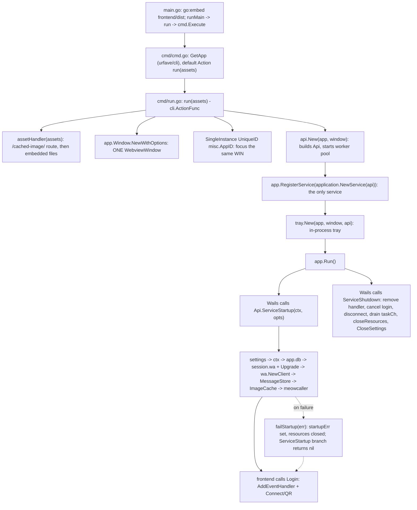

# Backend bootstrap: from `main()` to a running `Api` service

> **In one line:** `main()` embeds `frontend/dist` and calls `cmd.Execute`; with no subcommand the CLI action builds one Wails app with one window, registers exactly one `Api` service, and Wails then calls `ServiceStartup` to open settings, databases, the WhatsApp client, the message store, the image cache and the call adapter before `Login` can attach the event handler.

## Why this page exists

The Go side has three layers that are easy to mix up: the **entry point** (`main.go`), the **command shell** (`cmd/`), and the **long-lived service** (`api.Api`). A newcomer often looks for the code that "starts WhatsApp" and finds a CLI framework instead, or assumes the frontend calls Go through a global runtime that does not exist in this v3 codebase.

This page walks the real boot order from source. It answers: where do the web assets come from, why is there only one window, what does `RegisterService` actually enable, in what order are dependencies built, what happens when a step fails, and who drains the background queue at shutdown.

## The idea, in plain words

Think of startup as **opening one shop**:

- `main()` holds the deed and the spare keys: the built website (`frontend/dist`) is baked into the binary with `go:embed`, and the build version values are passed down when it calls `cmd.Execute`.
- The CLI shell is the **front door**. `cmd.Execute` builds a `urfave/cli` app; a normal launch has no subcommand, so the default action is `run(assets)`.
- `run(assets)` is the **builder**. It creates one Wails `App`, one `WebviewWindow`, one `Api` object, registers that one service, and finally calls `app.Run()`.
- A generated **binding is like a phone number written into the web page's address book**: the page does not need to know where a Go method lives. `app.RegisterService` is what makes those numbers ring a real object — the single `Api` service.
- The **`Api` service is the shop manager**. Wails calls `ServiceStartup` when the event loop begins and `ServiceShutdown` when it ends. Everything long-lived (the WhatsApp client, the databases, the image cache, the call client, an event handler ID and a worker pool) is a field on this one manager.
- `ServiceStartup` is the **opening checklist**. Each step depends on an earlier one: settings before logging, a context before any event can be emitted, the session database before the WhatsApp client, the client before the stores are useful.
- If a step fails, the manager does **not** slam the door. `failStartup` (a void method) records the error and cleans up what was opened; the **`ServiceStartup` failure branch** then returns `nil` so `app.Run` keeps going. The error is surfaced later when the frontend calls `Login`.
- The **worker pool is a bank of eight clerks** sharing one queue. Heavy work (history sync, reconnects, repairs) is handed to the queue so the event loop stays responsive; the connection health check runs its own goroutine and only queues `reconnectLoop` when it gives up.



## The code, line by line

### 1. The entry point and the embedded assets

```go
// main.go:12-13
//go:embed all:frontend/dist
var assets embed.FS
```

```go
// main.go:23-42 (faithful excerpt)
func main() {
	os.Exit(runMain(os.Args, run))
}

func run(args []string) error {
	return cmd.Execute(args, assets, cmd.BuildArgs{
		Version:   version,
		Commit:    commit,
		Date:      date,
		BuildType: buildType,
	})
}

func runMain(args []string, runFunc func([]string) error) int {
	if err := runFunc(args); err != nil {
		fmt.Printf("%s: %s\n", cmd.AppName, err.Error())
		return 1
	}
	return 0
}
```

```go
// cmd/cmd.go:47-61 (excerpt)
return &cli.App{
	Name:                   AppName,
	Usage:                  "An unofficial WhatsApp client.",
	Version:                fmt.Sprintf("%s-%s", bArgs.Version, bArgs.BuildType),
	Commands:               commands,
	Action:                 run(assets),
	UseShortOptionHandling: true,
	HideHelp:               true,
	HideVersion:            true,
}
```

```go
// cmd/cmd.go:64-80 (excerpt)
func Execute(args []string, assets fs.FS, bArgs BuildArgs) error {
	app := GetApp(assets, bArgs)
	common.VersionCmdStr = fmt.Sprintf("%s %s (%s_%s)\n",
		app.Name, app.Version, runtime.GOOS, runtime.GOARCH)
	if bArgs.Commit != "" && bArgs.Date != "" {
		common.VersionCmdStr += fmt.Sprintf("Build: %s=%s\n", bArgs.Date, bArgs.Commit)
	}
	return app.Run(args)
}
```

| Line | What it does |
|---|---|
| `main.go:12` | Bakes the entire built frontend directory into the binary (`all:` includes dotfiles). |
| `main.go:13` | Holds those bytes as an `embed.FS`, passed down instead of read from disk. |
| `main.go:15-21` | `version`, `commit`, `date`, `buildType` are build-time variables (defaults shown). |
| `main.go:24` | `main()` turns the returned error into an OS exit code via `runMain`. |
| `main.go:28-33` | `run()` injects the build info and calls `cmd.Execute`. |
| `main.go:36-42` | `runMain` prints `<AppName>: <error>` and returns `1` on failure, `0` otherwise. |
| `cmd/cmd.go:12` | `AppName = "whats4linux"`. |
| `cmd/cmd.go:57` | With no subcommand, `Action: run(assets)` is the normal launch path. |
| `cmd/cmd.go:64-80` | `Execute` builds the CLI app, formats the version string, and calls `app.Run(args)`. |

### 2. One app, one window, one registered service

```go
// cmd/run.go:20-30
func assetHandler(assets fs.FS) http.Handler {
	files := application.AssetFileServerFS(assets)
	cachedImages := server.NewAssetFileServer()
	return http.HandlerFunc(func(w http.ResponseWriter, r *http.Request) {
		if strings.HasPrefix(r.URL.Path, "/cached-image/") {
			cachedImages.ServeHTTP(w, r)
			return
		}
		files.ServeHTTP(w, r)
	})
}
```

```go
// cmd/run.go:40-99 (faithful excerpt; comments condensed as ...)
var window *application.WebviewWindow
var systray *tray.Tray

app := application.New(application.Options{
	Name:        misc.AppName,
	Description: "An unofficial WhatsApp client.",
	OnShutdown: func() {
		systray.Destroy()
	},
	Assets: application.AssetOptions{
		Handler: assetHandler(assets),
	},
	SingleInstance: &application.SingleInstanceOptions{
		UniqueID: misc.AppID,
		OnSecondInstanceLaunch: func(_ application.SecondInstanceData) {
			if window == nil {
				return
			}
			window.UnMinimise()
			window.Show()
			window.Focus()
		},
	},
	Windows: application.WindowsOptions{
		DisableQuitOnLastWindowClosed: true,
	},
	Mac: application.MacOptions{
		ApplicationShouldTerminateAfterLastWindowClosed: false,
	},
	Linux: application.LinuxOptions{
		ProgramName:                   misc.AppName,
		DisableQuitOnLastWindowClosed: true,
	},
})

window = app.Window.NewWithOptions(application.WebviewWindowOptions{
	Title:  misc.AppName,
	Width:  1024,
	Height: 768,
	BackgroundColour: application.NewRGBA(27, 38, 54, 1),
	Linux: application.LinuxWindow{
		WindowIsTranslucent: false,
		WebviewGpuPolicy:    application.WebviewGpuPolicyNever,
	},
})

api := apiPkg.New(app, window)
app.RegisterService(application.NewService(api))

systray = tray.New(app, window, api)

return app.Run()
```

| Line | What it does |
|---|---|
| `cmd/run.go:20-30` | Composes the asset handler: `/cached-image/*` goes to the guarded image server, everything else to the embedded frontend files. |
| `cmd/run.go:40-41` | Declares `window` and `systray` *before* the app because callbacks capture them. |
| `cmd/run.go:43` | Creates the one Wails `App`; `OnShutdown` destroys the tray. |
| `cmd/run.go:49-51` | Feeds the embedded assets to the app through `assetHandler`. |
| `cmd/run.go:52-62` | Single-instance uses `misc.AppID`; a second launch with the same ID un-minimises, shows and focuses the existing window. The `nil` guard covers an early notification. |
| `cmd/run.go:66-75` | Closing the last window does not quit on Windows, macOS or Linux — the app stays alive in the tray. |
| `cmd/run.go:78-90` | Creates the **single** `WebviewWindow`: 1024×768, RGBA `27,38,54,1`, and `WebviewGpuPolicyNever` on Linux (software rendering). |
| `cmd/run.go:92` | `apiPkg.New(app, window)` constructs the service; its worker pool starts here. |
| `cmd/run.go:93` | `app.RegisterService` is the **only** service registration — this is what exposes `Api` methods to the web page. |
| `cmd/run.go:97` | `tray.New` builds the in-process tray last, so every menu action has a window and service to target. |
| `cmd/run.go:99` | `app.Run()` starts the loop; Wails then invokes `ServiceStartup`. |

### 3. `ServiceStartup`: the exact dependency order

```go
// api/api.go:502-561 (faithful excerpt; long log text condensed as ...)
func (a *Api) ServiceStartup(ctx context.Context, _ application.ServiceOptions) error {
	slog.SetDefault(slog.New(slog.NewTextHandler(os.Stderr, nil)))

	store.LoadSettings()

	a.windowFocused.Store(true)
	a.ctx = ctx
	var err error

	dbLog := waLog.Stdout("Database", settings.GetLogLevel(), true)
	a.cw, err = wa.NewAppDatabase(ctx)
	if err != nil {
		a.failStartup(fmt.Errorf("open application database: %w", err))
		return nil
	}
	db, err := sql.Open("sqlite3", misc.GetSQLiteAddress("session.wa"))
	if err != nil {
		a.failStartup(fmt.Errorf("open WhatsApp session database: %w", err))
		return nil
	}
	a.sessionDB = db
	container := sqlstore.NewWithDB(db, "sqlite3", dbLog)
	a.waContainer = container
	err = container.Upgrade(ctx)
	if err != nil {
		a.failStartup(fmt.Errorf("upgrade WhatsApp session database: %w", err))
		return nil
	}
	misc.RestrictFile(filepath.Join(misc.ConfigDir, "session.wa"))
	a.waClient, err = wa.NewClient(ctx, container)
	if err != nil {
		a.failStartup(fmt.Errorf("create WhatsApp client: %w", err))
		return nil
	}
	a.messageStore, err = store.NewMessageStore()
	if err != nil {
		a.failStartup(fmt.Errorf("open message store: %w", err))
		return nil
	}
	a.imageCache, err = cache.NewImageCache()
	if err != nil {
		a.failStartup(fmt.Errorf("open image cache: %w", err))
		return nil
	}

	a.initMeowcaller()
	return nil
}
```

| Order | Line | What is opened / set |
|---|---|---|
| 1 | `api/api.go:503` | Structured logging (`slog` to stderr). |
| 2 | `api/api.go:507` | `store.LoadSettings()` — the settings file handle stays open for the whole app lifetime. |
| 3 | `api/api.go:511-514` | Focus flag set to `true`; `a.ctx` stored **before** anything can emit an event (the tray listens for `wa:notifications_toggled`). |
| 4 | `api/api.go:518` | `wa.NewAppDatabase(ctx)` → `Api.cw`, the group-metadata database (`app.db`). |
| 5 | `api/api.go:523-535` | `session.wa` opened with `sql.Open`, wrapped in `sqlstore.NewWithDB`, then `container.Upgrade(ctx)`. |
| 6 | `api/api.go:538` | `misc.RestrictFile` tightens the credential file's permissions. |
| 7 | `api/api.go:539` | `wa.NewClient(ctx, container)` → `Api.waClient`, the whatsmeow client. |
| 8 | `api/api.go:544` | `store.NewMessageStore()` → `Api.messageStore` (`messages.db` and its writer goroutine). |
| 9 | `api/api.go:549` | `cache.NewImageCache()` → `Api.imageCache`. |
| 10 | `api/api.go:556` | `initMeowcaller()` → the VoIP adapter. |
| — | `api/api.go:580-583` | Later, in `Login`: `AddEventHandler(a.mainEventHandler)` is registered once, guarded by `eventHandlerSet`. |

### 4. `failStartup` and the error you finally see

```go
// api/api.go:490-498
func (a *Api) failStartup(err error) {
	a.lifecycleMu.Lock()
	a.startupErr = err
	a.lifecycleMu.Unlock()
	log.Println("startup failed:", err)
	if closeErr := a.closeResources(); closeErr != nil {
		log.Println("startup cleanup failed:", closeErr)
	}
}
```

```go
// api/api.go:563-585 (excerpt)
func (a *Api) Login() error {
	a.loginMu.Lock()
	defer a.loginMu.Unlock()

	if a.isShuttingDown() {
		return context.Canceled
	}
	a.lifecycleMu.Lock()
	if a.startupErr != nil {
		err := a.startupErr
		a.lifecycleMu.Unlock()
		return err
	}
	if a.waClient == nil {
		a.lifecycleMu.Unlock()
		return errors.New("WhatsApp client is not ready")
	}
	if !a.eventHandlerSet {
		a.eventHandlerID = a.waClient.AddEventHandler(a.mainEventHandler)
		a.eventHandlerSet = true
	}
```

| Line | What it does |
|---|---|
| `api/api.go:490-498` | `failStartup` stores the error in `a.startupErr`, logs it, and closes whatever was opened so far. |
| `api/api.go:557-560` | Comment states the design: returning an error here would abort `app.Run` and run `ServiceShutdown` against a half-built service, so each failure branch calls `failStartup` (void) and then returns `nil`. |
| `api/api.go:570-575` | `Login` is where a stored startup error is finally returned to the caller. |
| `api/api.go:576-579` | A missing client without a recorded startup error becomes `"WhatsApp client is not ready"`. |
| `api/api.go:580-583` | The event handler is attached on first login, not during startup. |
| `api/auth.go:45-50` | `PairPhone` reads the same `startupErr`; `api/auth.go:86-91` does the same in `Logout`. |
| `main.go:36-42` | The final error a caller sees is printed by `runMain` and becomes exit code `1`. |

### 5. `ServiceShutdown` and `closeResources`

```go
// api/api.go:416-488 (faithful excerpt; comments condensed as ...)
func (a *Api) ServiceShutdown() error {
	a.stopConnectionHealthCheck()

	a.taskMu.Lock()
	a.shuttingDown = true
	a.taskMu.Unlock()

	a.lifecycleMu.Lock()
	client := a.waClient
	loginCancel := a.loginCancel
	if client != nil && a.eventHandlerSet {
		client.RemoveEventHandler(a.eventHandlerID)
		a.eventHandlerSet = false
	}
	a.lifecycleMu.Unlock()

	if loginCancel != nil {
		loginCancel()
	}
	if client != nil {
		client.Disconnect()
	}
	a.loginMu.Lock()
	a.loginMu.Unlock()
	if client != nil {
		client.Disconnect()
	}
	a.eventMu.Lock()
	a.eventMu.Unlock()
	close(a.taskCh)
	a.workerWg.Wait()

	closeErr := a.closeResources()
	if err := store.CloseSettings(); err != nil {
		log.Println("failed to close settings:", err)
		closeErr = errors.Join(closeErr, err)
	}
	if closeErr != nil {
		log.Println("shutdown cleanup failed:", closeErr)
	}
	return closeErr
}

func (a *Api) closeResources() error {
	var closeErr error
	a.cleanupMeowcaller()
	if a.messageStore != nil {
		closeErr = errors.Join(closeErr, a.messageStore.Close())
		a.messageStore = nil
	}
	if a.imageCache != nil {
		closeErr = errors.Join(closeErr, a.imageCache.Close())
		a.imageCache = nil
	}
	if a.cw != nil {
		closeErr = errors.Join(closeErr, a.cw.Close())
		a.cw = nil
	}
	if a.waContainer != nil {
		closeErr = errors.Join(closeErr, a.waContainer.Close())
		a.waContainer = nil
	}
	if a.sessionDB != nil {
		closeErr = errors.Join(closeErr, a.sessionDB.Close())
		a.sessionDB = nil
	}
	return closeErr
}
```

| Line | What it does |
|---|---|
| `api/api.go:417` | Stops the 30-second connection health check first. |
| `api/api.go:419-421` | Marks `shuttingDown` so new background tasks are refused. |
| `api/api.go:423-430` | Removes the whatsmeow event handler and clears `eventHandlerSet` under the lifecycle lock. |
| `api/api.go:432-437` | Cancels a pending QR login and disconnects once. |
| `api/api.go:441-445` | Takes `loginMu` (waiting for a racing login/`Connect`) and disconnects a second time. |
| `api/api.go:448-449` | Takes `eventMu` exclusively so an event that entered before handler removal finishes. |
| `api/api.go:450-451` | Closes the worker queue and waits for all workers to drain. |
| `api/api.go:453` | `closeResources` closes call client, message store, image cache, app DB, session container and session DB, joining errors. |
| `api/api.go:454-457` | `store.CloseSettings()` closes the settings handle opened at line 507. |
| `api/api.go:464-488` | Each `closeResources` step nils its field after closing, so a second call (for example after `failStartup`) does not double-close. |

### 6. The worker pool behind `startBackground`

```go
// api/api.go:275-318 (excerpt)
func New(app *application.App, window *application.WebviewWindow) *Api {
	a := &Api{app: app, window: window}
	a.startWorkerPool()
	return a
}

const workerPoolSize = 8
const workerQueueSize = 256

func (a *Api) startWorkerPool() {
	a.taskCh = make(chan func(), workerQueueSize)
	a.workerWg.Add(workerPoolSize)
	for range workerPoolSize {
		go func() {
			defer a.workerWg.Done()
			for task := range a.taskCh {
				if task == nil {
					return
				}
				task()
			}
		}()
	}
}

func (a *Api) startBackground(task func()) bool {
	if task == nil {
		return false
	}
	a.taskMu.Lock()
	shuttingDown := a.shuttingDown
	a.taskMu.Unlock()
	if shuttingDown {
		return false
	}
	select {
	case a.taskCh <- task:
		return true
	default:
		log.Println("[bg] worker queue full, dropping task")
		return false
	}
}
```

| Line | What it does |
|---|---|
| `api/api.go:275-278` | `New` only injects `app` and `window`, then starts the pool — no database work happens here. |
| `api/api.go:281-282` | Pool size `8`, queue depth `256`. |
| `api/api.go:285-297` | Eight goroutines range over one channel; a `nil` task is the per-worker exit signal. |
| `api/api.go:300-318` | `startBackground` refuses work after shutdown and **drops** the task (never blocks) when the queue is full. |
| `api/api.go:320-324` | `isShuttingDown` reads the flag under `taskMu`. |
| `api/api.go:328-389` | The connection health check is **not** a worker-pool task: it launches its own goroutine tracked by `healthCheckWg` (`:343-388`) with a 30-second ticker (`:346`). Only when it hits three failures does it submit `reconnectLoop` through `startBackground` (`:375`); `stopConnectionHealthCheck` (`:391-401`) cancels the context and waits on `healthCheckWg`. |

## What can go wrong

> **A second window is not a small change.** `cmd/run.go:40` holds a single `window` pointer; the single-instance callback (`cmd/run.go:54-60`), the tray menu and every `Api` method rely on that one object.

> **Startup failure is silent by design.** Every failure branch in `ServiceStartup` calls `failStartup` (void) and then returns `nil` (`api/api.go:519-553`). The app keeps running with a half-built service; the error appears later through `Login` (`api/api.go:570-575`), `PairPhone` (`api/auth.go:45-50`) or `Logout` (`api/auth.go:86-91`), and in the log line from `failStartup`.

> **Ordering in shutdown is load-bearing.** The handler is removed, login cancelled, the client disconnected twice, `eventMu` and the worker queue drained, and only then are stores closed (`api/api.go:423-453`). Reordering lets an in-flight event write into a closed database.

> **`OnShutdown` assumes the tray exists.** `cmd/run.go:46-48` calls `systray.Destroy()`, but `systray` is only assigned at `cmd/run.go:97`. The variable is declared early precisely so the callback can capture it; an early shutdown before assignment would hit a nil pointer.

> **Background work can be dropped.** With a queue of 256 (`api/api.go:282`), `startBackground` logs `"worker queue full, dropping task"` and returns `false` (`api/api.go:313-317`). "Event received" does not guarantee "background work finished" during a large history sync.

> **The asset path has two owners.** `/cached-image/*` is served by `server.NewAssetFileServer`, everything else by the embedded `frontend/dist` (`cmd/run.go:20-30`). A missing route in one handler is not fixed by the other.

## Where to next

- [Vocabulary](../00-start-here/vocabulary.md) — the terms used here, defined with file pointers.
- [Quickstart](../00-start-here/quickstart.md) — the exact toolchain and commands.
- [System map](../01-architecture/system-map.md) — the component graph this page boots.
- [Message pipeline](message-pipeline.md) — what the event handler does once `Login` attaches it.
- [Database](database.md) — the stores opened by `ServiceStartup`.
- [Docs index](../index.md) — the full reading order.
