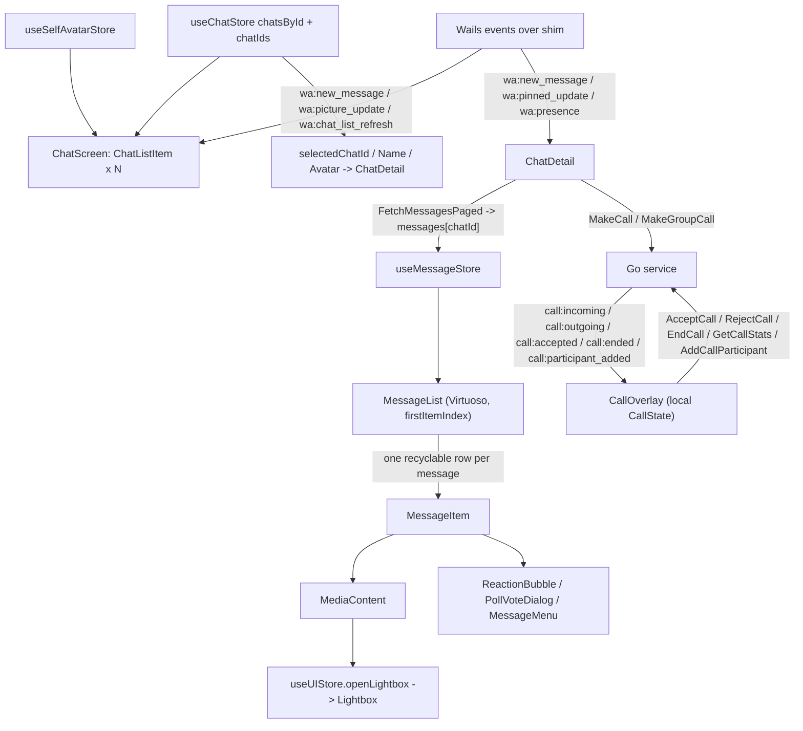

# Chat UI: the chat list, the recyclable message list, media and calls

> **In one line:** `ChatScreen` paints a whiteboard-backed list of chats, `ChatDetail` pages history into a store, `MessageList` shows only recyclable rows around a `firstItemIndex` anchor, and `MessageItem`/`MediaContent`/`CallOverlay` turn each row into bubbles, media and calls.

## Why this page exists

This is where the state and event plumbing from [State and events](state-and-events.md) becomes pixels. The tricky parts are invisible until they break: a date separator that shifts when you prepend history, a thumbnail that changes row height and makes the list jump, a stale call lookup that brings back a closed call overlay, or a reaction pill that gets clipped because someone added `overflow-hidden`.

Every detail below comes from the checked-in components. It explains the index arithmetic, the caches and the guards as they are written, including the places where the code deliberately does *not* do something (there is no mute control in the call overlay).

## The idea, in plain words

Think of the chat window as a **library with a revolving shelf**:

- The chat list on the left is a card index: one small card per conversation, each reading only its own entry from the shared whiteboard.
- The message area is **Virtuoso: a recyclable set of rows**. The library does not print a new card for every message you scroll past; it reuses the same few physical rows and refills them with different messages. That is why row heights must be stable.
- `firstItemIndex` is a large artificial starting number (1,000,000). When older history is prepended, the number goes *down* by exactly the number of messages added, so the scroll position stays visually anchored. It is a bookkeeping trick, not a real message id.
- Date separators are **stapled inside a message row**, not made into rows of their own. The list still has exactly one row per message; a small map says which message gets a "Today" pill above it.
- A Zustand store is the shared whiteboard: the list and the bubbles read from it rather than passing message arrays through every component.
- An event is a loudspeaker: `wa:new_message`, `wa:chat_presence` and the five `call:*` announcements arrive here and change what is on screen. A hook is the plumbing that listens and cleans up.



## The code, line by line

### 1. The chat list: one card, one chat, one subscription

```ts
// frontend/src/screens/ChatScreen.tsx:364-382
const ChatListItem = memo(({ chatId, isSelected, onSelect, onContextMenu }: ChatListItemProps) => {
  // This hook only triggers re-render when THIS specific chat changes
  const chat = useChatById(chatId)
  // Boolean selector - only re-renders when THIS chat's muted flag flips
  const muted = useChatMuted(chatId)

  if (!chat) return null

  return (
    <ChatListItemContent
      chat={chat}
      muted={muted}
      isSelected={isSelected}
      onSelect={onSelect}
      onContextMenu={onContextMenu}
    />
  )
})
```

| Line | What it does |
|---|---|
| `ChatScreen.tsx:367` | `useChatById` subscribes to one `Map` entry, so one message preview does not re-render every row. |
| `ChatScreen.tsx:369` | `useChatMuted` is a boolean selector over the mute store's `Set`. |
| `ChatScreen.tsx:371` | A chat removed from the store renders nothing rather than throwing. |
| `ChatScreen.tsx:266-353` | `ChatListItemContent` is separately memoized; it renders the avatar, name, sanitized preview, pin glyph and unread badge. |

The ids to render come from a filtered selector, not from the raw store array:

```ts
// frontend/src/store/useChatStore.ts:165-179
export const useFilteredChatIds = (showArchived = false) => {
  return useChatStore(
    useShallow((state: ChatStore) => {
      const { chatIds, chatsById, searchTerm } = state
      const term = searchTerm.toLowerCase()

      return chatIds.filter(id => {
        const chat = chatsById.get(id)
        if (!chat) return false
        if (!!chat.archived !== showArchived) return false
        return !term || chat.name.toLowerCase().includes(term)
      })
    }),
  )
}
```

| Line | What it does |
|---|---|
| `useChatStore.ts:168-178` | Archived chats are a separate view; search is a case-insensitive name filter. |
| `useChatStore.ts:167` | `useShallow` keeps the id array referentially stable when contents are unchanged. |
| `ChatScreen.tsx:1330-1338` | The result is mapped to `<ChatListItem key={chatId} ...>` rows. |

Chat elements returned by Go are converted into `ChatItem` objects, including a preview rewrite for call logs:

```ts
// frontend/src/screens/ChatScreen.tsx:706-737 (excerpt)
const transformChatElements = useCallback(
  async (chatElements: api.ChatElement[]): Promise<ChatItem[]> => {
    return Promise.all(
      chatElements.map(async c => {
        const isGroup = c.jid?.endsWith("@g.us") || false
        const avatar = c.avatar_url || ""
        const senderName = c.is_from_me ? "You" : isGroup ? c.sender || "" : ""

        return {
          id: c.jid || "",
          name: c.full_name || c.push_name || c.short || c.phno || "Unknown",
          subtitle: (c.latest_message || "")
            .replace(/^\[call\].*?missed.*/, "📞 Missed call")
            .replace(/^\[call\].*/, "📞 Call")
            .replace(/^\[system\]/, ""),
          type: isGroup ? "group" : "contact",
          // ... timestamp, avatar, sender, isFromMe, pinned, archived, community fields ...
        }
      }),
    )
  },
  [],
)
```

| Line | What it does |
|---|---|
| `ChatScreen.tsx:710` | A `@g.us` JID determines the `group` type. |
| `ChatScreen.tsx:713-714` | Backend already resolved the sender name; own messages become "You". |
| `ChatScreen.tsx:719-722` | Raw `[call]`/`[system]` markers are turned into readable preview text. |
| `ChatScreen.tsx:741-777` | Missing avatars are loaded with a 5-worker pool via `GetCachedAvatar` and written back with `updateSingleChat`. |
| `ChatScreen.tsx:779-792` | The user's own avatar goes to `useSelfAvatarStore` through `GetSelfAvatar(false)`. |

### 2. `ChatDetail` pages history and keeps the scroll anchored

```ts
// frontend/src/screens/ChatDetail.tsx:40-43
const PAGE_SIZE = 50
// Virtuoso needs a stable, large starting index so it can decrement as older
// messages are prepended, keeping the scroll position anchored.
const START_INDEX = 1_000_000
```

| Line | What it does |
|---|---|
| `ChatDetail.tsx:40` | Each history page requests 50 messages. |
| `ChatDetail.tsx:43` | The virtual list starts at index 1,000,000 so there is room to count down when older pages arrive. |

Prepending older messages changes the anchor and the data in the same request generation:

```ts
// frontend/src/screens/ChatDetail.tsx:388-404 (excerpt)
const request = (async () => {
  try {
    const msgs =
      (await FetchMessagesPaged(chatId, PAGE_SIZE, beforeTimestamp, oldestMessage.Info.ID)) || []
    if (requestGenerationRef.current !== generation) return []

    if (msgs.length > 0) {
      // Keep firstItemIndex and the prepended data in the same request
      // generation; a response from an abandoned chat cannot move this list.
      setFirstItemIndex(prev => prev - msgs.length)
      prependMessages(chatId, msgs)
    }
    const more = msgs.length >= PAGE_SIZE
    hasMoreRef.current = more
    setHasMore(more)
    return msgs
  } catch (err) { /* generation-checked error log; return [] */ }
})()
```

| Line | What it does |
|---|---|
| `ChatDetail.tsx:390-392` | Paging uses the oldest message's timestamp (seconds) and id as the cursor. |
| `ChatDetail.tsx:393` | A stale generation drops the response entirely. |
| `ChatDetail.tsx:398-399` | Anchor decreases by the exact number of prepended messages, then the data is prepended. Doing one without the other shifts the view. |
| `ChatDetail.tsx:401-403` | A page smaller than `PAGE_SIZE` means there is no more history. |

Jumps to a pinned or quoted message load contiguous pages until the target is present (`ChatDetail.tsx:424-456`), and reading the last messages is reported back to Go when the user is at the bottom (`ChatDetail.tsx:458-467`). The state that decides which screen element is visible is local to this component (`initialLoad`, `isReady`, `firstItemIndex`, `highlightedMessageId`, ... at `ChatDetail.tsx:99-105`).

### 3. `MessageList`: one row per message, separators stapled inside

```ts
// frontend/src/components/chat/MessageList.tsx:7-13
const TAG = "date"
type DateSeparatorEntry = { __t: typeof TAG; label: string; key: string }
type RowItem = Message | DateSeparatorEntry

function isSep(r: RowItem): r is DateSeparatorEntry {
  return r != null && (r as DateSeparatorEntry).__t === TAG
}
```

| Line | What it does |
|---|---|
| `MessageList.tsx:7-9` | A separator is a tagged object, distinguishable from a `Message` by `__t === "date"`. |
| `MessageList.tsx:11-13` | The type guard keeps the map-building code honest. |

Two `useMemo` passes build the rows and the lookup table:

```ts
// frontend/src/components/chat/MessageList.tsx:100-134 (excerpt)
const rows = useMemo<ReadonlyArray<RowItem>>(() => {
  const out: RowItem[] = []
  let prevDay = ""
  for (let i = 0; i < messages.length; i++) {
    const ts = messages[i]?.Info?.Timestamp
    const dk = ts ? dayKey(ts) : ""
    if (dk && dk !== prevDay) {
      prevDay = dk
      out.push({ __t: TAG, label: formatDateSeparator(dk), key: `d_${dk}` })
    }
    out.push(messages[i])
  }
  return out
}, [messages])

const separatorsByIndex = useMemo<Map<number, DateSeparatorEntry>>(() => {
  const map = new Map<number, DateSeparatorEntry>()
  let msgIndex = 0
  let pending: DateSeparatorEntry | null = null
  for (const row of rows) {
    if (isSep(row)) {
      pending = row
    } else {
      if (pending) map.set(msgIndex, pending)
      pending = null
      msgIndex++
    }
  }
  return map
}, [rows])
```

| Line | What it does |
|---|---|
| `MessageList.tsx:104-117` | Walks `messages` once and inserts a separator before the first message of each new `dayKey`. |
| `MessageList.tsx:110-113` | A missing timestamp produces no separator (`dk` is empty). |
| `MessageList.tsx:120-134` | Re-walks `rows` to record "message index → separator", incrementing `msgIndex` only for real messages. |
| `MessageList.tsx:66-78` | `DateSeparator` is the floating pill; it is rendered *inside* a row so the Virtuoso index stays 1:1 with `messages[]`. |

The virtual list configuration and the local-index conversion are the heart of the page:

```tsx
// frontend/src/components/chat/MessageList.tsx:154-206 (excerpt)
<Virtuoso
  ref={virtuosoRef}
  className="h-full virtuoso-scroller"
  data={messages}
  firstItemIndex={firstItemIndex}
  initialTopMostItemIndex={Math.max(0, messages.length - 1)}
  increaseViewportBy={OVERSCAN}
  startReached={() => {
    if (hasMore && !isLoading) onLoadMore?.()
  }}
  atBottomStateChange={atBottom => onAtBottomChange?.(atBottom)}
  followOutput={atBottom => (atBottom ? "auto" : false)}
  computeItemKey={(_index, msg) => msg?.Info?.ID ?? String(_index)}
  context={{ isLoading }}
  components={listComponents}
  itemContent={(_index, msg) => {
    // Virtuoso's index is global (firstItemIndex starts at START_INDEX =
    // 1,000,000), so keep the local-index conversion into messages[] for
    // every lookup — including the new separator/dayKey lookups. Never
    // walk rows with the raw Virtuoso index.
    const prev = messages[_index - firstItemIndex - 1]
    const firstInGroup =
      !prev || prev.Info.IsFromMe !== msg.Info.IsFromMe || prev.Info.Sender !== msg.Info.Sender
    const sep = separatorsByIndex.get(_index - firstItemIndex)
    return (
      <>
        {sep && <DateSeparator key={sep.key} label={sep.label} />}
        <div data-message-id={msg.Info.ID} className={firstInGroup ? "pt-2 pb-px" : "py-px"}>
          <MemoizedMessageItem message={msg} chatId={chatId} firstInGroup={firstInGroup} ... />
        </div>
      </>
    )
  }}
/>
```

| Line | What it does |
|---|---|
| `MessageList.tsx:158-159` | `data` is `messages`, not `rows`; the extra separator objects are never virtual rows. |
| `MessageList.tsx:159` | `firstItemIndex` is the decreasing anchor described above. |
| `MessageList.tsx:161` | `OVERSCAN = { top: 800, bottom: 800 }` mounts rows early so media/contact work happens off-screen (`MessageList.tsx:42`). |
| `MessageList.tsx:165-167` | Reaching the top loads older messages, but only when there are more and nothing is loading. |
| `MessageList.tsx:172` | New messages only auto-scroll when already at the bottom, using instant `"auto"` to avoid rubber-banding. |
| `MessageList.tsx:173` | Row keys are message ids; the fallback is the index string. |
| `MessageList.tsx:181-184` | `_index - firstItemIndex` is the local index into `messages[]`; the previous message uses one less. |
| `MessageList.tsx:182-183` | `firstInGroup` controls grouping (top rounded corner, sender avatar) by comparing `IsFromMe` and `Sender`. |
| `MessageList.tsx:190-191` | Separator and bubble share one row; no `overflow-hidden` here, or the reaction pill hanging below the bubble would be clipped. |
| `MessageList.tsx:51-64` | `ListHeader`, `ListFooter` and `listComponents` are module-level constants, so Virtuoso does not remount them mid-scroll. |
| `MessageList.tsx:136-152` | The imperative handle exposes `scrollToBottom` (`index: "LAST"`) and `scrollToMessage` (finds the id in `messages[]` and returns `false` if absent). |

### 4. `MessageItem`: bubbles, reactions, polls and edits

```ts
// frontend/src/components/chat/MessageItem.tsx:38-41
const QUICK_REACTIONS = ["👍", "❤️", "😂", "😮", "😢", "🙏"]
const EmojiPicker = lazy(() => import("./EmojiPickerLazy"))

const votedPollKeys = new Set<string>()
```

| Line | What it does |
|---|---|
| `MessageItem.tsx:38` | The six quick-reaction emojis in the hover picker. |
| `MessageItem.tsx:39` | The full emoji picker is lazy-loaded via `Suspense`. |
| `MessageItem.tsx:41` | A module-level `Set` gives instant "Voted ✓" feedback before the RPC returns. |

Reactions have a backend path and an optimistic path:

```ts
// frontend/src/components/chat/MessageItem.tsx:166-180
const myReaction = reactions.find(r => isMe(r.sender_id))?.emoji

const sendReaction = (emoji: string) => {
  const finalEmoji = myReaction === emoji ? "" : emoji
  if (chatId.endsWith("@newsletter")) {
    const serverID = parseInt(message.Info.ID, 10) || 0
    NewsletterSendReaction(chatId, serverID, finalEmoji).catch(() => {})
  } else {
    const senderJID = isFromMe ? "" : message.Info.Sender
    SendReaction(chatId, senderJID, message.Info.ID, finalEmoji).catch(() => {})
  }
  addReactionToMessage(chatId, message.Info.ID, finalEmoji, "me")
  setShowReactionPicker(false)
  setShowFullEmoji(false)
}
```

| Line | What it does |
|---|---|
| `MessageItem.tsx:166` | `isMe()` (`lib/self.ts:25-29`) recognises both the optimistic `"me"` marker and our real JID. |
| `MessageItem.tsx:169` | Tapping the same emoji again sends an empty string, which means "remove". |
| `MessageItem.tsx:170-176` | Newsletters need a numeric server id; other chats use the message id and sender. |
| `MessageItem.tsx:177` | The local whiteboard is updated immediately with the `"me"` sender. |
| `MessageItem.tsx:764-791` | `ReactionBubble` shows the pills; clicking one opens `ReactionDetails` with the list of reactors. |

Polls are detected from the HTML the backend stored, then hydrated from SQLite:

```ts
// frontend/src/components/chat/MessageItem.tsx:246-265 (excerpt)
const isPollCard =
  content?.conversation?.includes('class="msg-poll"') ||
  content?.extendedTextMessage?.text?.includes('class="msg-poll"') ||
  false
const [pollVotes, setPollVotes] = useState<PollVotesResult | null>(null)
useEffect(() => {
  if (!isPollCard || !message?.Info?.ID || !chatId) return
  let live = true
  GetPollVotes(chatId, message.Info.ID)
    .then(res => {
      if (!live || !res) return
      setPollVotes(res)
      if (res.hasVoted) votedPollKeys.add(message.Info.ID)
    })
    .catch(() => {})
  return () => { live = false }
}, [chatId, message?.Info?.ID, isPollCard])
```

| Line | What it does |
|---|---|
| `MessageItem.tsx:246-249` | A poll is recognised by the literal `class="msg-poll"` in stored HTML. |
| `MessageItem.tsx:254-259` | `GetPollVotes` is the authoritative source; `live` prevents a late response from setting state after unmount. |
| `MessageItem.tsx:401-425` | Vote bars and percentages are rendered from `pollVotes` when the stored HTML has no results block. |
| `MessageItem.tsx:426-455` | A "Voted ✓" banner or a "Vote" button opens `PollVoteDialog`; options are parsed from the HTML with a `○` regex (`:447-451`). |

Editing, deleting and other actions are direct bindings:

```ts
// frontend/src/components/chat/MessageItem.tsx:199-228 (excerpt)
// Ctrl+ArrowUp ("Edit last message") dispatches a window event naming the
// target message; the matching MessageItem switches itself into edit mode.
useEffect(() => {
  const onEditRequest = (e: Event) => {
    const targetId = (e as CustomEvent<string>).detail
    if (!isFromMe || targetId !== message.Info?.ID) return
    const text = content?.conversation || content?.extendedTextMessage?.text || ""
    if (!text || text.startsWith("[system]")) return
    handleEdit()
  }
  window.addEventListener("wa:edit-message", onEditRequest)
  return () => window.removeEventListener("wa:edit-message", onEditRequest)
}, [isFromMe, message.Info?.ID, content])

const handleEditSubmit = async () => {
  const cleanText = htmlToPlainText(editText)
  if (!cleanText.trim()) return
  try {
    await EditMessage(chatId, message.Info.ID, cleanText)
    setEditing(false)
  } catch (e) { console.error("EditMessage failed:", e) }
}

const handleDelete = () => {
  const method = isFromMe ? RevokeMessage : DeleteForMe
  method(chatId, message.Info.ID).catch((e: any) => console.error("Delete message failed:", e))
}
```

| Line | What it does |
|---|---|
| `MessageItem.tsx:201-212` | A browser-level `wa:edit-message` event targets one message by id; the listener is removed on cleanup. |
| `MessageItem.tsx:214-223` | Stored HTML is stripped to plain text before `EditMessage`; an empty edit is a no-op. |
| `MessageItem.tsx:225-228` | Own messages are revoked for everyone; others' messages are deleted locally only. |
| `MessageItem.tsx:184-188` | `handlePin` calls `SetMessagePinned`; `MessageMenu.tsx` wires reply/copy/react/edit/delete/forward/star (`MessageItem.tsx:714-728`). |
| `MessageItem.tsx:540-577` | `[system]` messages render as centred indicator lines; `[call]` entries render as call cards with a duration regex. |
| `MessageItem.tsx:85-87`, `:352-356` | Emoji-only text is detected and rendered large. |

### 5. `MediaContent`: reserved boxes, thumbnails, PTT and raw GIFs

```ts
// frontend/src/components/chat/MediaContent.tsx:28-41 (cache setup, excerpt)
const imagePathCache = new LRUCache<string, string>(48, 32 * 1024 * 1024, value => value.length)
const videoThumbCache = new LRUCache<string, string>(100, 16 * 1024 * 1024, value => value.length)
const imageThumbCache = new LRUCache<string, string>(100, 8 * 1024 * 1024, value => value.length)
const mediaRequests = new Map<string, Promise<string>>()
const THUMB_MISS = "__miss__"
const PRELOAD_BATCH_LIMIT = 8

const THUMB_MISS_TTL_MS = 5_000
const MAX_THUMB_MISS = 128
const thumbMissUntil = new Map<string, number>()
```

| Line | What it does |
|---|---|
| `MediaContent.tsx:28-30` | Three bounded LRU caches hold data URLs and thumbnails across row remounts. |
| `MediaContent.tsx:31` | `mediaRequests` deduplicates concurrent loads through `loadMediaOnce` (`:63-71`). |
| `MediaContent.tsx:32`, `:39-41` | A thumbnail miss is negative-cached for 5 seconds (max 128 ids), not stored permanently in the LRU — the image may simply not be downloaded yet. |
| `MediaContent.tsx:118-159` | `preloadImages` coalesces up to 8 ids into one `GetCachedImages` call and lets downloads wait on the in-flight batch. |

The layout box is computed from stored dimensions so loading media cannot resize a row:

```ts
// frontend/src/components/chat/MediaContent.tsx:168-185
// Computes the exact box CSS gives the loaded media from its intrinsic
// dimensions (stored by the backend in message_media), so the placeholder can
// reserve identical space up front. Without this the row height changes when
// the pixels arrive, which makes Virtuoso re-anchor and the list visibly
// jump while scrolling.
export function mediaBox(w?: number, h?: number): { width: number; height: number } | null {
  if (!w || !h || w <= 0 || h <= 0) return null
  const scale = Math.min(MEDIA_MAX_W / w, MEDIA_MAX_H / h, 1)
  let width = w * scale
  let height = h * scale
  if (width < MEDIA_MIN_W) {
    height = Math.min(MEDIA_MAX_H, (height * MEDIA_MIN_W) / width)
    width = MEDIA_MIN_W
  }
  return { width: Math.round(width), height: Math.round(height) }
}
```

| Line | What it does |
|---|---|
| `MediaContent.tsx:173` | Returns `null` for missing dimensions so a fallback box can be used. |
| `MediaContent.tsx:175-177` | Scales to at most 330px wide and 400px tall, never enlarging beyond 1×. |
| `MediaContent.tsx:178-183` | Mirrors CSS `min-width: 300px` resolution so placeholder and loaded media occupy the same box. |
| `MediaContent.tsx:165-166` | Fallbacks are 256×256 for GIF videos and 300×256 for images. |

Visibility drives loading, and the two media special cases are explicit:

```ts
// frontend/src/components/chat/MediaContent.tsx:229-237 (excerpt)
const messageBody = message.Content?.[`${type}Message`] as MediaMessageContent | undefined
// GIFs sent as raw .gif files carry mimetype image/gif — the decrypted
// bytes are a GIF image (playable in ), not a video file.
const isRawGif = type === "video" && isGif && messageBody?.mimetype === "image/gif"
const reservedBox =
  type === "image" || (type === "video" && isGif)
    ? (mediaBox(messageBody?.width, messageBody?.height) ??
      (type === "image" ? IMAGE_FALLBACK_BOX : GIF_FALLBACK_BOX))
    : null
```

```ts
// frontend/src/components/chat/MediaContent.tsx:507-527 (PTT branch)
if (type === "audio") {
  if (messageBody?.ptt) {
    // Voice notes must actually play (D-AUD-003b): the old static mic button
    // and fake progress bar were dead controls. Keep the mic as a decorative
    // icon and hand playback to the browser's native audio controls.
    return (
      <div className="flex items-center gap-2 w-75 h-14 rounded-lg bg-gray-200 dark:bg-gray-800 px-3">
        {/* decorative mic SVG */}
        <audio src={mediaSrc} controls preload="metadata" className="flex-1 min-w-0 h-10" />
      </div>
    )
  }
  return <audio src={mediaSrc} controls className="w-75 h-14" />
}
```

| Line | What it does |
|---|---|
| `MediaContent.tsx:341-395` | An `IntersectionObserver` (root margin 150px, 200ms debounce) auto-downloads visible images/GIFs and fetches image thumbnails; off-screen rows are cancelled. |
| `MediaContent.tsx:399-412` | Regular videos fetch `GetVideoThumbnail` for the preview without downloading the file. |
| `MediaContent.tsx:232` | A raw `.gif` is shown with ``; a GIF-playback video uses `<video>` (`:479-503`) and loops `MAX_GIF_LOOPS = 3` times (`:16`, `:486-493`). |
| `MediaContent.tsx:508-527` | Push-to-talk voice notes use the browser's native `<audio controls>`; the mic is decorative, not a button. |
| `MediaContent.tsx:322-335` | Optimistic `_tempImage`/`_tempFile` and `sentMediaCache` seed the source before the upload completes. |
| `MediaContent.tsx:414-421` | Blob URLs are revoked on unmount or source change. |
| `MediaContent.tsx:288-310` | Regular videos open the full data URL in the UI-store lightbox and cache it in a ref. |

### 6. `CallOverlay`: five events and strict callID guards

```ts
// frontend/src/components/chat/CallOverlay.tsx:17-27
interface CallState {
  callID: string
  peerJID: string
  isVideo: boolean
  isGroup: boolean
  groupJID: string
  status: "calling" | "ringing" | "active"
  contactName: string
  avatarUrl: string
  participants: number
}
```

| Line | What it does |
|---|---|
| `CallOverlay.tsx:17-27` | Call state is **local component state**, not a Zustand store (`CallOverlay.tsx:36`). |
| `CallOverlay.tsx:23` | Three statuses: `calling` (outbound), `ringing` (inbound), `active`. |

```ts
// frontend/src/components/chat/CallOverlay.tsx:144-175 (excerpt)
const onCallEvent = (data: any, status: CallState["status"]) => {
  const callID: string = data.callID
  if (!callID) return
  const isGroup = !!data.isGroup
  const groupJID = data.groupJID || ""
  // Keep exactly one visible, controllable call. Blindly overwriting the
  // ref on a second call orphaned the first one: its later call:ended was
  // ignored and its buttons acted on the wrong call. Ignore concurrent
  // call events while one is active instead. (D-AUD-004e)
  if (activeCallIDRef.current && activeCallIDRef.current !== callID) {
    console.log("[VoIP] Ignoring concurrent call while one is active:", callID)
    return
  }
  activeCallIDRef.current = callID
  resolveContact({ peerJID: data.peerJID, isGroup, groupJID }, (name, avatar, participants) => {
    // The profile/avatar/name awaits above can outlive the call. Never
    // resurrect a call that ended or was replaced while they were pending.
    if (activeCallIDRef.current !== callID) return
    setActiveCall({ callID, peerJID: data.peerJID, isVideo: data.isVideo, isGroup, groupJID, status, contactName: name, avatarUrl: avatar, participants })
  })
}
```

| Line | What it does |
|---|---|
| `CallOverlay.tsx:146-147` | No `callID`, no overlay. This guard opens every event path. |
| `CallOverlay.tsx:154-157` | A second call while one is active is ignored by design. |
| `CallOverlay.tsx:158` | The ref is the synchronous mirror of which call is visible. |
| `CallOverlay.tsx:159-162` | Async name/avatar lookups re-check the ref before calling `setActiveCall`, so a slow lookup cannot resurrect a finished call. |

The five subscriptions and their guards:

```ts
// frontend/src/components/chat/CallOverlay.tsx:231-243
const offIncoming = EventsOn("call:incoming", onIncoming)
const offOutgoing = EventsOn("call:outgoing", onOutgoing)
const offAccepted = EventsOn("call:accepted", onAccepted)
const offEnded = EventsOn("call:ended", onEnded)
const offParticipantAdded = EventsOn("call:participant_added", onParticipantAdded)

return () => {
  offIncoming()
  offOutgoing()
  offAccepted()
  offEnded()
  offParticipantAdded()
}
```

| Line | What it does |
|---|---|
| `CallOverlay.tsx:231-235` | Exactly five `call:*` events: incoming → `ringing`, outgoing → `calling`, accepted → `active`, ended → clear, participant_added → roster update. |
| `CallOverlay.tsx:187-194` | `onAccepted` changes status only when `prev.callID === data.callID`. |
| `CallOverlay.tsx:196-200` | `onEnded` calls `clearCall(data.callID)`, which refuses to clear a different call (`CallOverlay.tsx:60-74`). |
| `CallOverlay.tsx:202-229` | `participant_added` ignores other call ids, counts each `targetJID` once per call, then takes the authoritative roster size from `GetCallStats`. |
| `CallOverlay.tsx:237-243` | All five unsubscribes run on unmount. |

The visible controls are limited by status:

```ts
// frontend/src/components/chat/CallOverlay.tsx:421-480 (structure excerpt)
<div className="flex items-center justify-center gap-6 w-full pt-1">
  {activeCall.status === "active" && (
    <button title="Add participant to call" ... />        // AddCallParticipant
  )}

  {activeCall.status === "ringing" ? (
    <>
      <button onClick={handleReject} title="Decline Call" ... />
      <button onClick={handleAccept} title="Accept Call" ... />
    </>
  ) : (
    <button onClick={handleEnd} title="End Call" ... />
  )}
</div>

{activeCall.status === "active" && (
  <button onClick={() => setShowStats(!showStats)}>
    {showStats ? "Hide Details" : "Show Details"}
  </button>
)}
```

| Line | What it does |
|---|---|
| `CallOverlay.tsx:438-458` | Incoming calls show decline and accept. |
| `CallOverlay.tsx:459-469` | Calling or active calls show end. |
| `CallOverlay.tsx:423-436` | Only an active call can add a participant. |
| `CallOverlay.tsx:472-480` | Only an active call can toggle the stats panel. |
| `CallOverlay.tsx:283-336` | `AcceptCall`, `RejectCall`, `EndCall` and `AddCallParticipant` are bindings; each result is guarded against the call ending during the await. |
| — | **There is no mute button and no `call:mute` event in this component.** Chat muting (`mute-chat` shortcut in `ChatScreen.tsx:942-948`) is a different feature: it changes `useMuteStore`, not the live call. |
| `CallOverlay.tsx:246-279` | A 1-second duration timer runs only while status is `active`; stats are polled every 2 seconds only when the panel is open. |
| `CallOverlay.tsx:321-325` | The add-participant picker lists non-group chats from `chatsById`, excluding the current peer, sorted by recency. |

Outbound calls start in `ChatDetail`: `MakeCall` for contacts and `MakeGroupCall` for `@g.us` chats, with a static error toast on failure (`ChatDetail.tsx:818-835`).

## What can go wrong

> **The two index spaces are easy to mix up.** `itemContent` receives a global Virtuoso index and must subtract `firstItemIndex` before touching `messages[]` (`MessageList.tsx:181-184`). The imperative `scrollToMessage` instead passes `messages.findIndex(...)` to `scrollToIndex` (`MessageList.tsx:142-149`). If you change either side, check it against `firstItemIndex`; the file's own comment warns against walking rows with the raw index.

> **`firstItemIndex` and prepended data must move together.** `setFirstItemIndex(prev => prev - msgs.length)` and `prependMessages(chatId, msgs)` are in the same generation-guarded block (`ChatDetail.tsx:398-399`). Changing only one shifts the scroll anchor, which looks like "the list jumped".

> **A separator is not a virtual row.** `data={messages}` (`MessageList.tsx:158`) and `rows` is used only to build `separatorsByIndex`. If you render `rows` through Virtuoso, `firstInGroup`, `scrollToMessage` and every local-index lookup break. Messages with no `Info.Timestamp` get no separator (`MessageList.tsx:109-113`).

> **Media that changes height makes the list re-anchor.** `mediaBox` and the fixed fallbacks (`MediaContent.tsx:165-185`) exist because Virtuoso recalculates offsets when a row resizes. Removing the reserved box makes scrolling visibly jump as images arrive.

> **Keep the row free of `overflow-hidden`.** The comment at `MessageList.tsx:185-187` explains that hiding one axis forces the other to `auto`, which clips the reaction pill hanging below the bubble. Horizontal containment belongs at the panel level.

> **Inline component props would remount rows mid-scroll.** `listComponents`, `ListHeader` and `ListFooter` are module-level references (`MessageList.tsx:51-64`) because `atBottomStateChange` re-renders the parent frequently. Moving them inline causes visible hitches.

> **The GIF branches are not interchangeable.** A raw `.gif` has `mimetype === "image/gif"` and is rendered with `` (`MediaContent.tsx:232`, `:464-477`); a GIF-playback video uses `<video>` with a 3-loop cap (`MediaContent.tsx:479-503`). Treating both as video shows a black frame for raw GIFs.

> **PTT is native audio, not a custom player.** The mic SVG is decorative; playback is `<audio controls preload="metadata">` (`MediaContent.tsx:508-527`). Do not wire the SVG up as a play button — the old fake progress bar was removed because it was a dead control.

> **Thumbnail misses are retried on a short TTL.** A miss is stored for 5 seconds, capped at 128 ids (`MediaContent.tsx:39-57`), and cleared when the full image is cached (`:149`). Parking a miss permanently in the LRU would freeze a grey box even after the image downloads.

> **A late call lookup is guarded, but console logs are not redacted.** `resolveContact` re-checks `activeCallIDRef` before setting state (`CallOverlay.tsx:159-162`), yet `onIncoming`/`onOutgoing` log the full event object (`CallOverlay.tsx:177-185`) and the stats panel puts the peer JID in a `title` attribute (`:494-497`). Treat the console and tooltips as containing identifiers.

> **Concurrent calls are intentionally ignored.** A second `call:*` event with a different id is dropped while one call is active (`CallOverlay.tsx:154-157`). That is a deliberate fix for orphaned calls, not a missing feature; supporting two calls would require reworking the single `activeCallIDRef`.

> **A failed send leaves a pending bubble.** `addPendingMessage` runs before `SendMessage` (`ChatDetail.tsx:607`), and the catch block only logs (`ChatDetail.tsx:692-695`). `MessageItem` keeps showing the pending clock (`MessageItem.tsx:342`) until a matching `clientTempId` event arrives.

> **Poll "Voted ✓" has two sources.** The module-level `votedPollKeys` set is instant but in-memory; `GetPollVotes` restores the authoritative `hasVoted` across restarts (`MessageItem.tsx:41`, `:254-259`). Options are parsed from stored HTML with a regex (`:447-451`), so a backend markup change breaks the vote dialog.

> **Call presence is narrower in `ChatDetail`.** The global hook treats `composing` and `recording` as typing (`useWailsEvents.ts:38`); the detail-level listener only accepts `composing` (`ChatDetail.tsx:769-776`). Do not assume a recording indicator appears in the chat header.

## Where to next

- [Vocabulary](../00-start-here/vocabulary.md) — "component", "hook", "state" and the two meanings of "store".
- [Quickstart](../00-start-here/quickstart.md) — run the app and see these screens yourself.
- [State and events](state-and-events.md) — the stores and event mapping these components consume.
- [Frontend app](frontend-app.md) — the bootstrap that mounts `ChatListScreen` and `CallOverlay`.
- [Message pipeline](message-pipeline.md) — where `wa:new_message` and the call-prefixed strings come from on the Go side.
- [Database](database.md) — the `message_media` dimensions and poll votes read by these components.
- [Data flow](../01-architecture/data-flow.md) — the end-to-end sequence into the React stores.
- [Docs index](../index.md) — the full reading order.
