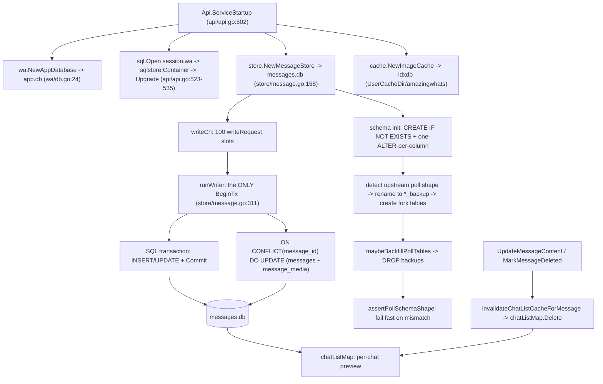

# Database: three SQLite files, one writer, and a guarded schema

> **In one line:** `ServiceStartup` opens `app.db` (groups), `session.wa` (WhatsApp credentials) and `messages.db` (the message store) while the image cache keeps its own `idxdb` under the user cache directory; all message writes funnel through one `runWriter` goroutine into `messages.db`, whose schema is created and migrated at startup, checked for the fork's poll shape, and fronted by a per-chat `chatListMap` cache that edits and deletes explicitly invalidate.

## Why this page exists

"Where is the data?" is a deceptively hard question in this app. Different lifetimes live in different files: credentials belong to WhatsApp's library, group metadata belongs to the app, chat history belongs to the message store, and thumbnails belong to a cache. On top of that, `messages.db` is not written directly by callers — it has a single writing desk and a preview cache that must be kept honest.

This page names each file with its owner from source, explains the writer invariant that prevents write contention, walks the startup schema work, and shows why `ON CONFLICT` upserts, the poll-schema assertion and cache invalidation all exist. Permissions (0600/0700) are included because these files hold long-lived credentials.

> **Naming note.** The [System map](../01-architecture/system-map.md) calls `session.wa` and `messages.db` "the two SQLite stores". The code also opens `app.db` during startup (group metadata) and the image cache opens a file named `idxdb`. This page describes all four accurately; the message store is `messages.db`, not `app.db`.

## The idea, in plain words

Think of the writer as a **single-lane post office**:

- There is exactly **one clerk who can stamp the ledger** (`runWriter`). Everyone else drops a sealed job (`writeRequest`) into an inbox (`writeCh`, 100 slots). The clerk opens a transaction, runs the job, commits it, and rings a small bell (`done` channel) for callers that are waiting.
- `runSync` is the "wait for the bell" service. Reads that must see pending writes, such as `GetDecodedMessage`, also queue through the clerk so they cannot overtake a write.
- The **ledger is `messages.db`**: tables for messages, media, reactions, pins, mutes, archives, polls, link previews and receipts. The clerk never lets two writers stamp at once.
- `app.db` is a **separate address book** for groups and communities; `session.wa` is the **locked safe** holding the WhatsApp pairing; `idxdb` (under `os.UserCacheDir()/amazingwhats`) is the **scratchpad** of cached image keys.
- Startup is a **renovation before opening**. Tables are created `IF NOT EXISTS`, missing columns are added one `ALTER` at a time (ignoring "duplicate column"), and an old upstream poll-table layout is moved aside, replaced with the fork's layout, backfilled and then verified. If the verification fails, opening the store fails fast rather than corrupting votes later.
- Upserts are **"write it again, but keep the good parts"**: an `ON CONFLICT DO UPDATE` refreshes a row without deleting child rows, and `COALESCE` preserves a cached thumbnail when a re-sync arrives without one.
- The **chat-list cache is a notepad on the counter** (`chatListMap`, keyed by the JID user part). New messages overwrite the line; edits and deletes must explicitly erase the line so the next `GetChatList` recomputes it from the ledger.



## The code, line by line

### 1. Which file belongs to whom

```go
// internal/wa/db.go:18-33
type AppDatabase struct {
	db  *sql.DB
	mu  sync.Mutex
	ctx context.Context
}

func NewAppDatabase(ctx context.Context) (*AppDatabase, error) {
	db, err := sql.Open("sqlite3", misc.GetSQLiteAddress("app.db"))
	if err != nil {
		return nil, err
	}
	return &AppDatabase{
		db:  db,
		ctx: ctx,
	}, nil
}
```

```go
// api/api.go:523-544 (excerpt)
db, err := sql.Open("sqlite3", misc.GetSQLiteAddress("session.wa"))
if err != nil {
	a.failStartup(fmt.Errorf("open WhatsApp session database: %w", err))
	return nil
}
a.sessionDB = db
container := sqlstore.NewWithDB(db, "sqlite3", dbLog)
a.waContainer = container
err = container.Upgrade(ctx)
// ...
a.waClient, err = wa.NewClient(ctx, container)
// ...
a.messageStore, err = store.NewMessageStore()
```

```go
// internal/store/message.go:389-415 (excerpt)
func openDB() (*sql.DB, error) {
	db, err := sql.Open("sqlite3", misc.GetSQLiteAddress("messages.db"))
	if err != nil {
		return nil, err
	}
	pragmas := []string{
		`PRAGMA journal_mode=WAL;`,
		`PRAGMA synchronous=NORMAL;`,
		`PRAGMA busy_timeout=5000;`,
		`PRAGMA foreign_keys=ON;`,
	}
	for _, p := range pragmas {
		if _, err := db.Exec(p); err != nil {
			_ = db.Close()
			return nil, err
		}
	}
	return db, nil
}
```

```go
// internal/misc/misc.go:20-31
func GetSQLiteAddress(dbName string) string {
	path := filepath.Join(ConfigDir, dbName)
	return fmt.Sprintf("file:%s?_foreign_keys=on&_busy_timeout=5000&_synchronous=NORMAL", path)
}
```

| File | Owner / source | What it holds |
|---|---|---|
| `app.db` | `wa.AppDatabase`, opened at `internal/wa/db.go:25` | `amazingwhats_groups`: group/community names, topics, owners, parent links (`internal/query/group.go:4-16`). |
| `session.wa` | whatsmeow `sqlstore.Container`, opened at `api/api.go:523-530` | Long-lived WhatsApp device credentials and app state; `container.Upgrade(ctx)` runs at `api/api.go:531`. |
| `messages.db` | `store.MessageStore`, opened at `internal/store/message.go:395` | Messages, media, reactions, pins, mutes, archives, polls, link previews, receipts. |
| `idxdb` (in `os.UserCacheDir()/amazingwhats`, not the config dir) | `cache.ImageCache` (created in `cache.NewImageCache`, called at `api/api.go:549`) | Cached image index keyed by message ID; path set at `internal/cache/image_cache.go:47-58`, table queried at `:157`. |

| Line | What it does |
|---|---|
| `internal/wa/db.go:25` | Opens `app.db` through the same DSN helper as the other DBs. |
| `internal/wa/db.go:35-61` | `Initialise(client)` creates the groups table, migrates community columns and fetches/stores joined groups. |
| `api/api.go:529-531` | The session DB is wrapped in a whatsmeow container and upgraded before a client is built. |
| `internal/wa/client.go:16` | `container.GetFirstDevice(ctx)` reads the paired device; its presence decides QR login. |
| `internal/store/message.go:395` | The message store opens `messages.db`. |
| `internal/misc/misc.go:30` | The DSN enables foreign keys, a 5000ms busy timeout and `NORMAL` synchronous on **every pooled connection** — a plain `PRAGMA` on `*sql.DB` would only affect one connection. |
| `internal/store/message.go:400-405` | `journal_mode=WAL` is applied once in `openDB` because it is a database-level setting. |

### 2. The single-writer invariant

```go
// internal/store/message.go:125-130
type writeJob func(*sql.Tx) error

type writeRequest struct {
	job  writeJob
	done chan error
}
```

```go
// internal/store/message.go:152-173 (excerpt)
type MessageStore struct {
	db *sql.DB
	chatListMap   misc.VMap[string, ChatMessage]
	reactionCache misc.NMap[string, string, []string]
	pttCache      map[string]pttCacheEntry
	pttCacheMu    sync.RWMutex
	writeMu    sync.RWMutex
	writeCh    chan writeRequest
	writerDone chan struct{}
	closed     bool
}

func NewMessageStore() (*MessageStore, error) {
	db, err := openDB()
	// ...
	ms := &MessageStore{
		// ...
		writeCh:       make(chan writeRequest, 100),
		writerDone:    make(chan struct{}),
	}
	go ms.runWriter()
```

```go
// internal/store/message.go:311-360 (excerpt)
func (ms *MessageStore) runWriter() {
	defer close(ms.writerDone)
	for req := range ms.writeCh {
		func() {
			defer func() {
				if r := recover(); r != nil {
					err := fmt.Errorf("PANIC in message store writer: %v", r)
					log.Println(err)
					if req.done != nil {
						req.done <- err
						close(req.done)
					}
				}
			}()
			tx, err := ms.db.BeginTx(context.Background(), nil)
			if err == nil {
				defer func() { _ = tx.Rollback() }()
				err = req.job(tx)
				if err == nil {
					err = tx.Commit()
				}
			}
			if req.done != nil {
				req.done <- err
				close(req.done)
			} else if err != nil {
				log.Println("asynchronous message-store write failed:", err)
			}
		}()
	}
}

func (ms *MessageStore) runSync(job writeJob) error {
	done := make(chan error, 1)
	if err := ms.enqueueWrite(writeRequest{job: job, done: done}); err != nil {
		return err
	}
	return <-done
}

func (ms *MessageStore) enqueueWrite(req writeRequest) error {
	ms.writeMu.RLock()
	defer ms.writeMu.RUnlock()
	if ms.closed {
		return errors.New("message store is closed")
	}
	ms.writeCh <- req
	return nil
}
```

| Line | What it does |
|---|---|
| `internal/store/message.go:125-130` | A write is a function over a `*sql.Tx`; `done` is the caller's bell. |
| `internal/store/message.go:169` | The inbox holds 100 queued writes. |
| `internal/store/message.go:173` | Exactly one `runWriter` goroutine is started per store. |
| `internal/store/message.go:312-313` | The writer ranges over the channel until it is closed, then closes `writerDone`. |
| `internal/store/message.go:315-324` | A panic in a job is recovered, logged and returned to a waiting caller so the writer itself survives. |
| `internal/store/message.go:325-332` | The writer is the only place that calls `BeginTx`; it commits only when the job succeeded (deferred rollback otherwise). |
| `internal/store/message.go:344-349` | `runSync` queues a job and waits for its error — used for schema work, inserts and consistency-sensitive reads. |
| `internal/store/message.go:352-359` | `enqueueWrite` refuses new jobs after `closed`. |
| `internal/store/message.go:2021-2040` | `GetDecodedMessage` deliberately uses `runSync` "to ensure read consistency with pending writes". |
| `internal/store/message.go:364-387` | `Close` sets `closed`, closes `writeCh`, waits for the writer, closes four prepared statements and finally the DB. |

> **Reads are not all serialized.** Queries such as `GetChatList` (`internal/store/message.go:1221`) and `GetDecodedChatList` (`:2125`) call `ms.db.Query` directly. That is safe because the DSN applies the pragmas to every connection, but those reads do **not** wait behind queued writes.

### 3. Schema creation and migrations at startup

```go
// internal/store/message.go:175-268 (faithful excerpt; later CREATEs condensed as ...)
err = ms.runSync(func(tx *sql.Tx) error {
	_, err := tx.Exec(query.CreateMessagesTable)
	if err != nil {
		return err
	}
	_, err = tx.Exec(query.CreateMessageMediaTable)
	if err != nil {
		return err
	}
	// Migrate pre-existing tables. Each column is added by its own Exec with
	// its own duplicate-column check ...
	for _, mig := range []string{
		query.AddGifPlaybackColumn,
		query.AddThumbnailColumn,
		query.AddPTTColumn,
		query.AddSecondsColumn,
		query.AddWaveformColumn,
		query.AddFileLengthColumn,
	} {
		if _, aerr := tx.Exec(mig); aerr != nil && !strings.Contains(aerr.Error(), "duplicate column") {
			return aerr
		}
	}
	_, err = tx.Exec(query.CreatePinnedMessagesTable)
	// ... pinned chats, muted chats, archived chats, reactions, read receipts ...
	pollsUpstream, votesUpstream, err := pollTablesHaveUpstreamShape(tx)
	if err != nil {
		return err
	}
	if pollsUpstream {
		if _, err := tx.Exec(`ALTER TABLE polls RENAME TO ` + pollsBackupTable); err != nil {
			return err
		}
	}
	if votesUpstream {
		if _, err := tx.Exec(`ALTER TABLE poll_votes RENAME TO ` + votesBackupTable); err != nil {
			return err
		}
		if _, err := tx.Exec(`DROP INDEX IF EXISTS idx_poll_votes_poll`); err != nil {
			return err
		}
	}
	_, err = tx.Exec(query.CreatePollsTable)
	// ... CreatePollVotesTable, CreateLinkPreviewsTable, link-preview columns ...
	return nil
})
```

```go
// internal/query/messages.go:6-24 (excerpt)
CreateMessagesTable = `
CREATE TABLE IF NOT EXISTS messages (
	message_id TEXT PRIMARY KEY,
	chat_jid TEXT NOT NULL,
	sender_jid TEXT NOT NULL,
	timestamp INTEGER NOT NULL,
	is_from_me BOOLEAN NOT NULL,
	text TEXT,
	has_media BOOLEAN DEFAULT FALSE,
	reply_to_message_id TEXT,
	edited BOOLEAN DEFAULT FALSE,
	forwarded BOOLEAN DEFAULT FALSE,
	type INTEGER DEFAULT 0
);
CREATE INDEX IF NOT EXISTS idx_messages_chat_jid ON messages(chat_jid);
CREATE INDEX IF NOT EXISTS idx_messages_sender_jid ON messages(sender_jid);
CREATE INDEX IF NOT EXISTS idx_messages_timestamp ON messages(timestamp DESC);
CREATE INDEX IF NOT EXISTS idx_messages_chat_cursor ON messages(chat_jid, timestamp DESC, message_id DESC);
`
```

| Line | What it does |
|---|---|
| `internal/store/message.go:175` | All schema work is itself a queued write — the writer is already running before schema init. |
| `internal/store/message.go:176-182` | Core `messages` and `message_media` tables are created with `IF NOT EXISTS`. |
| `internal/store/message.go:187-198` | Six `message_media` columns are added **one statement each**, ignoring "duplicate column" per statement. |
| `internal/query/message_media.go:26-30` | The comment explains why bundling ALTERs fails: the first duplicate-column error aborts the rest. |
| `internal/store/message.go:199-221` | Pins, mutes, archives, reactions and receipts tables are created. |
| `internal/store/message.go:229-254` | Upstream-shaped poll tables are renamed aside before the fork tables are created. |
| `internal/store/message.go:259-266` | Four link-preview poster columns are migrated the same one-ALTER-per-column way. |
| `internal/store/message.go:270-287` | On any init error the store calls `Close()`; then poll data is backfilled and the schema shape asserted. |
| `internal/wa/db.go:35-60` | Separately, `AppDatabase.Initialise` creates `amazingwhats_groups`, applies four community-column ALTERs and fetches groups — called from the `events.Connected` branch (`api/api.go:795`). |

### 4. Poll schema authority and the startup shape assertion

```go
// internal/store/polls.go:101-106
pragmaPollsTableInfo = `SELECT name, pk FROM pragma_table_info('polls') ORDER BY cid`
pragmaVotesTableInfo = `SELECT name, pk FROM pragma_table_info('poll_votes') ORDER BY cid`
pollsBackupTable     = "polls__upstream_backup"
votesBackupTable     = "poll_votes__upstream_backup"
idxPollVotesPoll     = "idx_poll_votes_poll"
```

```go
// internal/store/polls.go:152-203 (excerpt)
func pollTablesHaveUpstreamShape(tx *sql.Tx) (pollsUpstream, votesUpstream bool, err error) {
	pollsCols, _, err := pollTableShape(tx, pragmaPollsTableInfo)
	if err != nil {
		return false, false, err
	}
	votesCols, _, err := pollTableShape(tx, pragmaVotesTableInfo)
	if err != nil {
		return false, false, err
	}
	return columnIn(pollsCols, "name", "selectable_count"),
		columnIn(votesCols, "sender_jid", "updated_at"), nil
}

// assertPollSchemaShape fails fast if the fork DDL was not actually installed
// (CREATE TABLE IF NOT EXISTS can silently retain an upstream-shaped table).
func assertPollSchemaShape(q sqlQuerier) error {
	pollsCols, pollsPK, err := pollTableShape(q, pragmaPollsTableInfo)
	if err != nil {
		return fmt.Errorf("inspect polls schema: %w", err)
	}
	if !reflect.DeepEqual(pollsCols, []string{"chat_jid", "message_id", "question", "options_json"}) ||
		!reflect.DeepEqual(pollsPK, []int{1, 2}) {
		return fmt.Errorf("polls schema mismatch: columns=%v pk=%v; want [chat_jid message_id question options_json] pk [1 2]", pollsCols, pollsPK)
	}
	// ... same check for poll_votes: [chat_jid poll_message_id voter_jid option_indices_json] pk [1 2 3] ...
	for _, col := range append(append([]string{}, pollsCols...), votesCols...) {
		switch col {
		case "updated_at", "name", "sender_jid", "selectable_count":
			return fmt.Errorf("poll schema still contains upstream-only column %q", col)
		}
	}
	// ... idx_poll_votes_poll must exist exactly once (195-201) ...
	return nil
}
```

```go
// internal/store/message.go:275-287 (excerpt)
// Restore any upstream-shaped poll data the init transaction moved aside,
// then drop the backups. This is a no-op on fresh/fork-shaped databases.
if err := ms.maybeBackfillPollTables(); err != nil {
	_ = ms.Close()
	return nil, err
}

// Fail fast if the authoritative fork schema is not actually installed:
// continuing with an upstream-shaped table would corrupt future votes.
if err := assertPollSchemaShape(ms.db); err != nil {
	_ = ms.Close()
	return nil, err
}
```

| Line | What it does |
|---|---|
| `internal/query/polls.go:5-13` | Fork `polls` columns: `chat_jid`, `message_id`, `question`, `options_json`; composite PK `(chat_jid, message_id)`. |
| `internal/query/polls.go:18-27` | Fork `poll_votes` columns: `chat_jid`, `poll_message_id`, `voter_jid`, `option_indices_json`; PK of three columns plus `idx_poll_votes_poll`. |
| `internal/store/polls.go:163-165` | Upstream shape is detected by presence of `name`/`selectable_count` or `sender_jid`/`updated_at`. |
| `internal/store/message.go:233-246` | Such tables are renamed to `polls__upstream_backup` / `poll_votes__upstream_backup` and the old index dropped. |
| `internal/store/message.go:247-254` | The fork tables are created fresh — `CREATE TABLE IF NOT EXISTS` would otherwise silently no-op. |
| `internal/store/message.go:277-280` | `maybeBackfillPollTables` copies old data in and drops the backups (no-op on a fresh DB). |
| `internal/store/polls.go:174-186` | `assertPollSchemaShape` checks exact column order and PK positions against the fork shape. |
| `internal/store/polls.go:188-193` | Any surviving upstream-only column is a hard error. |
| `internal/store/polls.go:195-202` | The fork index `idx_poll_votes_poll` must exist exactly once; only then does the assertion return `nil`. |
| `internal/store/message.go:284-287` | A mismatch fails store construction, so `ServiceStartup` calls `failStartup` (`api/api.go:544-547`). |

### 5. Upserts: refresh a row without destroying its children

```go
// internal/query/messages.go:26-48 (excerpt)
// InsertMessage upserts a message in place rather than using REPLACE. REPLACE
// deletes the old row before inserting the new one, which fires the ON DELETE
// CASCADE on child tables (reactions, and any other FK that references
// messages) and silently loses reactions on a history re-sync.
InsertMessage = `
INSERT INTO messages
(message_id, chat_jid, sender_jid, timestamp, is_from_me, text, has_media, reply_to_message_id, edited, forwarded, type)
VALUES (?, ?, ?, ?, ?, ?, ?, ?, ?, ?, ?)
ON CONFLICT(message_id) DO UPDATE SET
	chat_jid = excluded.chat_jid,
	sender_jid = excluded.sender_jid,
	timestamp = excluded.timestamp,
	is_from_me = excluded.is_from_me,
	text = excluded.text,
	has_media = excluded.has_media,
	reply_to_message_id = excluded.reply_to_message_id,
	edited = excluded.edited,
	forwarded = excluded.forwarded,
	type = excluded.type;
`
```

```go
// internal/query/message_media.go:55-80 (excerpt)
// InsertMessageMedia uses ON CONFLICT rather than REPLACE so a re-sync that
// arrives without a thumbnail cannot erase one already cached for the row.
InsertMessageMedia = `
INSERT INTO message_media
(message_id, type, url, mimetype, direct_path, media_key, file_sha256, file_enc_sha256, width, height, file_name, gif_playback, thumbnail, ptt, seconds, waveform, file_length)
VALUES (?, ?, ?, ?, ?, ?, ?, ?, ?, ?, ?, ?, ?, ?, ?, ?, ?)
ON CONFLICT(message_id) DO UPDATE SET
	type = excluded.type,
	url = excluded.url,
	-- ... mimetype, direct_path, media_key, hashes, dimensions, file_name ...
	gif_playback = COALESCE(excluded.gif_playback, message_media.gif_playback),
	thumbnail = COALESCE(excluded.thumbnail, message_media.thumbnail),
	ptt = COALESCE(excluded.ptt, message_media.ptt),
	seconds = COALESCE(excluded.seconds, message_media.seconds),
	waveform = COALESCE(excluded.waveform, message_media.waveform),
	file_length = COALESCE(excluded.file_length, message_media.file_length);
`
```

| Line | What it does |
|---|---|
| `internal/query/messages.go:33-48` | `ON CONFLICT(message_id) DO UPDATE` keeps row identity, so child rows (reactions) survive a re-sync. |
| `internal/query/messages.go:26-32` | The comment spells out the `REPLACE` failure mode: delete + insert fires `ON DELETE CASCADE`. |
| `internal/query/message_media.go:59-80` | The media upsert refreshes transport fields but uses `COALESCE` for the six locally enriched fields. |
| `internal/query/message_media.go:74-79` | A NULL incoming thumbnail/PTT/waveform leaves the cached value intact. |
| `internal/query/polls.go:29-32` | Poll metadata uses `INSERT OR REPLACE` instead — it has no child foreign keys. |
| `internal/query/polls.go:41-44` | Poll votes also use `INSERT OR REPLACE`, keyed by `(chat_jid, poll_message_id, voter_jid)`. |
| `internal/query/group.go:25-29` | Groups use `INSERT OR REPLACE INTO amazingwhats_groups` keyed by JID. |
| `internal/store/message.go:292-306` | The four hot statements are prepared once on the DB (not on a transaction) and closed by `Close`. |

### 6. `chatListMap`: the preview cache and its invalidation

```go
// internal/store/message.go:714-739 (excerpt)
chat := msg.Info.Chat.User
var messageText string
if parsedHTML != "" {
	messageText = parsedHTML
} else {
	messageText = ExtractMessageText(msg.Message)
}
chatMsg := ChatMessage{
	JID:         msg.Info.Chat,
	MessageText: messageText,
	MessageTime: msg.Info.Timestamp.Unix(),
	Sender:      msg.Info.Sender.String(),
	IsFromMe:    msg.Info.IsFromMe,
}

ms.chatListMap.Set(chat, chatMsg)

err := ms.InsertMessage(&msg.Info, msg.Message, parsedHTML)
if err != nil {
	log.Println("Failed to insert message:", err)
	return ""
}
return msg.Info.ID
```

```go
// internal/store/message.go:1267-1288 (excerpt)
// Check per-chat cache first
if cachedChat, ok := ms.chatListMap.Get(jid.User); ok {
	chatList = append(chatList, cachedChat)
	continue
}
// ... build chatMsg from scanned row ...
// Cache per-chat entry
ms.chatListMap.Set(jid.User, chatMsg)
chatList = append(chatList, chatMsg)
```

```go
// internal/store/message.go:952-965
// invalidateChatListCacheForMessage drops the per-chat preview cache entry for
// the chat owning messageID so the next GetChatList recomputes it from the DB.
// Both edits (D-AUD-005c) and deletes change the cached preview text.
func (ms *MessageStore) invalidateChatListCacheForMessage(messageID string) {
	var chatJID string
	if err := ms.db.QueryRow(`SELECT chat_jid FROM messages WHERE message_id = ?`, messageID).Scan(&chatJID); err != nil {
		return
	}
	jid, err := types.ParseJID(chatJID)
	if err != nil {
		return
	}
	ms.chatListMap.Delete(jid.User)
}
```

| Line | What it does |
|---|---|
| `internal/store/message.go:142` | `chatListMap` is a `misc.VMap[string, ChatMessage]` keyed by `jid.User`. |
| `internal/store/message.go:732` | A new message **overwrites** the chat's cached preview before the insert. |
| `internal/store/message.go:1268-1271` | `chatListFromQuery` returns the cached entry when present, without building it from the row. |
| `internal/store/message.go:1287` | A cache miss fills the entry from the scanned DB row. |
| `internal/store/message.go:955-965` | Invalidation looks up the owning chat by message ID and deletes that one entry. |
| `internal/store/message.go:1017` | `UpdateMessageContent` invalidates after a successful edit. |
| `internal/store/message.go:2332` | `MarkMessageDeleted` invalidates after writing the deleted marker. |
| `internal/store/message.go:617-652` | LID→PN migration also deletes stale LID-keyed entries during `migrateChatlist`. |

### 7. Permissions: 0700 directory, 0600 secrets

```go
// internal/misc/misc.go:13-16
// Config files and the session database hold long-lived credentials, so the
// config directory is owner-only and secret files are owner-read/write only.
const configDirPerm = 0700
const secretFilePerm = 0600
```

```go
// internal/misc/misc.go:33-41
func RestrictFile(path string) {
	if err := os.Chmod(path, secretFilePerm); err != nil && !os.IsNotExist(err) {
		log.Printf("misc: could not restrict permissions for %s: %v", filepath.Base(path), err)
	}
}
```

```go
// internal/misc/misc.go:43-61 (excerpt)
func defaultConfigDir() string {
	cdr, err := os.UserConfigDir()
	if err != nil {
		panic(err)
	}
	cdr = filepath.Join(cdr, AppName)
	if !dirExists(cdr) {
		err = os.MkdirAll(cdr, configDirPerm)
		if err != nil {
			panic(err)
		}
	}
	// Migrate directories created by older versions with permissive modes.
	if err := os.Chmod(cdr, configDirPerm); err != nil {
		log.Printf("misc: could not restrict config directory permissions: %v", err)
	}
	return cdr
}
```

```go
// api/api.go:536-538
// The session DB holds long-lived WhatsApp credentials. Restrict it once
// the file exists, tightening older installs on every start as well.
misc.RestrictFile(filepath.Join(misc.ConfigDir, "session.wa"))
```

| Line | What it does |
|---|---|
| `internal/misc/misc.go:15` | Config directory mode is `0700` (owner only). |
| `internal/misc/misc.go:16` | Secret file mode is `0600`. |
| `internal/misc/misc.go:49-60` | The directory is created with `MkdirAll(..., 0700)` and re-`Chmod`-ed on every start to migrate older, looser installs. |
| `internal/misc/misc.go:37-40` | `RestrictFile` is best-effort: a missing file is fine, and other failures are logged, never fatal (Windows ignores POSIX mode bits). |
| `api/api.go:538` | `session.wa` is tightened to `0600` after its upgrade, on every start. |
| `internal/store/settings.go:43-49` | `app_settings.json` is opened with `0600` and passed through `RestrictFile`. |
| `internal/settings/config.go:67-71,86-90` | `custom.css` and `custom.js` are written with `0600` and re-restricted. |

> **`app.db` and `messages.db` are not individually chmod'd in the reviewed code.** They live inside the `0700` config directory, so directory permissions are the protection. Do not claim a `0600` mode for them without a code line that sets it.

## What can go wrong

> **Opening the store fails if the poll shape is wrong.** `assertPollSchemaShape` is a hard gate (`internal/store/message.go:282-287`); a mismatch makes `NewMessageStore` return an error, which `ServiceStartup` turns into a recorded `startupErr` (`api/api.go:544-547`) surfaced later by `Login`. The reason is stated in code: an upstream-shaped table would corrupt future votes.

> **Never add a second writer.** Only `runWriter` calls `BeginTx` (`internal/store/message.go:325`). Writing to `ms.db` from another goroutine outside the queue bypasses the invariant and can defeat the "one clerk" guarantee, even with WAL and a busy timeout.

> **Bundled ALTERs lose columns.** SQLite has no `ADD COLUMN IF NOT EXISTS`; a multi-statement `ALTER` aborts at the first "duplicate column" error (`internal/query/message_media.go:26-30`). New columns must be separate statements with separate checks.

> **`REPLACE` would eat reactions.** Switching the message upsert to `INSERT OR REPLACE` reintroduces the `ON DELETE CASCADE` bug described at `internal/query/messages.go:26-32`. Keep `ON CONFLICT DO UPDATE`, and keep `COALESCE` in the media upsert so cached thumbnails are not erased by a re-sync.

> **A stale preview means a missing invalidation.** `chatListMap` is only refreshed on new messages (`internal/store/message.go:732`), misses (`:1287`), edits (`UpdateMessageContent` → `:1017`), deletes (`MarkMessageDeleted` → `:2332`) and LID migration (`:652`). A new code path that changes message text without calling `invalidateChatListCacheForMessage` will show old text in the chat list until restart.

> **The writer inbox is finite.** `writeCh` has 100 slots (`internal/store/message.go:169`) and `enqueueWrite` blocks when full (`:358`). Unlike the API worker pool, which drops tasks, the store queue applies backpressure to callers.

> **Background tasks must stop before stores close.** `ServiceShutdown` drains `taskCh` and takes `eventMu` before `closeResources` (`api/api.go:448-453`); `MessageStore.Close` waits for `writerDone` before closing the DB (`:373`). Reordering lets a queued write hit a closed database.

## Where to next

- [Vocabulary](../00-start-here/vocabulary.md) — definitions of "store", "upsert", "DSN" and "cache invalidation".
- [System map](../01-architecture/system-map.md) — where these files sit in the component graph.
- [Message pipeline](message-pipeline.md) — who calls `ProcessMessageEvent` and `GetDecodedMessage`.
- [Backend bootstrap](backend-bootstrap.md) — `ServiceStartup` and `ServiceShutdown` in full.
- [Docs index](../index.md) — the full reading order.
