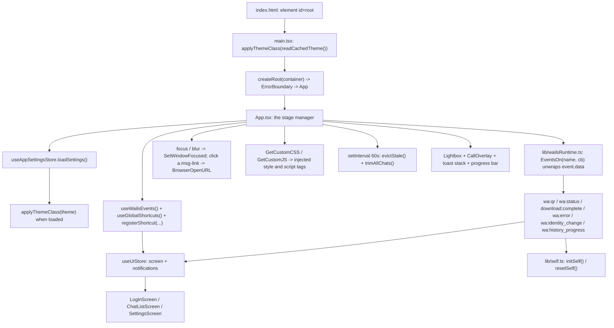

# Frontend app: from `main.tsx` to the window the user sees

> **In one line:** `main.tsx` paints a themed shell before React starts, `App.tsx` registers every event listener *before* it calls `Login()`, and the Wails shim turns each `event.data` into a plain callback that writes into Zustand.

## Why this page exists

The frontend has two files that look small but decide everything: `main.tsx` (19 lines) and `App.tsx` (307 lines). A newcomer usually opens a deep component like `CallOverlay` first and cannot answer basic questions: where did the window focus flag come from, why is there a canvas ref, what happens on `wa:status`, and who removes all these listeners.

This page answers those questions from the checked-in source. It lists the exact event names `App` subscribes to, the exact payload keys it reads, and the cleanup function that unsubscribes them all. It is the frontend companion to [Backend bootstrap](backend-bootstrap.md) and the UI-detail sibling of [Chat UI](chat-ui.md).

## The idea, in plain words

Think of the app as a **theatre**:

- `main.tsx` is the stagehand who sets the lights before the audience arrives. It reads the last known theme and applies it *before* the first render, so a dark-mode user never sees a flash of white (`main.tsx:9`).
- `App.tsx` is the stage manager. It does not draw the chat UI itself; it wires the building: load settings, open outside links in the system browser, tell the backend whether the window is focused, inject user CSS/JS, start the listeners, and choose which screen is visible.
- A **hook** is plumbing pinned to the wall: "when the event arrives, do this; when we unmount, undo it." `useEffect` is that instruction, and the returned function is the undo.
- An **event** is a loudspeaker announcement from Go. The stage manager does not poll; it subscribes once to `wa:qr`, `wa:status`, and friends.
- A **Zustand store** is a shared whiteboard behind the counter: any component can read the current screen or notifications without passing props through every room.
- The chat list you will meet later is a **Virtuoso list**: recyclable rows, not one DOM node per message. That detail matters in [Chat UI](chat-ui.md).



## The code, line by line

### 1. The entry point applies the theme before the first paint

```ts
// frontend/src/main.tsx:1-19
import { createRoot } from "react-dom/client"
import "./style.css"
import App from "./App"
import { ErrorBoundary } from "./components/ErrorBoundary"
import { applyThemeClass, readCachedTheme } from "./lib/theme"

// Apply the last known theme before first render so a dark-mode user does not
// see a flash of the light theme while settings load from the backend.
applyThemeClass(readCachedTheme())

const container = document.getElementById("root")

const root = createRoot(container!)

root.render(
  <ErrorBoundary>
    <App />
  </ErrorBoundary>,
)
```

| Line | What it does |
|---|---|
| `main.tsx:2` | Imports the global stylesheet; the CSS variables are what the theme class switches. |
| `main.tsx:5` | Imports the two theme helpers used to avoid a light-mode flash. |
| `main.tsx:9` | Applies the **cached** theme synchronously, before React renders anything. |
| `main.tsx:11` | Finds the single mount element in the page. |
| `main.tsx:13` | `container!` is a non-null assertion: if that element is missing, this crashes. |
| `main.tsx:15-19` | Renders `App` inside an `ErrorBoundary`, so a render error shows a fallback instead of a blank window. |

### 2. `App.tsx` imports both halves of the app

```ts
// frontend/src/App.tsx:1-18 (grouped excerpt; every import below is real)
import { Login, GetCustomCSS, GetCustomJS, SetWindowFocused } from "../bindings/github.com/lugvitc/amazingwhats/api/api.js"
import { EventsOn, BrowserOpenURL } from "./lib/wailsRuntime"
import { ChatListScreen } from "./screens/ChatScreen"
import { LoginScreen } from "./screens/LoginScreen"
import { SettingsScreen } from "./screens/SettingsScreen"
import { initSelf, resetSelf } from "./lib/self"
import { useUIStore, useMessageStore } from "./store"
import { useAppSettingsStore } from "./store/useAppSettingsStore"
import { applyThemeClass } from "./lib/theme"
import { useWailsEvents } from "./hooks/useWailsEvents"
```

| Line | What it does |
|---|---|
| `App.tsx:2` | Generated **bindings** — functions that call Go methods. This is the v3 path, not `wailsjs/`. |
| `App.tsx:3` | The event shim, which unwraps `event.data` for all legacy-style callers. |
| `App.tsx:5-7` | The three screens `App` can show. |
| `App.tsx:8` | Identity helpers; `myUser` lives in a module variable, not in Zustand. |
| `App.tsx:12-13` | The shared whiteboard imports: UI/message stores from the barrel, settings store directly. |
| `App.tsx:14` | Applies the theme again once the backend's real settings arrive. |
| `App.tsx:15-16` | The two global hooks: backend-event plumbing and keyboard shortcuts. |

### 3. Screen choice and theme loading

```ts
// frontend/src/App.tsx:19-38 (excerpt)
function App() {
  const screen = useUIStore(state => state.screen)
  const setScreen = useUIStore(state => state.setScreen)
  const canvasRef = useRef<HTMLCanvasElement | null>(null)
  const loginStartedRef = useRef(false)
  const [status, setStatus] = useState<string>("waiting")
  const [historyProgress, setHistoryProgress] = useState<number | null>(null)

  const { theme, loaded } = useAppSettingsStore()
  const { notifications, addNotification, removeNotification } = useUIStore()

  useEffect(() => {
    useAppSettingsStore.getState().loadSettings()
  }, [])

  useEffect(() => {
    if (loaded) {
      applyThemeClass(theme)
    }
  }, [theme, loaded])
```

| Line | What it does |
|---|---|
| `App.tsx:20-21` | Reads the current screen and its setter from the UI whiteboard. |
| `App.tsx:22` | `canvasRef` is where the QR code is drawn; it is passed down to `LoginScreen`. |
| `App.tsx:23` | `loginStartedRef` makes the one-time `Login()` call survive a remount. |
| `App.tsx:24` | Local `status` starts at `"waiting"` and is driven only by `wa:status`. |
| `App.tsx:25` | `historyProgress` is `null` when hidden, otherwise a clamped 0-100 number. |
| `App.tsx:30-32` | Loads settings from the backend once on mount. |
| `App.tsx:34-38` | Re-applies the theme class when the loaded settings say the theme changed. |

### 4. Opening links outside the WebView

```ts
// frontend/src/App.tsx:40-54
useEffect(() => {
  const onClick = (e: MouseEvent) => {
    const target = e.target as HTMLElement | null
    const anchor = target?.closest?.("a.msg-link") as HTMLAnchorElement | null
    if (anchor) {
      e.preventDefault()
      const href = anchor.getAttribute("href")
      if (href) BrowserOpenURL(href).catch(err => console.error("Open URL failed:", err))
    }
  }
  document.addEventListener("click", onClick)
  return () => document.removeEventListener("click", onClick)
}, [])
```

| Line | What it does |
|---|---|
| `App.tsx:45` | Looks for the `a.msg-link` class that the backend puts on links in message HTML. |
| `App.tsx:47-49` | Cancels WebView navigation and hands the URL to the OS browser via a binding. |
| `App.tsx:52-53` | A document-level listener must be removed on unmount or clicks get handled twice. |

### 5. Telling the backend whether the window is focused

```ts
// frontend/src/App.tsx:56-68 (excerpt)
useEffect(() => {
  const onFocus = () => SetWindowFocused(true).catch(err => console.error("SetWindowFocused failed:", err))
  const onBlur = () => SetWindowFocused(false).catch(err => console.error("SetWindowFocused failed:", err))
  window.addEventListener("focus", onFocus)
  window.addEventListener("blur", onBlur)
  SetWindowFocused(document.hasFocus()).catch(err => console.error("SetWindowFocused failed:", err))
  return () => {
    window.removeEventListener("focus", onFocus)
    window.removeEventListener("blur", onBlur)
  }
}, [])
```

| Line | What it does |
|---|---|
| `App.tsx:59-60` | Browser focus and blur become two calls to the same Go method. |
| `App.tsx:61-62` | Both listeners are real DOM listeners on `window`. |
| `App.tsx:63` | Seeds the backend with the current state, because a reload may happen while already focused. |
| `App.tsx:64-67` | Cleanup removes both listeners. The backend uses this flag to suppress notifications while you are looking at the window. |

### 6. Custom CSS and JS from the backend

```ts
// frontend/src/App.tsx:70-92 (two branches, faithful)
GetCustomCSS()
  .then(css => {
    if (css) {
      const style = document.createElement("style")
      style.id = "custom-css"
      style.innerHTML = css
      document.head.appendChild(style)
    }
  })
  .catch(err => console.error("Failed to load custom CSS:", err))

GetCustomJS()
  .then(js => {
    if (js) {
      const script = document.createElement("script")
      script.id = "custom-js"
      script.innerHTML = js
      document.body.appendChild(script)
    }
  })
  .catch(err => console.error("Failed to load custom JS:", err))
```

| Line | What it does |
|---|---|
| `App.tsx:71-80` | Fetches a CSS string and appends a `style` element with `id="custom-css"`. |
| `App.tsx:82-91` | Fetches a JS string and appends a `script` element with `id="custom-js"`. |
| `App.tsx:74-77` | The content is assigned through `innerHTML`; it is trusted user configuration, not sanitized here. |
| `App.tsx:70-92` | This effect has **no cleanup**, so the injected nodes are not removed on unmount. |

### 7. Global hooks and app-level shortcuts

```ts
// frontend/src/App.tsx:94-115 (excerpt)
useWailsEvents()

// Dispatch key combinations to whichever component registered the matching
// shortcut (chat list / chat detail). Registered below: app-level ones.
useGlobalShortcuts()

useEffect(() => {
  const openSettings = () => {
    if (useUIStore.getState().screen !== "login") useUIStore.getState().setScreen("settings")
  }
  const openProfile = () => {
    if (useUIStore.getState().screen === "login") return
    useUIStore.getState().setScreen("settings")
    window.dispatchEvent(new CustomEvent("wa:open-settings-category", { detail: "account" }))
  }
  const unregSettings = registerShortcut("open-settings", openSettings)
  const unregProfile = registerShortcut("profile-about", openProfile)
  return () => {
    unregSettings()
    unregProfile()
  }
}, [])
```

| Line | What it does |
|---|---|
| `App.tsx:94` | Starts the separate hook that maps most backend events into stores (see [State and events](state-and-events.md)). |
| `App.tsx:98` | Installs the key dispatcher used by all screens. |
| `App.tsx:102` | Settings cannot be opened while on the login screen. |
| `App.tsx:105-107` | "Profile" also switches to settings and shouts a `wa:open-settings-category` browser event with `detail: "account"`. |
| `App.tsx:109-110` | Registers two app-level shortcuts. |
| `App.tsx:111-114` | Both registrations return functions that are called on unmount. |

### 8. The six listeners `App` owns, and their cleanup

All six subscriptions live in one effect (`App.tsx:117-235`). This is the effect that registers everything **before** `Login()` is called.

```ts
// frontend/src/App.tsx:117-125 — QR drawing
const unsubQR = EventsOn("wa:qr", async (qr: string) => {
  if (!canvasRef.current) return
  await QRCode.toCanvas(canvasRef.current, qr, {
    width: 300,
    color: { dark: "#000000", light: "#ffffff" },
  })
})
```

| Line | What it does |
|---|---|
| `App.tsx:118` | Subscribes to the QR string emitted by Go. |
| `App.tsx:119` | No canvas (login screen not mounted) means no work. |
| `App.tsx:120-123` | Draws the QR at 300px with a fixed black/white palette. |
| `App.tsx:118` | The returned `unsubQR` is a function; calling it removes this listener. |

```ts
// frontend/src/App.tsx:126-155 — login state machine (excerpt)
const unsubStatus = EventsOn("wa:status", (status: string) => {
  setStatus(status)
  if (status === "logged_in" || status === "success") {
    useUIStore.getState().setScreen("chats")
    void initSelf()
    const nid = (window as any).__reconnectNotifId
    if (nid !== undefined) {
      removeNotification(nid)
      delete (window as any).__reconnectNotifId
    }
  } else if (status === "reconnecting") {
    const nid = addNotification("Reconnecting to WhatsApp...")
    ;(window as any).__reconnectNotifId = nid
  } else if (status === "disconnected") {
    // ... clear reconnect toast, then a 6-second disconnect toast ...
  } else if (status === "logged_out") {
    // ... clear reconnect toast, resetSelf(), setScreen("login") ...
  }
})
```

| Line | What it does |
|---|---|
| `App.tsx:126-127` | Every status string also becomes the local `status` shown by `LoginScreen`. |
| `App.tsx:128-130` | `logged_in` **or** `success` moves to the chats screen and starts the async self-JID lookup. |
| `App.tsx:131-135` | On success, the reconnect toast id is removed from the global `window` slot. |
| `App.tsx:136-139` | `reconnecting` adds a toast and stores its id on `window.__reconnectNotifId`. |
| `App.tsx:140-145` | `disconnected` clears that id, then shows a "Disconnected from WhatsApp" toast for 6 seconds. |
| `App.tsx:146-154` | A backend-confirmed `logged_out` clears the self cache and returns to the login screen. |

The remaining four listeners are short and follow the same pattern:

```ts
// frontend/src/App.tsx:157-184 (abbreviated; message strings are exact)
const unsubDownload = EventsOn("download:complete", (filePath: string) => {
  const name = (typeof filePath === "string" ? filePath : "")
    .split(/[\\/]/)
    .pop()
    ?.trim()
  const notificationId = addNotification(`Downloaded: ${name || "file"}`)
  setTimeout(() => { removeNotification(notificationId) }, 3000)
})

const unsubError = EventsOn("wa:error", (msg: string) => {
  const nid = addNotification(msg)
  setTimeout(() => removeNotification(nid), 6000)
})

const unsubIdentity = EventsOn("wa:identity_change", (_msg: string) => {
  // Do not render the raw payload: it contains a contact JID.
  const nid = addNotification(
    "A contact's security code changed. Verify it in WhatsApp on your phone."
  )
  setTimeout(() => removeNotification(nid), 8000)
})
```

| Line | What it does |
|---|---|
| `App.tsx:157-167` | `download:complete` carries an absolute path; only its basename reaches the toast. |
| `App.tsx:160-163` | Splitting on both slash types keeps a Windows or Linux path from leaking directories or a username. |
| `App.tsx:171-174` | Backend errors are shown verbatim as toasts for 6 seconds. |
| `App.tsx:178-184` | Identity changes deliberately show a **fixed** sentence; the raw payload is ignored because it holds a JID. |

The login call is deliberately placed after all listener registrations:

```ts
// frontend/src/App.tsx:186-193
// Register all status listeners before starting login. Existing sessions
// can complete quickly enough to otherwise lose the "logged_in" event.
if (!loginStartedRef.current) {
  loginStartedRef.current = true
  // Never render a raw backend error: it can contain proxy URLs with credentials
  // or filesystem paths. Details stay in the backend logs only.
  void Login().catch(() => setStatus("error: Unable to sign in. Please try again."))
}
```

| Line | What it does |
|---|---|
| `App.tsx:186-187` | The comment explains the ordering: a saved session can emit `logged_in` almost instantly. |
| `App.tsx:188-189` | The ref guard means `Login()` is attempted once per mounted `App` lifetime. |
| `App.tsx:192` | A rejection becomes a generic, static message; the real error object is discarded. |

```ts
// frontend/src/App.tsx:195-225 — history progress (excerpt)
const unsubHistory = EventsOn(
  "wa:history_progress",
  (data: {
    type?: string
    totalConversations?: number
    processedConversations?: number
    totalMessages?: number
    processedMessages?: number
    done?: boolean
  }) => {
    if (data?.done) {
      setHistoryProgress(null)
      return
    }
    if (!data) return
    // `type` is the whatsmeow sync type (INITIAL_BOOTSTRAP / FULL / RECENT
    // / ...), not a progress counter. The real counters are the explicit
    // conversation/message fields.
    const hasMessageTotal =
      typeof data.totalMessages === "number" && data.totalMessages > 0
    const total = hasMessageTotal ? data.totalMessages : data.totalConversations
    const processed = hasMessageTotal
      ? (data.processedMessages ?? 0)
      : (data.processedConversations ?? 0)
    if (typeof total !== "number" || !Number.isFinite(total) || total <= 0) return
    const pct = Math.round((Math.min(Math.max(processed, 0), total) / total) * 100)
    setHistoryProgress(Number.isFinite(pct) ? Math.max(0, Math.min(100, pct)) : 0)
  },
)
```

| Line | What it does |
|---|---|
| `App.tsx:197-204` | The payload type names every key this listener reads. |
| `App.tsx:205-208` | `done: true` hides the progress bar by setting the state back to `null`. |
| `App.tsx:210-214` | `type` is a sync **name**, not a counter — a real trap for anyone building a progress bar. |
| `App.tsx:215-220` | Message counts win when a message total exists; otherwise conversation counts are used. |
| `App.tsx:221-223` | Bad totals are ignored; the percentage is clamped to 0-100. |

```ts
// frontend/src/App.tsx:227-235
return () => {
  unsubQR()
  unsubStatus()
  unsubDownload()
  unsubError()
  unsubIdentity()
  unsubHistory()
}
```

| Line | What it does |
|---|---|
| `App.tsx:227-234` | Every `EventsOn` call has a matching unsubscribe in this effect's cleanup. |
| `App.tsx:235` | The effect depends on `addNotification` and `removeNotification`; when those change, all six listeners are replaced. |

### 9. Periodic housekeeping

```ts
// frontend/src/App.tsx:237-244
useEffect(() => {
  const id = setInterval(() => {
    useUIStore.getState().evictStale()
    useMessageStore.getState().trimAllChats()
  }, 60_000)
  return () => clearInterval(id)
}, [])
```

| Line | What it does |
|---|---|
| `App.tsx:239-242` | Every minute, stale typing/online markers are evicted and oversized message arrays are trimmed. |
| `App.tsx:243` | The interval is cleared on unmount. |

### 10. The render tree

```tsx
// frontend/src/App.tsx:246-303 (structure excerpt; class strings condensed)
<div className="min-h-screen bg-light-secondary text-light-text dark:bg-dark-bg ...">
  {historyProgress !== null && (
    <div className="fixed top-0 left-0 right-0 z-[100] h-1 ...">
      <div className="h-full bg-[#21c063] ..." style={{ width: `${historyProgress}%` }} />
    </div>
  )}
  <Lightbox />
  <div className="fixed bottom-4 right-4 z-50 flex flex-col gap-2 ...">
    {notifications.map(n => { /* toast-base + kind class + close button */ })}
  </div>

  {screen === "login" && <LoginScreen canvasRef={canvasRef} status={status} />}

  {(screen === "chats" || screen === "settings") && (
    <div className={screen === "settings" ? "hidden" : "contents"}>
      <ChatListScreen onOpenSettings={() => setScreen("settings")} />
    </div>
  )}

  {screen === "settings" && <SettingsScreen onBack={() => setScreen("chats")} />}
  <CallOverlay />
</div>
```

| Line | What it does |
|---|---|
| `App.tsx:248-255` | A 4px top bar is shown only while a history sync reports progress. |
| `App.tsx:256` | `Lightbox` is always mounted and reads its source from the UI store. |
| `App.tsx:261-290` | The toast stack maps the UI store's `notifications` to fixed-position cards. |
| `App.tsx:262-275` | Toast kind is guessed from the lowercased message text: `downloaded`/`logged_in`/`success` → success, `error`/`failed`/`disconnect` → error, `reconnect` → warning, else info. |
| `App.tsx:293` | The login screen receives the QR canvas ref and the local status string. |
| `App.tsx:295-299` | On `chats` **or** `settings`, `ChatListScreen` stays mounted; on settings it is hidden with CSS. Its state therefore survives a settings visit. |
| `App.tsx:301` | `SettingsScreen` is mounted only for that screen. |
| `App.tsx:302` | `CallOverlay` is always mounted and listens for its own five `call:*` events. |

## What can go wrong

> **Registering listeners after `Login()` loses the fastest event.** A saved session can emit `logged_in` before a later-created listener exists. The code comments this explicitly and registers all six listeners first (`App.tsx:186-193`). If you move `Login()` into a different effect, keep that ordering.

> **Calling `Events.On` directly gives you a wrapper, not the payload.** The shim exists because Wails v3 callbacks receive a `WailsEvent`; `wailsRuntime.ts:13` unwraps `event.data`. A callback written against the raw API would read `undefined` for `qr`, `status`, and every other string payload.

> **Raw backend strings are deliberately suppressed in two places.** `Login()` errors are replaced by a generic sentence (`App.tsx:190-192`) because they can contain proxy URLs with credentials or filesystem paths; `wa:identity_change` payloads are ignored (`App.tsx:178-184`) because they contain a contact JID. Do not "improve" these by rendering the payload.

> **Only the basename of a download path is shown.** The split on `/` and `\` (`App.tsx:160-163`) is a privacy decision, not cosmetic. Passing the full path to `addNotification` would put a user's directory layout and username in a toast.

> **Toast styling is substring-based.** A harmless message containing the word "error" is painted as an error, and `"logged_in"` is matched with its underscore intact (`App.tsx:262-275`). If you add a new status string, check how it will be classified.

> **The reconnect toast id lives on `window`.** `window.__reconnectNotifId` is untyped global state (`App.tsx:131-143`). An unexpected event order can leave an id behind, and the cleanup function of this effect does not clear it. Removing a notification twice is harmless, but debugging "why did my toast vanish" starts here.

> **Custom CSS/JS is injected with `innerHTML` and never removed.** The effect at `App.tsx:70-92` has no cleanup and the nodes are identified only by `id`. Two mounts would append duplicate tags with the same id; changing the feature means replacing nodes, not just appending.

> **`history_progress.type` is not a number.** Treating `INITIAL_BOOTSTRAP` or `FULL` as a counter produces a nonsense progress bar. Use `totalMessages`/`processedMessages` or `totalConversations`/`processedConversations`, and keep the `Number.isFinite` guard (`App.tsx:215-223`).

> **Missing DOM nodes fail hard at the entry point.** `createRoot(container!)` (`main.tsx:13`) assumes `#root` exists. An `ErrorBoundary` catches render errors in `App`, but not a null container passed to `createRoot`.

> **Timers toasts are not cleaned up on unmount.** The `setTimeout` calls for download/error/identity/disconnect toasts (`App.tsx:145`, `:165`, `:173`, `:183`) are not stored or cleared. The listeners are removed, but an already-scheduled timeout can still call `removeNotification` later.

## Where to next

- [Vocabulary](../00-start-here/vocabulary.md) — what "binding", "event", "hook" and "store" mean in this repo.
- [Quickstart](../00-start-here/quickstart.md) — the exact commands to run the frontend and backend together.
- [State and events](state-and-events.md) — the shim contract and the event-to-store mapping in full.
- [Chat UI](chat-ui.md) — the screens and virtualized list this page mounts.
- [System map](../01-architecture/system-map.md) — the Go side of the same window.
- [Data flow](../01-architecture/data-flow.md) — the QR and message flows drawn end to end.
- [Backend bootstrap](backend-bootstrap.md) — where `Login`, `GetSettings` and the event emitter live.
- [Docs index](../index.md) — the full reading order.
