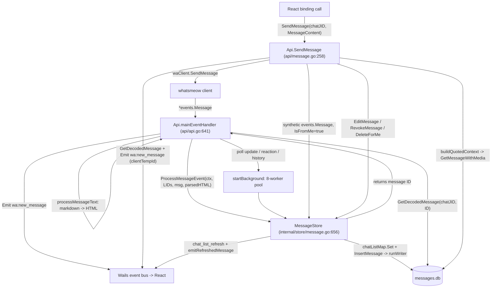

# Message pipeline: from WhatsApp event to `wa:new_message` and back

> **In one line:** Incoming messages are parsed into HTML, persisted by `MessageStore.ProcessMessageEvent`, re-read with `GetDecodedMessage`, and announced on the loudspeaker as `app.Event.Emit("wa:new_message", ...)`; outgoing messages take the same store-and-re-read detour so the sender's own UI updates before the network echoes anything back.

## Why this page exists

The names in this path look arbitrary until you see the order: `ProcessMessageEvent` returns an ID, the ID is used to re-read a row, and only then is an event emitted. A junior developer who adds a field to one `wa:new_message` payload but not the others will create a UI bug that looks like a rendering problem.

This page follows the real call sites in `api/api.go` and `api/message.go`, lists the **exact event name and payload keys** used by each emitter, and explains the three different local-echo shapes. It also covers the incoming edit/revoke branches that live inside the store, because they are easy to miss when you only read the handler.

## The idea, in plain words

Picture a **post office with a loudspeaker**:

- The WhatsApp library is the mail carrier. It drops an envelope (`*events.Message`) onto one sorting desk: `Api.mainEventHandler`.
- The desk does not tape the letter to the wall. It sends it to the archive clerk, `MessageStore.ProcessMessageEvent`, who files it in `messages.db` and returns a **message ID**.
- The desk then asks the clerk for a **clean copy** of what was filed (`GetDecodedMessage`) and pins that copy to the noticeboard with an announcement: `wa:new_message`. The announcement is a loudspeaker, not the letter itself — the database remains the source of truth.
- Reactions, edits and revokes are **special deliveries**: the clerk updates an existing row and returns the *target* ID, so the UI hears about the original message, refreshed, rather than about a new row.
- Sending is the mirror image. Go builds a WhatsApp message, sends it, then **writes a synthetic incoming event** (`IsFromMe: true`) through the same clerk and makes the same loudspeaker announcement. That is the local echo: the UI shows "You" immediately instead of waiting for the network round-trip.
- A quoted reply is built by looking up the old row and re-attaching its media and text — but with the stored HTML stripped, because WhatsApp expects plain text.



## The code, line by line

### 1. The handler is attached on first login

```go
// api/api.go:580-583
if !a.eventHandlerSet {
	a.eventHandlerID = a.waClient.AddEventHandler(a.mainEventHandler)
	a.eventHandlerSet = true
}
```

| Line | What it does |
|---|---|
| `api/api.go:581` | `mainEventHandler` is registered on the one whatsmeow client; the ID is stored for removal at shutdown. |
| `api/api.go:580` | `eventHandlerSet` makes registration idempotent across logins. |

### 2. Incoming: parse, persist, re-read, announce

```go
// api/api.go:641-681 (faithful excerpt; comments condensed as ...)
func (a *Api) mainEventHandler(evt any) {
	a.eventMu.RLock()
	defer a.eventMu.RUnlock()
	if a.isShuttingDown() {
		return
	}
	switch v := evt.(type) {
	case *events.Message:
		// Poll vote messages: insert a system message and skip normal processing
		if v.Message.GetPollUpdateMessage() != nil {
			a.startBackground(func() { a.handlePollVoteEvent(v) })
			return
		}

		parsedHTML := a.processMessageText(v.Message)

		// Handle message edits: re-parse the edited content
		if protoMsg := v.Message.GetProtocolMessage(); protoMsg != nil && protoMsg.GetType() == waE2E.ProtocolMessage_MESSAGE_EDIT {
			newContent := protoMsg.GetEditedMessage()
			if newContent != nil {
				parsedHTML = a.processMessageText(newContent)
			}
		}

		messageID := a.messageStore.ProcessMessageEvent(a.ctx, a.waClient.Store.LIDs, v, parsedHTML)

		// If a message was processed (inserted or updated), emit the decoded message from DB
		if messageID != "" {
			updatedMsg, err := a.messageStore.GetDecodedMessage(v.Info.Chat.String(), messageID)
			if err == nil {
				a.app.Event.Emit("wa:new_message", map[string]any{
					"chatId":      v.Info.Chat.String(),
					"message":     updatedMsg,
					"messageText": parsedHTML,
					"timestamp":   v.Info.Timestamp.Unix(),
					"sender":      v.Info.PushName,
					"isFromMe":    v.Info.IsFromMe,
				})
			} else if !errors.Is(err, sql.ErrNoRows) {
				log.Println("Failed to get decoded message after processing:", err)
			}
		}
```

| Line | What it does |
|---|---|
| `api/api.go:642-646` | Holds a read lock so shutdown cannot close the stores while an event is in flight; drops events once shutdown begins. |
| `api/api.go:649-653` | Poll votes leave the normal path and go to `handlePollVoteEvent` on the worker pool. |
| `api/api.go:655` | `processMessageText` converts Markdown to HTML (and replaces mentions) before storage. |
| `api/api.go:657-663` | An incoming edit is re-parsed from `GetEditedMessage()`, so the *new* text is what gets stored and announced. |
| `api/api.go:665` | `ProcessMessageEvent` returns the inserted or updated message ID. |
| `api/api.go:668-669` | Only a non-empty ID triggers a re-read; protocol noise returns `""`. |
| `api/api.go:671-678` | The loudspeaker announcement with its six exact keys (see the payload table below). |
| `api/api.go:679-681` | `sql.ErrNoRows` is deliberately quiet; other read errors are logged. |

```go
// api/message.go:61-108 (excerpt)
func (a *Api) processMessageText(msg *waE2E.Message) string {
	if msg == nil {
		return ""
	}
	var text string
	var mentionedJIDs []string

	if msg.GetConversation() != "" {
		text = msg.GetConversation()
	} else if msg.GetExtendedTextMessage() != nil {
		text = msg.GetExtendedTextMessage().GetText()
		if msg.GetExtendedTextMessage().GetContextInfo() != nil {
			mentionedJIDs = msg.GetExtendedTextMessage().GetContextInfo().GetMentionedJID()
		}
	} else {
		switch {
		case msg.GetImageMessage() != nil:
			text = msg.GetImageMessage().GetCaption()
		// ... video/document caption cases follow the same pattern ...
		}
	}
	if text == "" {
		return ""
	}
	htmlText := markdown.MarkdownLinesToHTML(text)
	if len(mentionedJIDs) > 0 {
		htmlText = replaceMentions(htmlText, mentionedJIDs, a)
	}
	return htmlText
}
```

| Line | What it does |
|---|---|
| `api/message.go:68-93` | Reads the body from a conversation, extended text, or an image/video/document caption. |
| `api/message.go:99-100` | Markdown is converted to HTML first (this also escapes content). |
| `api/message.go:102-105` | Mentions are substituted into the HTML afterwards. |

### 3. What the store does with the event

```go
// internal/store/message.go:656-740 (faithful excerpt; comments condensed as ...)
func (ms *MessageStore) ProcessMessageEvent(ctx context.Context, sd store.LIDStore, msg *events.Message, parsedHTML string) string {
	ms.migrateChatlist(ctx, sd, msg.Info.Chat)
	updateCanonicalJID(ctx, sd, &msg.Info.Chat)
	updateCanonicalJID(ctx, sd, &msg.Info.Sender)

	// Handle reactions
	if msg.Message.GetReactionMessage() != nil {
		reactionMsg := msg.Message.GetReactionMessage()
		targetID := reactionMsg.GetKey().GetID()
		reaction := reactionMsg.GetText()
		senderJID := msg.Info.Sender.String()
		err := ms.AddReactionToMessage(targetID, reaction, senderJID)
		if err != nil {
			log.Println("Failed to add reaction:", err)
			return ""
		}
		return targetID
	}

	// Handle message edits
	if protoMsg := msg.Message.GetProtocolMessage(); protoMsg != nil && protoMsg.GetType() == waE2E.ProtocolMessage_MESSAGE_EDIT {
		targetID := protoMsg.GetKey().GetID()
		newContent := protoMsg.GetEditedMessage()
		if targetID == "" || newContent == nil {
			return ""
		}
		err := ms.UpdateMessageContent(targetID, newContent, parsedHTML)
		if err != nil {
			log.Println("Failed to update edited message:", err)
			return ""
		}
		return targetID
	}

	// Handle revokes: replace the target's content with a deleted marker.
	if protoMsg := msg.Message.GetProtocolMessage(); protoMsg != nil && protoMsg.GetType() == waE2E.ProtocolMessage_REVOKE {
		targetID := protoMsg.GetKey().GetID()
		if targetID == "" {
			return ""
		}
		if err := ms.MarkMessageDeleted(targetID); err != nil {
			log.Println("Failed to mark message deleted:", err)
			return ""
		}
		return targetID
	}

	// Protocol noise (poll votes, keep-in-chat, remaining protocol messages)
	// must not create visible rows or bump the chat list.
	if ShouldSkipMessage(msg.Message) && msg.Message.GetPinInChatMessage() == nil {
		return ""
	}

	chat := msg.Info.Chat.User
	var messageText string
	if parsedHTML != "" {
		messageText = parsedHTML
	} else {
		messageText = ExtractMessageText(msg.Message)
	}
	chatMsg := ChatMessage{
		JID:         msg.Info.Chat,
		MessageText: messageText,
		MessageTime: msg.Info.Timestamp.Unix(),
		Sender:      msg.Info.Sender.String(),
		IsFromMe:    msg.Info.IsFromMe,
	}

	ms.chatListMap.Set(chat, chatMsg)

	err := ms.InsertMessage(&msg.Info, msg.Message, parsedHTML)
	if err != nil {
		log.Println("Failed to insert message:", err)
		return ""
	}
	return msg.Info.ID
}
```

| Line | What it does |
|---|---|
| `internal/store/message.go:657-660` | Canonicalises LID/PN JIDs, including the chat-list cache, before anything else. |
| `internal/store/message.go:663-674` | A reaction adds a row in `reactions` and returns the **target** ID — no new message row. |
| `internal/store/message.go:677-690` | An edit updates the target row's text/media and returns the target ID. |
| `internal/store/message.go:693-703` | A revoke replaces the target's content with the deleted marker and returns the target ID. |
| `internal/store/message.go:707-709` | `ShouldSkipMessage` filters protocol noise; pin-in-chat is the explicit exception. |
| `internal/store/message.go:714-732` | The per-chat preview cache is updated with the latest message before the DB insert. |
| `internal/store/message.go:734-739` | `InsertMessage` writes through the single writer; only its success yields an ID. |

### 4. Outgoing: build, send, then echo locally

```go
// api/message.go:258-279 (excerpt)
func (a *Api) SendMessage(chatJID string, content MessageContent) (string, error) {
	if a.waClient.Store.ID == nil {
		return "", fmt.Errorf("client not logged in")
	}
	parsedJID, err := types.ParseJID(chatJID)
	if err != nil {
		return "", err
	}

	var msgContent *waE2E.Message
	contextInfo, err := a.buildQuotedContext(parsedJID, content.QuotedMessageID)
	if err != nil {
		log.Println("Failed to build quoted context:", err)
		return "", err
	}
	if content.Forwarded {
		if contextInfo == nil {
			contextInfo = &waE2E.ContextInfo{}
		}
		contextInfo.IsForwarded = proto.Bool(true)
	}
```

```go
// api/message.go:519-597 (faithful excerpt; type switch body condensed as ...)
	resp, err := a.waClient.SendMessage(a.ctx, parsedJID, msgContent)
	if err != nil {
		log.Println("SendMessage error:", err)
		return "", err
	}

	// Manually add to store and emit event so UI updates immediately
	msgEvent := &events.Message{
		Info: types.MessageInfo{
			ID:        resp.ID,
			Timestamp: resp.Timestamp,
			MessageSource: types.MessageSource{
				Chat:     parsedJID,
				IsFromMe: true,
				Sender:   *a.waClient.Store.ID,
			},
		},
		Message: msgContent,
	}
	parsedHTML := a.processMessageText(msgContent)
	messageID := a.messageStore.ProcessMessageEvent(a.ctx, a.waClient.Store.LIDs, msgEvent, parsedHTML)

	// Extract message text for chat list update
	var messageText string
	if msgContent.GetConversation() != "" {
		messageText = msgContent.GetConversation()
	} else if msgContent.GetExtendedTextMessage() != nil {
		messageText = msgContent.GetExtendedTextMessage().GetText()
	} else {
		switch {
		case msgContent.GetImageMessage() != nil:
			messageText = "image"
		case msgContent.GetVideoMessage() != nil:
			if msgContent.GetVideoMessage().GetGifPlayback() {
				messageText = "gif"
			} else {
				messageText = "video"
			}
		// ... audio/document/sticker/default cases follow ...
		}
	}

	var msg any
	if messageID != "" {
		decodedMsg, err := a.messageStore.GetDecodedMessage(parsedJID.String(), messageID)
		if err == nil {
			msg = decodedMsg
		}
	}

	if msg == nil {
		msg = struct {
			Info    types.MessageInfo
			Content *waE2E.Message
		}{
			Info:    msgEvent.Info,
			Content: msgEvent.Message,
		}
	}

	a.app.Event.Emit("wa:new_message", map[string]any{
		"chatId":       parsedJID.String(),
		"message":      msg,
		"clientTempId": content.ClientTempID,
		"messageText":  messageText,
		"parsedHTML":   parsedHTML,
		"timestamp":    resp.Timestamp.Unix(),
		"sender":       "You",
	})

	return resp.ID, nil
```

| Line | What it does |
|---|---|
| `api/message.go:259-266` | Requires a logged-in client and parses the destination JID. |
| `api/message.go:269-279` | Builds reply/forward context first; a failed quote lookup aborts the send. |
| `api/message.go:281-517` | Type switch builds `text`, `image`, `video`, `audio`, `document` or `sticker` content; media is base64-decoded and uploaded via `uploadWithRetry` (3 attempts, `api/message.go:40-59`). |
| `api/message.go:519-523` | The real network send through `waClient.SendMessage`. |
| `api/message.go:526-537` | Synthesises an incoming-shaped event with `IsFromMe: true` and the server's ID/timestamp. |
| `api/message.go:539` | The same `ProcessMessageEvent` path as incoming traffic. |
| `api/message.go:542-566` | Derives a short chat-list preview ("image", "gif", "video", …). |
| `api/message.go:568-584` | Re-reads the decoded row; if that fails, falls back to a minimal `Info`/`Content` struct. |
| `api/message.go:586-594` | The local-echo announcement — note `clientTempId` and `parsedHTML`, and **no** `isFromMe` key. |
| `api/message.go:596` | Returns the server-assigned message ID. |

### 5. Quote building: HTML out, plain text into WhatsApp

```go
// api/message.go:129-143 (excerpt)
func buildQuotedMessage(msg *store.ExtendedMessage) *waE2E.Message {
	if msg == nil {
		return nil
	}
	// Stored text is rendered HTML (D-AUD-005d); a quoted preview is sent as
	// plain WhatsApp text, so strip the markup before embedding it.
	text := markdown.StripHTML(msg.Text)
	var quotedMessage waE2E.Message
	if msg.ReplyToMessageID == "" {
		quotedMessage.Conversation = proto.String(text)
	} else {
		quotedMessage.ExtendedTextMessage = &waE2E.ExtendedTextMessage{
			Text: proto.String(text),
		}
	}
```

```go
// api/message.go:203-230 (excerpt)
func (a *Api) buildQuotedContext(chatJID types.JID, quotedMessageID string) (*waE2E.ContextInfo, error) {
	if quotedMessageID == "" {
		return nil, nil
	}
	msg, err := a.messageStore.GetMessageWithMedia(chatJID.String(), quotedMessageID)
	if err != nil {
		return nil, fmt.Errorf("quoted message not found")
	}
	quotedMessage := buildQuotedMessage(msg)
	if quotedMessage == nil {
		return nil, fmt.Errorf("failed to build quoted message")
	}
	stanzaID := quotedMessageID
	contextInfo := &waE2E.ContextInfo{
		StanzaID:      &stanzaID,
		QuotedMessage: quotedMessage,
	}
	if msg.Info.Sender.User != "" {
		participantJID := msg.Info.Sender.ToNonAD().String()
		contextInfo.Participant = proto.String(participantJID)
	}
	return contextInfo, nil
}
```

| Line | What it does |
|---|---|
| `api/message.go:135` | Stored HTML is stripped before it becomes a WhatsApp quote. |
| `api/message.go:137-143` | A plain reply uses `Conversation`; a reply to a reply uses `ExtendedTextMessage`. |
| `api/message.go:145-200` | Media quotes copy URL, mimetype, hashes, dimensions and caption into the matching `Image/Video/Audio/Document/StickerMessage`. |
| `api/message.go:208-211` | A missing quoted row is a hard error, so `SendMessage` refuses to send a broken quote. |
| `api/message.go:219-228` | `StanzaID` and, for group senders, `Participant` identify the original message. |

### 6. The shared local-echo helper and the edit/revoke/delete refreshes

```go
// api/message.go:841-875 (excerpt)
func (a *Api) sendAndStoreLocal(chat types.JID, msgContent *waE2E.Message, preview string) (string, error) {
	resp, err := a.waClient.SendMessage(a.ctx, chat, msgContent)
	if err != nil {
		return "", err
	}
	msgEvent := &events.Message{
		Info: types.MessageInfo{
			ID:        resp.ID,
			Timestamp: resp.Timestamp,
			MessageSource: types.MessageSource{
				Chat:     chat,
				IsFromMe: true,
				Sender:   *a.waClient.Store.ID,
			},
		},
		Message: msgContent,
	}
	messageID := a.messageStore.ProcessMessageEvent(a.ctx, a.waClient.Store.LIDs, msgEvent, "")
	var msg any
	if messageID != "" {
		if decodedMsg, derr := a.messageStore.GetDecodedMessage(chat.String(), messageID); derr == nil {
			msg = decodedMsg
		}
	}
	a.app.Event.Emit("wa:new_message", map[string]any{
		"chatId":      chat.String(),
		"message":     msg,
		"messageText": preview,
		"timestamp":   resp.Timestamp.Unix(),
		"sender":      "You",
		"isFromMe":    true,
	})
	return resp.ID, nil
}
```

```go
// api/message.go:936-946
func (a *Api) emitRefreshedMessage(chatJID, messageID string) {
	msg, err := a.messageStore.GetDecodedMessage(chatJID, messageID)
	if err != nil || msg == nil {
		return
	}
	a.app.Event.Emit("wa:new_message", map[string]any{
		"chatId":   chatJID,
		"message":  msg,
		"isFromMe": true,
	})
}
```

```go
// api/message.go:950-1001 (excerpt)
func (a *Api) EditMessage(chatJID, messageID, newText string) (string, error) {
	// ... logged-in and JID checks; plainText = markdown.StripHTML(newText)
	msg := a.waClient.BuildEdit(chat, messageID, &waE2E.Message{
		Conversation: &plainText,
	})
	resp, err := a.waClient.SendMessage(a.ctx, chat, msg)
	if err != nil {
		return "", err
	}
	editedHTML := a.processMessageText(&waE2E.Message{Conversation: &plainText})
	err = a.messageStore.UpdateMessageContent(messageID, &waE2E.Message{Conversation: &plainText}, editedHTML)
	if err != nil {
		log.Println("EditMessage: failed to persist edit locally:", err)
	}
	a.app.Event.Emit("wa:chat_list_refresh")
	a.emitRefreshedMessage(chat.String(), messageID)
	return resp.ID, nil
}

func (a *Api) RevokeMessage(chatJID, messageID string) error {
	// ... logged-in and JID checks
	revokeMsg := a.waClient.BuildRevoke(chat, types.EmptyJID, messageID)
	_, err = a.waClient.SendMessage(a.ctx, chat, revokeMsg)
	if err != nil {
		return err
	}
	err = a.messageStore.MarkMessageDeleted(messageID)
	if err != nil {
		log.Println("RevokeMessage: failed to mark deleted locally:", err)
	}
	a.app.Event.Emit("wa:chat_list_refresh")
	a.emitRefreshedMessage(chat.String(), messageID)
	return nil
}
```

| Line | What it does |
|---|---|
| `api/message.go:839-875` | `sendAndStoreLocal` is the shared echo helper used by `ForwardMessage` (`:721`), `SendPoll` (`:898`), `SendShareContact` (`:929`) and `SendLocation` (`:1024`). |
| `api/message.go:858` | It passes `""` as `parsedHTML`, so no HTML is stored for these synthetic events. |
| `api/message.go:866-873` | Its payload has `isFromMe: true` but no `clientTempId` and no `parsedHTML`. |
| `api/message.go:936-946` | `emitRefreshedMessage` emits only `chatId`, `message`, `isFromMe` — a deliberately small "update this row in place" notice. |
| `api/message.go:958-975` | `EditMessage` sends a `BuildEdit`, persists rendered HTML through `UpdateMessageContent`, refreshes the chat list, then re-emits the row. |
| `api/message.go:981-1001` | `RevokeMessage` sends `BuildRevoke`, marks the row deleted locally, refreshes and re-emits. |
| `api/message.go:1032-1045` | `DeleteForMe` is local-only: `MarkMessageDeleted`, `wa:chat_list_refresh`, `emitRefreshedMessage` — no network send. |
| `internal/store/message.go:952-965` | Both edit and delete paths call `invalidateChatListCacheForMessage`, so the cached preview is recomputed from the DB. |
| `internal/store/message.go:2320-2334` | `MarkMessageDeleted` writes `<i>🚫 This message was deleted</i>` into `text` and clears `has_media`. |

### 7. The exact `wa:new_message` payload keys

Every emitter below uses the same event name, `wa:new_message` (`app.Event.Emit`). The keys are exactly those written in the `map[string]any` literal at each call site.

| Emitter | Source | Exact keys in the payload |
|---|---|---|
| Incoming live message | `api/api.go:671-678` | `chatId`, `message`, `messageText`, `timestamp`, `sender`, `isFromMe` |
| Incoming reaction | `api/api.go:713-720` | `chatId`, `message` (nil), `messageText`, `reaction`, `timestamp`, `sender` |
| Outgoing `SendMessage` echo | `api/message.go:586-594` | `chatId`, `message`, `clientTempId`, `messageText`, `parsedHTML`, `timestamp`, `sender` ("You") |
| `sendAndStoreLocal` echo | `api/message.go:866-873` | `chatId`, `message`, `messageText`, `timestamp`, `sender` ("You"), `isFromMe` (true) |
| `emitRefreshedMessage` (edit/revoke/delete) | `api/message.go:941-945` | `chatId`, `message`, `isFromMe` (true) |
| Poll vote refresh | `api/polls.go:406-413` | `chatId`, `message`, `messageText`, `timestamp`, `sender`, `pollUpdate` (true) |

> **The `message` value is a `DecodedMessage` whenever the re-read succeeds.** It is read back from `messages.db` via `GetDecodedMessage` (`internal/store/message.go:2021-2121`), which builds `Info`, `Content`, reactions, quoted context, PTT and media metadata. `SendMessage` is the one emitter with an explicit fallback struct if that read fails (`api/message.go:576-584`).

### 8. History sync uses the same clerk

```go
// api/api.go:1106-1136 (excerpt)
for _, histMsg := range conv.GetMessages() {
	webMsg := histMsg.GetMessage()
	if webMsg == nil {
		continue
	}
	parsedMsg, err := a.waClient.ParseWebMessage(chatJID, webMsg)
	if err != nil || parsedMsg.Message == nil {
		continue
	}
	parsedMsg.Message = store.UnwrapMessage(parsedMsg.Message)
	if parsedMsg.Message == nil {
		continue
	}
	parsedHTML := a.processMessageText(parsedMsg.Message)
	if a.messageStore.ProcessMessageEvent(a.ctx, a.waClient.Store.LIDs, parsedMsg, parsedHTML) != "" {
		stored++
	}
}
// ... final wa:history_progress emit with "done": true, then wa:chat_list_refresh
```

| Line | What it does |
|---|---|
| `api/api.go:822` | `HistorySync` is dispatched to `processHistorySync` on the worker pool so thousands of messages do not block live events. |
| `api/api.go:1111-1120` | Each history entry is parsed and unwrapped into the same shape a live message has. |
| `api/api.go:1122` | It goes through the **same** `ProcessMessageEvent`, so history and live rows are stored identically. |
| `api/api.go:1094-1100` | Progress is announced as `wa:history_progress` with keys `type`, `totalConversations`, `processedConversations`, `totalMessages`, `processedMessages`; the final emit adds `done: true` (`:1127-1134`). |

## What can go wrong

> **A successful reaction, edit or revoke returns the target ID, not an empty string.** On success `ProcessMessageEvent` returns `targetID` (`internal/store/message.go:673`, `:689`, `:702`). The incoming branch therefore re-reads that target and emits the decoded `wa:new_message` (`api/api.go:665-678`). An incoming reaction then queues a **second** `wa:new_message` from the separate reaction branch (`api/api.go:695-722`, via `startBackground`) with `message: nil`, `messageText` set to the target's text and a `reaction` key. Do not treat these special deliveries as "nothing was announced".

> **An empty ID really does mean no decoded announcement.** `ProcessMessageEvent` returns `""` only on failure or skip paths: a failed reaction add (`:671`), missing edit content (`:681`), a failed edit (`:687`), an empty revoke target (`:696`), a failed revoke (`:700`), skipped protocol noise (`:708`) or a failed insert (`:737`). The decoded emit is gated on a non-empty ID (`api/api.go:668`), so those cases produce no decoded `wa:new_message`; skipped noise produces no announcement at all.

> **The three echo shapes are not interchangeable.** The `SendMessage` echo has `clientTempId` and `parsedHTML` but no `isFromMe`; `sendAndStoreLocal` has `isFromMe` but no `clientTempId`/`parsedHTML`; `emitRefreshedMessage` has only three keys. Code that reads `isFromMe` from every `wa:new_message` will misclassify `SendMessage`'s own echo, and code that requires `clientTempId` will break the forwarded/location/poll paths.

> **A local echo can be followed by the network echo.** The synthetic event is stored with the server's ID from `resp.ID`; when WhatsApp sends the real delivery event back, `ProcessMessageEvent` upserts the same `message_id` (`internal/store/message.go:734`, `internal/query/messages.go:33-48`). Expect two `wa:new_message` announcements for one outbound message.

> **A bad quote aborts the send.** `buildQuotedContext` returns `"quoted message not found"` when `GetMessageWithMedia` fails (`api/message.go:208-211`), and `SendMessage` returns that error before uploading anything.

> **Media sends are retried, but only three times.** `uploadWithRetry` loops up to `maxAttempts = 3` with a 1s/2s backoff (`api/message.go:40-59`); after that `SendMessage` returns the last error and no local echo is written.

> **An empty edit silently does nothing.** `UpdateMessageContent` returns `nil` without a DB write when the extracted text is empty (`internal/store/message.go:979-981`), yet `EditMessage` still emits `wa:chat_list_refresh` and a refreshed row.

> **Background handlers can be dropped.** Reaction lookups, notifications, history sync and poll votes all go through `startBackground` (`api/api.go:300-318`); if the 256-slot queue is full the task is logged and dropped.

## Where to next

- [Vocabulary](../00-start-here/vocabulary.md) — what "event", "binding" and "decoded message" mean here.
- [Data flow](../01-architecture/data-flow.md) — the same path drawn as an end-to-end sequence with the React side.
- [Backend bootstrap](backend-bootstrap.md) — where the handler is registered and the worker pool is created.
- [Database](database.md) — the store, the writer goroutine and the upserts behind `ProcessMessageEvent`.
- [Docs index](../index.md) — the full reading order.
