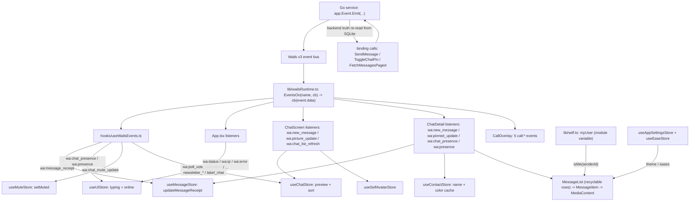

# State and events: small whiteboards, one loudspeaker

> **In one line:** Go shouts named events over a loudspeaker, `wailsRuntime.ts` unwraps `event.data`, `useWailsEvents` files nine of those announcements into separate Zustand whiteboards, and optimistic UI writes are later replaced — or rolled back — by what the backend confirms.

## Why this page exists

There is no single "app state" in this frontend. There are eight small Zustand stores, one module-level identity variable, a set of LRU caches, and a handful of events that arrive from Go with **two different generations of payload keys**. A newcomer who adds a field to one listener but not its legacy branch will see the field work in development and fail on an older session.

This page is the map of that territory. It lists every store in `frontend/src/store/`, the exact subscription in `useWailsEvents`, and the optimistic paths in `ChatScreen` and `ChatDetail` that make the UI feel instant. For the Go side of the loudspeaker, read [Message pipeline](message-pipeline.md) first.

## The idea, in plain words

Picture a **shop with several whiteboards and one loudspeaker**:

- Each **Zustand store** is a separate whiteboard. The chat board holds the list and which chat is selected; the message board holds message arrays per chat; the UI board holds the current screen, toasts, and typing markers. They are fast and in-memory — wiped on reload. The durable filing cabinet is SQLite in Go, which is why a "store" in this repo can mean two very different things ([Vocabulary](../00-start-here/vocabulary.md) calls this out).
- A **hook** is the plumbing that listens. `useWailsEvents` is a standing instruction: "when the loudspeaker says `wa:message_receipt`, update the receipt on the matching message; when we unmount, unplug the wire."
- An **event** is the loudspeaker itself. Go does not care who is listening; React does not poll. The shim in `wailsRuntime.ts` is the translator that turns the v3 `WailsEvent` wrapper into a plain callback argument.
- A **Virtuoso list** is a set of recyclable rows: the message board changes, the list repaints only what is on screen. It reads from the whiteboard rather than owning data of its own ([Chat UI](chat-ui.md)).
- An **optimistic write** is pencilling an answer on the whiteboard before the office confirms it. When confirmation arrives, the pencil mark is replaced; when it fails, it is rubbed out.



## The code, line by line

### 1. The store barrel tells you what exists

```ts
// frontend/src/store/index.ts:1-14
export {
  useChatStore,
  useChatById,
  useChatIds,
  useFilteredChatIds,
  useArchivedCount,
  useChatsArray,
} from "./useChatStore"
export { useMessageStore } from "./useMessageStore"
export { useUIStore } from "./useUIStore"
export { useMuteStore, useChatMuted } from "./useMuteStore"
export { useAppSettingsStore } from "./useAppSettingsStore"
export { useEaseStore } from "./useEaseStore"
export * from "./types"
```

| Line | What it does |
|---|---|
| `index.ts:1-8` | Re-exports the chat store and five selector hooks built on top of it. |
| `index.ts:9-13` | Re-exports the message, UI, mute, settings and ease stores. |
| `index.ts:14` | Re-exports the shared TypeScript interfaces (`Message`, `ChatItem`, reactions, media content). |

Note what is **not** in the barrel: `useContactStore` and `useSelfAvatarStore` are imported directly by their users (`ChatDetail.tsx:18`, `ChatScreen.tsx:33`).

### 2. Who owns what

| Store / holder | Source | State it owns |
|---|---|---|
| `useChatStore` | `useChatStore.ts:36-43` | `chatsById` (`Map`), `chatIds` (display order), `selectedChatId`, `selectedChatName`, `selectedChatAvatar`, `selectedChatSender`, `searchTerm`. |
| `useMessageStore` | `useMessageStore.ts:25-28` | `messages: Record<string, Message[]>` keyed by chat id, plus `activeChatId`; built with `immer`. |
| `useUIStore` | `useUIStore.ts:42-55` | `screen` (`"login" \| "chats" \| "settings"`), `sidebarOpen`, `showEmojiPicker`, `chatInfoOpen`, `typingIndicators`, `onlineStatus`, `notifications`, `lightboxSrc`, `lightboxKind`. |
| `useContactStore` | `useContactStore.ts:14-16` | `contacts` cache of name, sender colour and timestamp, keyed by user id in some methods and raw JID in `getSenderInfo`. |
| `useAppSettingsStore` | `useAppSettingsStore.ts:81-83` | Spread of `defaultSettings` (theme, theme colours, eases, privacy/notification/general/chat flags), plus `loaded`. |
| `useEaseStore` | `useEaseStore.ts:17-19` | `eases`, read by `getEase("DropDown", "open")` in `ChatDetail.tsx:122-123`. |
| `useMuteStore` | `useMuteStore.ts:32-34` | `mutedJids: Set<string>`; `useChatMuted(jid)` is a one-jid selector. |
| `useSelfAvatarStore` | `useSelfAvatarStore.ts:8-10` | `selfAvatar?: string`, set from `GetSelfAvatar(false)` in `ChatScreen.tsx:779-792`. |
| **not a store:** `myUser` | `lib/self.ts:3` | Module-level string holding our phone-number part; `initSelf()` fills it, `resetSelf()` clears it, `isMe()` compares against it. |

```ts
// frontend/src/store/useChatStore.ts:36-43
export const useChatStore = create<ChatStore>((set, get) => ({
  chatsById: new Map(),
  chatIds: [],
  selectedChatId: null,
  selectedChatName: "",
  selectedChatAvatar: undefined,
  selectedChatSender: undefined,
  searchTerm: "",
```

| Line | What it does |
|---|---|
| `useChatStore.ts:37` | A `Map` gives O(1) lookup by JID; updates copy the map rather than mutating it. |
| `useChatStore.ts:38` | A separate id array preserves display order after sorting. |
| `useChatStore.ts:39-42` | Selection details are duplicated here so `ChatDetail` can be rendered without a second lookup. |

```ts
// frontend/src/store/useMessageStore.ts:6,25-28
const MAX_MSGS_PER_CHAT = 200

export const useMessageStore = create<MessageStore>()(
  immer((set, get) => ({
    messages: {},
    activeChatId: null,
```

| Line | What it does |
|---|---|
| `useMessageStore.ts:6` | Hard cap of 200 messages per chat. |
| `useMessageStore.ts:27` | `messages` is keyed by chat id, so switching chats never copies arrays. |
| `useMessageStore.ts:28` | `activeChatId` drives the trimming and contact-cache disposal on switch (`useMessageStore.ts:30-51`). |

Selector hooks keep renders small. For example, `useChatById` subscribes to exactly one map entry, and `useChatIds` uses `useShallow` so a `chatIds` array with the same contents does not cause a re-render:

```ts
// frontend/src/store/useChatStore.ts:155-163
export const useChatById = (chatId: string) => {
  return useChatStore(useCallback((state: ChatStore) => state.chatsById.get(chatId), [chatId]))
}

export const useChatIds = () => {
  return useChatStore(useShallow((state: ChatStore) => state.chatIds))
}
```

| Line | What it does |
|---|---|
| `useChatStore.ts:156-158` | One chat entry, one subscription; this is what each `ChatListItem` uses. |
| `useChatStore.ts:161-163` | `useShallow` prevents re-renders when the id list is equal by value. |

### 3. The event shim contract

```ts
// frontend/src/lib/wailsRuntime.ts:1-18
/**
 * Compatibility shim for the legacy v2 runtime helpers used by the React UI.
 * Wails v3 exposes these through `@wailsio/runtime`, where event
 * callbacks receive a `WailsEvent` wrapper and `Events.On` returns its own
 * unsubscribe function.
 */
import { Browser, Events } from "@wailsio/runtime"

type EventCallback = (data: any) => void
type Unsubscribe = () => void

export function EventsOn(name: string, cb: EventCallback): Unsubscribe {
  return Events.On(name, (event) => cb(event.data))
}

export function BrowserOpenURL(url: string): Promise<void> {
  return Browser.OpenURL(url)
}
```

| Line | What it does |
|---|---|
| `wailsRuntime.ts:3-5` | States the contract: v3 wraps payloads and returns an unsubscribe function. |
| `wailsRuntime.ts:7` | Imports the v3 runtime package, not a generated `wailsjs` folder. |
| `wailsRuntime.ts:12-14` | `EventsOn(name, cb)` passes `event.data` to `cb` and passes the unsubscribe straight back. |
| `wailsRuntime.ts:16-18` | `BrowserOpenURL` is the same wrapper idea for opening links in the OS browser. |

The practical contract is: **callbacks receive the payload directly, and every call returns a function that must be called**. Nothing in the shim deduplicates events, retries them, or validates payload keys — that is each listener's job.

### 4. `useWailsEvents`: the event-to-store mapping

The hook subscribes to nine events in one effect and returns nine unsubscribe calls.

```ts
// frontend/src/hooks/useWailsEvents.ts:11-31 — receipts
const unsubReceipt = EventsOn(
  "wa:message_receipt",
  (data: { chatId: string; status: string; messageIDs?: string[]; messageID?: string }) => {
    if (!data?.chatId || !data?.status) return
    // The backend's events.Receipt carries every acked id in MessageIDs
    // (serialized as a string array). Older emitters sent a single
    // messageID, so keep that path working too.
    const ids = Array.isArray(data.messageIDs)
      ? data.messageIDs
      : data.messageID
        ? [data.messageID]
        : []
    if (ids.length === 0) return
    const { updateMessageReceipt } = useMessageStore.getState()
    for (const id of ids) {
      if (id) updateMessageReceipt(data.chatId, id, data.status)
    }
  },
)
```

| Line | What it does |
|---|---|
| `useWailsEvents.ts:13-15` | Event name and the exact keys the callback reads: `chatId`, `status`, `messageIDs`, `messageID`. |
| `useWailsEvents.ts:16` | Missing chat id or status discards the event. |
| `useWailsEvents.ts:20-24` | New path = `messageIDs` array; older path = one `messageID`; both yield an id array. |
| `useWailsEvents.ts:25` | No ids means no store write. |
| `useWailsEvents.ts:26-29` | `getState()` avoids a stale closure; each id gets `updateMessageReceipt(chatId, id, status)`. |

```ts
// frontend/src/hooks/useWailsEvents.ts:34-62 — presence (two generations of keys)
const unsubChatPresence = EventsOn(
  "wa:chat_presence",
  (data: { chatId: string; state: string; media?: string }) => {
    if (!data?.chatId) return
    const isTyping = data.state === "composing" || data.state === "recording"
    useUIStore.getState().setTypingIndicator(data.chatId, isTyping)
  },
)

const unsubPresence = EventsOn(
  "wa:presence",
  (data: { jid?: string; unavailable?: boolean; lastSeen?: number; sender?: string; status?: string }) => {
    // Backend emits { jid, unavailable, lastSeen } from events.Presence;
    // legacy payloads used { sender, status: "available" }.
    const jid = data?.jid || data?.sender
    if (!jid) return
    const isOnline =
      typeof data.unavailable === "boolean"
        ? !data.unavailable
        : data.status === "available"
    useUIStore.getState().setOnlineStatus(jid, isOnline)
  },
)
```

| Line | What it does |
|---|---|
| `useWailsEvents.ts:34-40` | Typing is `composing` **or** `recording`; anything else clears the marker via `setTypingIndicator(chatId, false)`. |
| `useWailsEvents.ts:44-52` | Online listener accepts five keys, two of them from legacy payloads. |
| `useWailsEvents.ts:55` | `jid` wins; `sender` is the fallback. |
| `useWailsEvents.ts:57-60` | Boolean `unavailable` wins; otherwise `status === "available"`. `lastSeen` is typed but not used. |
| `useWailsEvents.ts:61` | Writes to `useUIStore.onlineStatus` with a timestamp. |

The full mapping, with the exact keys read in the source:

| # | Event name | Payload keys read | Store action and effect | Source |
|---|---|---|---|---|
| 1 | `wa:message_receipt` | `chatId`, `status`, `messageIDs`, `messageID` | For each id, `useMessageStore.updateMessageReceipt` sets `receiptStatus`. | `useWailsEvents.ts:13-31` |
| 2 | `wa:chat_presence` | `chatId`, `state`, `media` | `useUIStore.setTypingIndicator` — `composing`/`recording` → true, else false. | `useWailsEvents.ts:34-41` |
| 3 | `wa:presence` | `jid`, `unavailable`, `lastSeen`, `sender`, `status` | `useUIStore.setOnlineStatus(jid, isOnline)`; `lastSeen` typed but unused. | `useWailsEvents.ts:44-63` |
| 4 | `wa:chat_mute_update` | `chatId`, `muted` | `useMuteStore.setMuted(chatId, !!muted)`. | `useWailsEvents.ts:66-72` |
| 5 | `wa:poll_vote_submitted` | `chatId` | `useChatStore.updateChatLastMessage(chatId, "Vote submitted", Math.floor(Date.now() / 1000), "You", true)` — no sender in the event, so the preview hardcodes "You". | `useWailsEvents.ts:75-92` |
| 6 | `wa:newsletter_joined` | string payload (`channelId`) | Toast `Joined channel: <user part>` and `useChatStore.resortChats()`. | `useWailsEvents.ts:95-98` |
| 7 | `wa:newsletter_left` | string payload (`channelId`) | Toast `Left channel: <user part>` and `resortChats()`. | `useWailsEvents.ts:100-103` |
| 8 | `wa:newsletter_update` | `jid`, `channelId`, `name` | `channelId = jid \|\| channelId`; optional `updateSingleChat(channelId, { name })`; then `resortChats()`. | `useWailsEvents.ts:105-120` |
| 9 | `wa:label_chat` | `jid`, `labelId`, `chatId`, `labeled` | `chatId = jid \|\| chatId`; `labeled = labeled ?? !!labelId`; if true, `updateSingleChat(chatId, {})` just touches the row. | `useWailsEvents.ts:123-135` |

```ts
// frontend/src/hooks/useWailsEvents.ts:123-135 — labels (no invented field)
const unsubLabelChat = EventsOn(
  "wa:label_chat",
  (data: { jid?: string; labelId?: string; chatId?: string; labeled?: boolean }) => {
    const chatId = data?.jid || data?.chatId
    if (!chatId) return
    const labeled = data?.labeled ?? !!data?.labelId
    // Labels stay backend-managed and ChatItem has no label field, so no
    // label state is fabricated here. Touch the labeled chat in place;
    // remote label changes are otherwise reflected via chat_list_refresh.
    if (labeled) useChatStore.getState().updateSingleChat(chatId, {})
  },
)
```

| Line | What it does |
|---|---|
| `useWailsEvents.ts:127` | Accepts both `jid` (current) and `chatId` (legacy). |
| `useWailsEvents.ts:129` | `labeled` flag or the presence of `labelId`. |
| `useWailsEvents.ts:130-133` | Deliberately no `label` field is invented: `ChatItem` has none, so the row is merely touched. |

`useWailsEvents` is **not** the only listener owner. The same shim is used by `App.tsx:117-225` (six listeners), `ChatScreen.tsx:1068-1141` (new message, picture update, chat-list refresh), `ChatDetail.tsx:145-149` and `:725-789` (pins, new messages, presence), and `CallOverlay.tsx:231-235` (calls). `MessageItem.tsx:209` also listens to the browser-only `wa:edit-message` event, which is a `window.dispatchEvent` from `ChatDetail.tsx:294`, not a Go event.

### 5. Optimistic writes versus backend truth

The chat list rolls a pin toggle back on failure:

```ts
// frontend/src/screens/ChatScreen.tsx:809-824
const handleTogglePin = useCallback(async () => {
  if (!chatMenu) return
  const { chat } = chatMenu
  setChatMenu(null)
  const store = useChatStore.getState()
  // Optimistic: flip locally and re-sort; backend refresh confirms.
  store.updateSingleChat(chat.id, { pinned: !chat.pinned })
  store.resortChats()
  try {
    await ToggleChatPin(chat.id, !chat.pinned)
  } catch (err) {
    console.error("Failed to toggle chat pin:", err)
    store.updateSingleChat(chat.id, { pinned: chat.pinned })
    store.resortChats()
  }
}, [chatMenu])
```

| Line | What it does |
|---|---|
| `ChatScreen.tsx:814-816` | Pencil the new pin state on the whiteboard and recompute order immediately. |
| `ChatScreen.tsx:818` | Ask the backend to persist it. |
| `ChatScreen.tsx:819-822` | On failure, restore the old value **and** re-sort. Deletion and mark-as-read are not optimistic (`ChatScreen.tsx:871-895`): they only change the store after the await succeeds. |

Sending a message creates a temporary row before the network call:

```ts
// frontend/src/screens/ChatDetail.tsx:512-527, 606-607 (excerpt)
const tempId = `temp-${Date.now()}-${Math.random()}`

const pendingMessage: any = {
  tempId,
  isPending: true,
  Info: {
    ID: tempId,
    IsFromMe: true,
    Timestamp: new Date().toISOString(),
    PushName: "You",
    Sender: "",
  },
  Content: {},
}
// ... Content is filled by message type (text/image/video/audio/document) ...
addPendingMessage(chatId, pendingMessage)
```

| Line | What it does |
|---|---|
| `ChatDetail.tsx:513` | The id is prefixed `temp-` — media preloading skips such ids (`MediaContent.tsx:108`). |
| `ChatDetail.tsx:516-527` | The pending row uses a fake `Info` with `IsFromMe: true` and `PushName: "You"`. |
| `ChatDetail.tsx:607` | The row is inserted before `SendMessage` is awaited; `MessageItem` shows a clock instead of ticks (`MessageItem.tsx:342`). |

When the backend confirms, the event handler reconciles by `clientTempId`:

```ts
// frontend/src/screens/ChatDetail.tsx:725-755 (faithful excerpt; inner loop condensed)
const unsub = EventsOn(
  "wa:new_message",
  (data: { chatId: string; message: Message; clientTempId?: string }) => {
    if (data?.chatId === chatId && data.message?.Info?.ID) {
      const currentMessages = useMessageStore.getState().messages[chatId] || []
      const hasPendingMessage = currentMessages.some(m => m.isPending)

      if (hasPendingMessage && data.message.Info?.IsFromMe && data.clientTempId) {
        const pendingMessages = currentMessages.filter(m => m.isPending)
        const pending = pendingMessages.find(m => m.tempId === data.clientTempId)
        if (pending && pending.tempId) {
          for (const body of ["imageMessage", "videoMessage", "audioMessage"] as const) {
            const transient =
              pending.Content?.[body]?._tempImage || pending.Content?.[body]?._tempFile
            if (transient && data.message.Content?.[body]) {
              const content = data.message.Content[body]
              if (transient instanceof File) content._tempFile = transient
              else content._tempImage = transient
            }
          }
          updatePendingMessageToSent(data.chatId, pending.tempId, data.message)
        } else {
          updateMessage(data.chatId, data.message)
        }
      } else {
        updateMessage(data.chatId, data.message)
      }
    }
  },
)
```

| Line | What it does |
|---|---|
| `ChatDetail.tsx:730` | The payload uses `chatId`, `message` and optional `clientTempId` — the outgoing echo shape from [Message pipeline](message-pipeline.md). |
| `ChatDetail.tsx:736-738` | The pending row is matched by `tempId === clientTempId`. |
| `ChatDetail.tsx:740-748` | Transient `_tempImage`/`_tempFile` fields are copied onto the real content so locally selected media does not disappear during the swap. |
| `ChatDetail.tsx:749` | `updatePendingMessageToSent` replaces the row by `tempId`, falling back to `Info.ID` or a push (`useMessageStore.ts:141-161`). |
| `ChatDetail.tsx:754` | Any other message is a plain `updateMessage`, which appends if the id is new (`useMessageStore.ts:76-90`). |

Initial history is merged so the database snapshot does not overwrite optimistic rows that arrived while the request was in flight:

```ts
// frontend/src/screens/ChatDetail.tsx:327-355 (excerpt)
const beforeRequest = new Map(
  (useMessageStore.getState().messages[chatId] || []).map(message => [
    message.Info?.ID,
    message,
  ]),
)
try {
  const msgs = await FetchMessagesPaged(chatId, PAGE_SIZE, 0, "")
  if (requestGenerationRef.current !== generation) return
  const loadedMsgs = msgs || []

  const current = useMessageStore.getState().messages[chatId] || []
  const currentByID = new Map(current.map(message => [message.Info?.ID, message]))
  const loadedIDs = new Set(loadedMsgs.map(message => message.Info?.ID))
  const merged = loadedMsgs.map(message => {
    const currentMessage = currentByID.get(message.Info?.ID)
    return currentMessage && currentMessage !== beforeRequest.get(message.Info?.ID)
      ? currentMessage
      : message
  })
  for (const message of current) {
    const id = message.Info?.ID
    if (id && !loadedIDs.has(id) && (!beforeRequest.has(id) || message.isPending)) {
      merged.push(message)
    }
  }
  setMessages(chatId, merged)
```

| Line | What it does |
|---|---|
| `ChatDetail.tsx:327-332` | Snapshot of what was on the whiteboard before the request. |
| `ChatDetail.tsx:335` | A generation counter drops responses from a chat that was closed meanwhile. |
| `ChatDetail.tsx:340-348` | A row changed during the request wins over the database copy. |
| `ChatDetail.tsx:349-354` | Pending or newly arrived rows absent from the loaded page are appended. |
| `ChatDetail.tsx:355` | Only then does the database-derived array replace the store array. |

Reactions are optimistic too: `sendReaction` calls `SendReaction` (or `NewsletterSendReaction` for `@newsletter` chats) and then `addReactionToMessage(..., "me")` immediately (`MessageItem.tsx:168-180`). The store deduplicates by the phone-number part of the JID, so an optimistic `"me"` reaction replaces a previously synced full-JID reaction from the same person (`useMessageStore.ts:94-109`). The `"me"` marker is recognised by `isMe()` in `lib/self.ts:25-29`.

### 6. Unsubscribe cleanup is part of the contract

```ts
// frontend/src/hooks/useWailsEvents.ts:137-148
return () => {
  unsubReceipt()
  unsubChatPresence()
  unsubPresence()
  unsubMuteUpdate()
  unsubPollVote()
  unsubNewsletterJoined()
  unsubNewsletterLeft()
  unsubNewsletterUpdate()
  unsubLabelChat()
}
```

| Line | What it does |
|---|---|
| `useWailsEvents.ts:137-146` | All nine unsubscribes are called in the effect cleanup. |
| `useWailsEvents.ts:148` | The dependency array is `[addNotification]` — when that store action changes, every listener is replaced. |

The same rule appears elsewhere: `App.tsx:227-234` removes six listeners, `ChatScreen.tsx:1143-1149` removes three plus a timeout, `ChatDetail.tsx:760` and `:784-788` remove their event subscriptions and clear the typing marker, `CallOverlay.tsx:237-243` removes five call listeners, and `MessageItem.tsx:209-211` removes its `window` listener. Several of these read state through `getState()` precisely because a listener registered once must not capture a stale render-time value (`ChatScreen.tsx:1125-1131` says so explicitly).

## What can go wrong

> **Two payload generations are live at once.** Receipts use `messageIDs` *or* `messageID` (`useWailsEvents.ts:20-24`), presence uses `jid`/`unavailable` *or* `sender`/`status` (`:55-60`), newsletters use `jid` *or* `channelId` (`:113`), and labels use `jid`/`labelId` *or* `chatId`/`labeled` (`:127-129`). Handle only the new keys and older sessions silently stop updating.

> **The shim unwraps one level.** `cb(event.data)` (`wailsRuntime.ts:13`) is the whole translation. If you subscribe with the raw v3 API, your callback receives the wrapper and `data.chatId` is `undefined`; every listener here guards with `if (!data?.chatId) return`, so the failure is a silent no-op.

> **Forgetting the unsubscribe duplicates handlers.** React can mount, unmount and remount effects. `App`'s `loginStartedRef` prevents a second `Login()` but does not prevent duplicate event handlers if a subscription leaks (`App.tsx:23`, `:227-234`). Every `EventsOn` call in this page has a matching cleanup call for that reason.

> **A failed send leaves the optimistic row pending.** `handleSendMessage` catches errors with only `console.error` and a comment saying the failure could optionally be marked (`ChatDetail.tsx:692-695`). `addPendingMessage` has already run at `:607`, and no rollback exists. A clock icon that never becomes ticks is a real state this code can produce.

> **Pin rollback re-sorts, archive rollback does not.** `handleTogglePin` calls `resortChats()` after both the optimistic change and the rollback (`ChatScreen.tsx:816`, `:822`); `handleToggleArchive` only calls `updateSingleChat` (`:862`, `:867`). Match the pattern of the action you are changing.

> **Switching chats throws away most of the previous message array.** `setActiveChatId` keeps only the last 10 messages of the old chat and disposes the contact name cache (`useMessageStore.ts:30-42`). The full history is re-read from the backend on return — the store is a cache, not the source of truth.

> **Notification ids are `Date.now()`.** `addNotification` returns the current millisecond as the id (`useUIStore.ts:93-99`). Two toasts created in the same millisecond share an id, and `removeNotification` removes every match (`:101-104`). Also capped at 50 entries via `.slice(-50)`.

> **Stale typing/online markers are swept, not pushed.** `evictStale` runs every minute from `App.tsx:239-242`; typing entries older than 60 seconds and online entries older than 600 seconds are dropped (`useUIStore.ts:3-4`, `:80-91`). A missed `wa:presence` therefore clears itself on a timer rather than immediately.

> **`myUser` is filled asynchronously, and it is not Zustand.** `initSelf()` is fire-and-forget on login (`App.tsx:130`), so `isMe(senderJID)` can be false for our own messages until `GetMyJID()` resolves (`lib/self.ts:10-16`). `resetSelf()` on logout prevents a new account from being compared against the old account's phone number (`lib/self.ts:18-22`).

> **Contact cache keys are not uniform.** `getContactName`/`getContactColor` key by the user id returned from `GetJIDUser`, while `getSenderInfo` keys by the raw JID string (`useContactStore.ts:18-19`, `:42-43`, `:69-71`). The same person can occupy two cache entries; `disposeCache()` clears them all at once (`:89-92`).

> **A "label" event cannot create label state.** `ChatItem` has no label field, so `wa:label_chat` only touches the row and leaves authoritative metadata to `wa:chat_list_refresh` (`useWailsEvents.ts:130-133`). Do not add a fabricated `label` boolean to satisfy a UI mock.

## Where to next

- [Vocabulary](../00-start-here/vocabulary.md) — "store (frontend/Zustand)" versus "Store (Go/SQLite)", and "hook".
- [Frontend app](frontend-app.md) — the effect that calls `useWailsEvents()` and owns six other listeners.
- [Chat UI](chat-ui.md) — where the message store is rendered and where optimistic media is resolved.
- [Message pipeline](message-pipeline.md) — the Go emitters, including the three different `wa:new_message` shapes.
- [Backend bootstrap](backend-bootstrap.md) — the service that owns the event bus.
- [Data flow](../01-architecture/data-flow.md) — these events drawn as end-to-end sequences.
- [System map](../01-architecture/system-map.md) — the full component graph.
- [Docs index](../index.md) — the full reading order.
