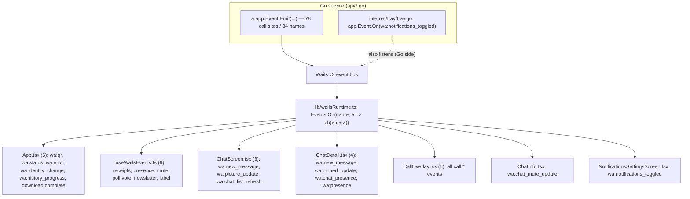

# Events: the loudspeaker between Go and React

> **In one line:** Go calls `a.app.Event.Emit(name, payload)` 78 times across 34 distinct names, the Wails v3 bus delivers them to `Events.On`, the shim hands the callback `event.data`, and every listener must unsubscribe on unmount.

## Why this page exists

The frontend never polls Go for "did something change?" — Go announces it. That makes the event name and its payload the contract between the two halves. But the contract is spread out: emit sites live in ten Go files, listeners live in seven frontend files, and a small shim rewrites the v3 callback shape. A newcomer who guesses a name or forgets that `event.data` is already unwrapped gets a listener that silently never fires.

This page is the index of that contract. It lists **all 34 emitted names**, their emit sites, their payload kind and their listeners. The exact fields of the envelopes are in [Payload shapes](payload-shapes.md); what the stores do with them is in [State and events](../02-components/state-and-events.md).

## The idea, in plain words

Think of the app as **a shop with a loudspeaker**:

- An **event** is the loudspeaker: Go shouts a name and an envelope into it. It does not know or care who is listening. A **binding** is the separate phone number you dial to ask Go to do something ([Wails bindings](wails-bindings.md)).
- A **payload** is the **contents of the envelope** — sometimes a bare string, sometimes a boolean, sometimes a `map[string]any`. Listening code must open the right kind of envelope.
- `wailsRuntime.ts` is the **translator at the speaker**: v3 hands it a `WailsEvent` wrapper, and it passes only `event.data` to the React callback.



## The code, line by line

### 1. The shim defines the `event.data` contract

```ts
// frontend/src/lib/wailsRuntime.ts:1-18
/**
 * Compatibility shim for the legacy v2 runtime helpers used by the React UI.
 * Wails v3 exposes these through `@wailsio/runtime`, where event
 * callbacks receive a `WailsEvent` wrapper and `Events.On` returns its own
 * unsubscribe function.
 */
import { Browser, Events } from "@wailsio/runtime"

type EventCallback = (data: any) => void
type Unsubscribe = () => void

export function EventsOn(name: string, cb: EventCallback): Unsubscribe {
  return Events.On(name, (event) => cb(event.data))
}

export function BrowserOpenURL(url: string): Promise<void> {
  return Browser.OpenURL(url)
}
```

| Line | What it does |
|---|---|
| `wailsRuntime.ts:3-5` | States the reason for the shim: v3 wraps callbacks in `WailsEvent`. |
| `wailsRuntime.ts:7` | Imports `Events` and `Browser` from `@wailsio/runtime`. |
| `wailsRuntime.ts:9` | A callback receives one argument of type `any` — there is **no generated event payload type**. |
| `wailsRuntime.ts:10` | An unsubscribe is a zero-argument function returned by `Events.On`. |
| `wailsRuntime.ts:13` | The contract: `cb` gets `event.data`, not the wrapper. |
| `wailsRuntime.ts:17` | `BrowserOpenURL` is a separate v2-compatibility helper, not an event. |

So a `string` emit arrives as a `string` (`call:...` objects arrive as objects). Never write `event.data` inside a listener registered through this shim — that would be double unwrapping.

### 2. Every emitted name, with its source and listener

`Payload` uses the shorthand **str** (bare string), **bool** (bare boolean) and **obj** (`map[string]any`). A listener cell marked "none" means no `EventsOn(...)` for that name was found in `frontend/src` — the event still crosses the bridge.

| Event name | Go emit sites (`file:line`) | Payload | Frontend listener |
|---|---|---|---|
| `call:incoming` | `api/calls.go:101`, `:169` | obj | `CallOverlay.tsx:231` |
| `call:outgoing` | `api/calls.go:364` | obj | `CallOverlay.tsx:232` |
| `call:accepted` | `api/calls.go:314` | obj | `CallOverlay.tsx:233` |
| `call:ended` | `api/calls.go:157`, `:299` | obj | `CallOverlay.tsx:234` |
| `call:participant_added` | `api/calls.go:393` | obj | `CallOverlay.tsx:235` |
| `download:complete` | `api/media.go:621`, `:710` | str (absolute path) | `App.tsx:157` |
| `wa:appstate_sync_complete` | `api/api.go:883` | obj | none |
| `wa:chat_list_refresh` | 29 sites: `api.go:114,172,745,767,771,779,814,828,834,853,855,1077,1136`; `account.go:130,142,169`; `chat.go:59,78,237`; `channels.go:76`; `calls.go:512`; `groups_ext.go:70,169,190`; `message.go:973,998,1042`; `polls.go:415`; `privacy.go:234` | no payload | `ChatScreen.tsx:1139` |
| `wa:chat_mute_update` | `api/notifications.go:50`, `:102` | obj | `useWailsEvents.ts:66`; `ChatInfo.tsx:176` |
| `wa:chat_presence` | `api/api.go:857` | obj | `useWailsEvents.ts:34`; `ChatDetail.tsx:769` |
| `wa:connection_stable` | `api/api.go:908` | no payload | none |
| `wa:connection_unstable` | `api/api.go:902` | obj | none |
| `wa:error` | `api/api.go:238`, `:243` (the `emitError` helper at `:241`, called at `:149,161,374,797,811,837,889,921,925`) | str | `App.tsx:171` |
| `wa:history_progress` | `api/api.go:1094`, `:1127` | obj | `App.tsx:195` |
| `wa:identity_change` | `api/api.go:867` | str (security warning) | `App.tsx:178` |
| `wa:label_chat` | `api/api.go:753` | obj | `useWailsEvents.ts:123` |
| `wa:label_edit` | `api/api.go:748` | obj | none |
| `wa:label_message` | `api/api.go:759` | obj | none |
| `wa:logged_out` | `api/api.go:916` (comment calls it "legacy listeners") | no payload | none |
| `wa:message_receipt` | `api/api.go:841` | obj | `useWailsEvents.ts:13` |
| `wa:new_message` | `api/api.go:671`, `:713`; `api/message.go:586`, `:866`, `:941`; `api/polls.go:406` | obj | `ChatScreen.tsx:1068`; `ChatDetail.tsx:728` |
| `wa:newsletter_joined` | `api/api.go:766` | str (JID) | `useWailsEvents.ts:95` |
| `wa:newsletter_left` | `api/api.go:770` | str (JID) | `useWailsEvents.ts:100` |
| `wa:newsletter_update` | `api/api.go:774` | obj | `useWailsEvents.ts:105` |
| `wa:notifications_toggled` | `api/notifications.go:26` | bool | `NotificationsSettingsScreen.tsx:76`; also `internal/tray/tray.go:82` (Go-side `app.Event.On`) |
| `wa:picture_update` | `api/api.go:727` | str (JID) | `ChatScreen.tsx:1117` |
| `wa:pinned_update` | `api/message.go:801` | obj | `ChatDetail.tsx:145` |
| `wa:poll_vote_submitted` | `api/polls.go:175` | obj | `useWailsEvents.ts:75` |
| `wa:poll_vote_update` | `api/polls.go:396` | obj | none |
| `wa:presence` | `api/api.go:872` | obj | `useWailsEvents.ts:44`; `ChatDetail.tsx:778` |
| `wa:privacy_settings_changed` | `api/api.go:733` | obj | none |
| `wa:push_name_changed` | `api/api.go:898` | str | none |
| `wa:qr` | `api/api.go:621` | str (QR code) | `App.tsx:118` |
| `wa:status` | `api/api.go:205`, `:237`, `:623`, `:636`, `:917`; `api/auth.go:114` | str | `App.tsx:126` |

There are **29 frontend `EventsOn` registrations** across `App.tsx` (6), `useWailsEvents.ts` (9), `ChatDetail.tsx` (4), `ChatScreen.tsx` (3), `CallOverlay.tsx` (5), `ChatInfo.tsx` (1) and `NotificationsSettingsScreen.tsx` (1), covering **25 distinct names**. The remaining nine emitted names have no frontend listener.

### 3. Media events that actually exist

Only one media-related event is emitted: `download:complete` (`api/media.go:621`, `:710`), carrying the saved file path as a string. There is **no** `media:*` event in the current code:

```go
// api/media.go:675-679
	// Stream the decrypted payload straight into the temp file. The previous
	// "media:download_progress" emits were removed (D-AUD-003e): no frontend
	// listener consumes that event, so it was orphaned IPC traffic with an
	// inconsistent total. "download:complete" below is kept intact.
	if dlErr := a.waClient.DownloadToFile(a.ctx, msg.Media, tmp); dlErr != nil {
```

| Line | What it does |
|---|---|
| `media.go:676-678` | Records that `media:download_progress` was deliberately removed; do not re-add it based on older notes. |
| `media.go:710` | The surviving emit: `download:complete` with the final file path. |

### 4. The unsubscribe pattern

Every `EventsOn` call returns a function, and every listener stores it and calls it during `useEffect` cleanup.

```ts
// frontend/src/hooks/useWailsEvents.ts:137-148
    return () => {
      unsubReceipt()
      unsubChatPresence()
      unsubPresence()
      unsubMuteUpdate()
      unsubPollVote()
      unsubNewsletterJoined()
      unsubNewsletterLeft()
      unsubNewsletterUpdate()
      unsubLabelChat()
    }
  }, [addNotification])
```

```ts
// frontend/src/components/chat/CallOverlay.tsx:231-243
    const offIncoming = EventsOn("call:incoming", onIncoming)
    const offOutgoing = EventsOn("call:outgoing", onOutgoing)
    const offAccepted = EventsOn("call:accepted", onAccepted)
    const offEnded = EventsOn("call:ended", onEnded)
    const offParticipantAdded = EventsOn("call:participant_added", onParticipantAdded)

    return () => {
      offIncoming()
      offOutgoing()
      offAccepted()
      offEnded()
      offParticipantAdded()
    }
```

| Line | What it does |
|---|---|
| `useWailsEvents.ts:137` | The effect's cleanup closes over all nine unsubscribe functions. |
| `useWailsEvents.ts:138-146` | Calling each one detaches that listener on unmount or dependency change. |
| `CallOverlay.tsx:231-235` | Five call listeners are registered together. |
| `CallOverlay.tsx:237-242` | All five are detached together; a leak here would double-handle later calls. |

`App.tsx:227-235` does the same for its six listeners, and the registration order matters:

```ts
// frontend/src/App.tsx:186-188
    // Register all status listeners before starting login. Existing sessions
    // can complete quickly enough to otherwise lose the "logged_in" event.
    if (!loginStartedRef.current) {
```

| Line | What it does |
|---|---|
| `App.tsx:186-187` | Comment explains why listeners are installed before `Login()` is called. |
| `App.tsx:188` | The ref prevents duplicate login across re-renders. |

## What can go wrong

> **An event name is a string, so TypeScript cannot catch a typo.** `EventsOn("wa:new_mesage", ...)` compiles and never fires. Check the name against the table above or the emit site.

> **Nine emitted events have no frontend listener.** `wa:appstate_sync_complete`, `wa:connection_stable`, `wa:connection_unstable`, `wa:label_edit`, `wa:label_message`, `wa:logged_out`, `wa:poll_vote_update`, `wa:privacy_settings_changed` and `wa:push_name_changed` are real emits with no `EventsOn` in `frontend/src`. They may be intended for future features; do not invent a listener description for them.

> **The same name can carry different shapes.** `wa:new_message` has six emit sites with different key sets, and `call:incoming` has two. Read the right emit site before typing a callback; see [Payload shapes](payload-shapes.md).

> **Legacy payload keys still appear in listeners.** `useWailsEvents.ts:17-23,53-61,107-113,126-129` accepts both the current backend keys and older variants. If you add a field, keep the fallback branch working.

> **Forgetting to unsubscribe duplicates work.** A second mount without cleanup means two callbacks per announcement — for example two unread increments or two call overlays.

> **Register before you trigger.** `App.tsx:186-187` exists because a quick existing-session login can emit `wa:status` before a late listener is attached.

> **The frontend handles a value Go does not emit.** `App.tsx:128` accepts `status === "success"` as logged-in, but no Go emit site sends that value; treat it as a legacy branch, not a contract.

> **No `media:*` progress event exists.** `media:download_progress` was removed intentionally (`media.go:676-678`). Do not design UI around it.

## Where to next

- [Payload shapes](payload-shapes.md) — the exact keys and types inside these envelopes.
- [Wails bindings](wails-bindings.md) — the other direction: request/response calls into Go.
- [State and events](../02-components/state-and-events.md) — the Zustand stores each listener updates.
- [Message pipeline](../02-components/message-pipeline.md) — how `wa:new_message` fits into the live and history paths.
- [Data flow](../01-architecture/data-flow.md) — the "event is a notification, database is the truth" rule.
- [Index](../index.md) — the full reading order.
