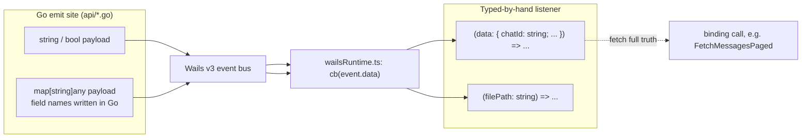

# Payload shapes: what is actually inside the envelope

> **In one line:** Every event payload is defined by its Go `Emit` call — a bare string, a bare boolean or a `map[string]any` — and the same event name can carry different key sets depending on which emit site fired.

## Why this page exists

The generated bindings give TypeScript a type for every method argument and result, but there are **no generated types for event payloads**. The shim types the callback argument as `any` (`frontend/src/lib/wailsRuntime.ts:9`), so a listener compiles no matter what it assumes about the payload. That is why guessing is dangerous here.

The authoritative source is the Go emit site. This page transcribes those sites field by field. Where the code does not explain what a value means, it says so instead of guessing.

## The idea, in plain words

Use the **postal** picture from the other integration pages:

- An **event** is the **loudspeaker** announcement: "a new message arrived".
- A **binding** is the **phone number into a Go function** you dial afterwards to fetch the full record.
- A **payload** is the **contents of the envelope** thrown with the announcement. Sometimes the envelope contains one sheet (a string); sometimes it contains a form with named boxes (`map[string]any`). Your listener has to read the right boxes.

The important habit: a name like `wa:new_message` does not define one shape. It is a **label on several envelopes**. Open the envelope at the emit site that produced it.



## The code, line by line

### 1. `wa:new_message` — six emit sites, six envelope shapes

This is the most important shape to get right, because both `ChatScreen` and `ChatDetail` listen to it.

```go
// api/api.go:671-678 — live incoming message
				a.app.Event.Emit("wa:new_message", map[string]any{
					"chatId":      v.Info.Chat.String(),
					"message":     updatedMsg,
					"messageText": parsedHTML, // Text field contains HTML now, but better than nothing or we can use updatedMsg.Text
					"timestamp":   v.Info.Timestamp.Unix(),
					"sender":      v.Info.PushName,
					"isFromMe":    v.Info.IsFromMe,
				})
```

| Line | What it does |
|---|---|
| `api.go:672` | `chatId` is the chat JID as a string. |
| `api.go:673` | `message` is the decoded row re-read from the store after `ProcessMessageEvent`; the emit only happens when that read succeeded (`api.go:668-670`). |
| `api.go:674` | `messageText` is `parsedHTML`; the inline comment says the field now contains HTML. |
| `api.go:675` | `timestamp` is `v.Info.Timestamp.Unix()` — Unix seconds. |
| `api.go:676` | `sender` is the raw push name from whatsmeow. |
| `api.go:677` | `isFromMe` mirrors whatsmeow's flag. |

```go
// api/api.go:713-720 — reaction to an existing message
				a.app.Event.Emit("wa:new_message", map[string]any{
					"chatId":      v.Info.Chat.String(),
					"message":     nil,
					"messageText": targetText,
					"reaction":    reaction.GetText(),
					"timestamp":   v.Info.Timestamp.Unix(),
					"sender":      senderName,
				})
```

| Line | What it does |
|---|---|
| `api.go:715` | `message` is explicitly `nil` — this envelope has no decoded message. |
| `api.go:716` | `messageText` is the **target** message's text, read from the store (`api.go:698-705`). |
| `api.go:717` | `reaction` is the emoji from `reaction.GetText()`. |
| `api.go:719` | `sender` is push name, falling back to `v.Info.Sender.User`, or `"You"` when `IsFromMe` (`api.go:705-711`). |

```go
// api/message.go:586-594 — local echo after SendMessage
	a.app.Event.Emit("wa:new_message", map[string]any{
		"chatId":       parsedJID.String(),
		"message":      msg,
		"clientTempId": content.ClientTempID,
		"messageText":  messageText,
		"parsedHTML":   parsedHTML,
		"timestamp":    resp.Timestamp.Unix(),
		"sender":       "You",
	})
```

| Line | What it does |
|---|---|
| `message.go:589` | `clientTempId` lets `ChatDetail` reconcile a pending optimistic row with the confirmed one (`ChatDetail.tsx:736-750`). |
| `message.go:590` | `messageText` is a short kind label derived at `message.go:550-565` (`image`, `gif`, `video`, `audio`, `document`, `sticker`, `message`, or text). |
| `message.go:591` | `parsedHTML` is the HTML rendering of the message text. |
| `message.go:593` | `sender` is the literal string `"You"`. |

```go
// api/message.go:866-873 — sendAndStoreLocal (polls, contact cards, forwards, locations)
	a.app.Event.Emit("wa:new_message", map[string]any{
		"chatId":      chat.String(),
		"message":     msg,
		"messageText": preview,
		"timestamp":   resp.Timestamp.Unix(),
		"sender":      "You",
		"isFromMe":    true,
	})
```

```go
// api/message.go:941-945 — edit / revoke / delete-for-me refresh
	a.app.Event.Emit("wa:new_message", map[string]any{
		"chatId":   chatJID,
		"message":  msg,
		"isFromMe": true,
	})
```

```go
// api/polls.go:406-413 — refreshed poll card
		a.app.Event.Emit("wa:new_message", map[string]any{
			"chatId":      chatJID,
			"message":     dm,
			"messageText": html,
			"timestamp":   pollTS.Unix(),
			"sender":      dm.Info.PushName,
			"pollUpdate":  true,
		})
```

**Field matrix.** A blank cell means the key is absent from that envelope, not that it is empty.

| Key | Type | Meaning | Live msg (`api.go:671`) | Reaction (`api.go:713`) | SendMessage (`message.go:586`) | `sendAndStoreLocal` (`message.go:866`) | Refresh (`message.go:941`) | Poll update (`polls.go:406`) |
|---|---|---|---|---|---|---|---|---|
| `chatId` | string | Chat JID | yes | yes | yes | yes | yes | yes |
| `message` | decoded message or `null` | The message row; `nil` in the reaction envelope | yes | `nil` | yes | yes | yes | yes |
| `messageText` | string | HTML text (live), target text (reaction), kind label (`SendMessage`), or preview (`sendAndStoreLocal`) | yes | yes | yes | yes | — | yes (HTML card) |
| `timestamp` | number | Unix seconds | yes | yes | yes | yes | — | yes |
| `sender` | string | Push name / fallback / `"You"` | yes | yes | `"You"` | `"You"` | — | yes |
| `isFromMe` | boolean | Own-message flag | yes | — | — | `true` | `true` | — |
| `reaction` | string | Emoji of the reaction | — | yes | — | — | — | — |
| `clientTempId` | string | Optimistic row id supplied by the frontend | — | — | yes | — | — | — |
| `parsedHTML` | string | HTML rendering of the sent text | — | — | yes | — | — | — |
| `pollUpdate` | boolean | Marks a re-rendered poll card | — | — | — | — | — | `true` |

### 2. `wa:status` — a bare string

```go
// api/api.go:620-624
				if evt.Event == "code" {
					a.app.Event.Emit("wa:qr", evt.Code)
				} else {
					a.app.Event.Emit("wa:status", evt.Event)
				}
```

| Emit site | Payload value | Meaning |
|---|---|---|
| `api/api.go:205` | `"reconnecting"` | Reconnect loop has started. |
| `api/api.go:237` | `"disconnected"` | All eight reconnect attempts failed. |
| `api/api.go:623` | `evt.Event` (raw whatsmeow QR-channel event name, for events other than `"code"`) | Possible values are meaning not documented in code. |
| `api/api.go:636` | `"logged_in"` | An existing session connected. |
| `api/api.go:917` | `"logged_out"` | Logged out from another device (paired with the legacy `wa:logged_out` emit at `:916`). |
| `api/auth.go:114` | `"logged_out"` | Explicit `Logout()` completed. |

The listener maps these to screens and toasts at `App.tsx:126-155`. `App.tsx:128` also accepts `"success"`, which no current Go emit site sends.

### 3. `wa:qr` and `wa:error` — bare strings

| Event | Emit site | Type | Meaning | Frontend use |
|---|---|---|---|---|
| `wa:qr` | `api/api.go:621` (`evt.Code`) | string | The QR code string from whatsmeow's QR channel; individual values are meaning not documented in code. | Drawn onto a canvas at `App.tsx:118-124`. |
| `wa:error` | `api/api.go:238` | string | `"Could not reconnect to WhatsApp after 8 attempts."` | Toast at `App.tsx:171-174`. |
| `wa:error` | `api/api.go:243` (`emitError`) | string | Whatever message the caller passed; examples are `"App state sync failed: …"` (`:149`), `"LID migration failed: …"` (`:811`), `"Disconnected from WhatsApp — reconnecting..."` (`:837`), `"Another device took over the connection"` (`:889`), `"Failed to connect to WhatsApp"` (`:921`), `"WhatsApp no longer supports this client — update the app"` (`:925`). | Toast; raw text is deliberately shown for this event. |

```go
// api/api.go:241-244
func (a *Api) emitError(msg string) {
	slog.Error(msg, "source", "app")
	a.app.Event.Emit("wa:error", msg)
}
```

| Line | What it does |
|---|---|
| `api.go:241` | One helper funnels every human-readable backend error into a single event name. |
| `api.go:243` | The payload is the message string itself — there is no error code field. |

### 4. `wa:history_progress` — two envelopes, one with `done`

```go
// api/api.go:1094-1100 — first emit, before the loop
	a.app.Event.Emit("wa:history_progress", map[string]any{
		"type":                   v.Data.GetSyncType().String(),
		"totalConversations":     totalConvs,
		"processedConversations": 0,
		"totalMessages":          0,
		"processedMessages":      0,
	})
```

```go
// api/api.go:1127-1134 — final emit, after the loop
	a.app.Event.Emit("wa:history_progress", map[string]any{
		"type":                   v.Data.GetSyncType().String(),
		"totalConversations":     totalConvs,
		"processedConversations": totalConvs,
		"totalMessages":          0,
		"processedMessages":      stored,
		"done":                   true,
	})
```

| Key | Type | Meaning | First emit | Final emit |
|---|---|---|---|---|
| `type` | string | `v.Data.GetSyncType().String()` — the whatsmeow sync type, not a counter (`App.tsx:210-211` names `INITIAL_BOOTSTRAP`, `FULL`, `RECENT`, … as examples) | yes | yes |
| `totalConversations` | number | Number of conversations in the history batch (`len(conversations)`, `api.go:1093`) | yes | yes |
| `processedConversations` | number | Conversations processed so far | `0` | `totalConvs` |
| `totalMessages` | number | Always `0` in both emits | yes (`0`) | yes (`0`) |
| `processedMessages` | number | Messages actually stored | `0` | `stored` |
| `done` | boolean | Completion marker | absent | `true` |

`App.tsx:195-225` treats `data.done` as "clear the progress UI" and otherwise prefers message counts when `totalMessages > 0`, falling back to conversation counts — with the current Go values, that fallback is always the one used.

### 5. `call:*` events — five names, all object envelopes

```go
// api/calls.go:101-107 — group incoming call
			a.app.Event.Emit("call:incoming", map[string]any{
				"callID":   offer.CallID,
				"peerJID":  peerJID,
				"isVideo":  isVideo,
				"isGroup":  true,
				"groupJID": groupJID,
			})
```

```go
// api/calls.go:169-174 — one-to-one incoming call
			a.app.Event.Emit("call:incoming", map[string]any{
				"callID":  call.ID(),
				"peerJID": call.Peer().String(),
				"isVideo": call.IsVideo(),
				"isGroup": false,
			})
```

| Event | Emit site | Key | Type | Meaning |
|---|---|---|---|---|
| `call:incoming` | `calls.go:101-107` (group) | `callID` | string | `offer.CallID` from the whatsmeow `CallOffer`. |
| | | `peerJID` | string | The call's canonical peer JID, patched in the group offer handler (`calls.go:87-97`). |
| | | `isVideo` | boolean | From the tracked `ActiveCall` (`calls.go:96`). |
| | | `isGroup` | boolean | Literal `true`. |
| | | `groupJID` | string | `offer.GroupJID.String()`. |
| `call:incoming` | `calls.go:169-174` (1:1) | `callID`, `peerJID`, `isVideo` | string, string, boolean | From the meowcaller `Call`. |
| | | `isGroup` | boolean | Literal `false`; there is **no** `groupJID` key. |
| `call:outgoing` | `calls.go:364-370` | `callID` | string | `call.ID()`. |
| | | `peerJID` | string | Target JID passed to `MakeCall`/`MakeGroupCall`. |
| | | `isVideo` | boolean | Literal `false`. |
| | | `isGroup` | boolean | `isGroup` from `trackOutgoingCall`. |
| | | `groupJID` | string | Group JID; empty string for 1:1 calls. |
| `call:accepted` | `calls.go:314-316` | `callID` | string | The outbound call the peer accepted. |
| `call:ended` | `calls.go:157-160`, `:299-302` | `callID` | string | The call that ended. |
| | | `reason` | string | The value meowcaller passes to `OnEnd`; possible values are meaning not documented in code. |
| `call:participant_added` | `calls.go:393-396` | `callID` | string | The established call. |
| | | `targetJID` | string | The invited user's JID. |

`CallOverlay.tsx:145-229` reads exactly these keys; it then calls `GetCallStats` for the authoritative group roster size rather than incrementing a local counter.

### 6. `download:complete` — a bare file path

```go
// api/media.go:710-712
	a.app.Event.Emit("download:complete", filePath)
	_ = beeep.Notify("amazingwhats", "Downloaded: "+filePath, "")
	playBeep()
```

| Line | What it does |
|---|---|
| `media.go:710` | The payload is the final absolute path chosen by the save dialog and written to disk. |
| `media.go:621` | The other emit site (`DownloadImageToFile`) emits the same kind of path string. |
| `App.tsx:157-164` | The listener takes only the basename so a full path (and username) never appears in a toast. |

### 7. Other map payloads, for completeness

Transcribed from their emit sites; no fields have been added.

| Event | Keys (all from the cited Go lines) |
|---|---|
| `wa:message_receipt` (`api.go:841-845`) | `chatId`, `status`, `messageIDs` |
| `wa:chat_presence` (`api.go:857-861`) | `chatId`, `state`, `media` |
| `wa:presence` (`api.go:872-876`) | `jid`, `unavailable`, `lastSeen` |
| `wa:privacy_settings_changed` (`api.go:733-741`) | `groupAddChanged`, `lastSeenChanged`, `statusChanged`, `profileChanged`, `readReceiptsChanged`, `onlineChanged`, `callAddChanged` |
| `wa:label_edit` (`api.go:748-750`) | `labelId` |
| `wa:label_chat` (`api.go:753-756`) | `jid`, `labelId` |
| `wa:label_message` (`api.go:759-763`) | `jid`, `labelId`, `messageId` |
| `wa:newsletter_update` (`api.go:774-776`) | `jid` |
| `wa:appstate_sync_complete` (`api.go:883-885`) | `name` |
| `wa:connection_unstable` (`api.go:902-904`) | `errorCount` |
| `wa:chat_mute_update` (`notifications.go:50-53`, `:102-105`) | `chatId`, `muted` |
| `wa:poll_vote_submitted` (`polls.go:175-179`) | `chatId`, `messageID`, `options` |
| `wa:poll_vote_update` (`polls.go:396-399`) | `chatId`, `messageID` |
| `wa:pinned_update` (`message.go:801`) | `chatId` |

Bare payloads: `wa:picture_update`, `wa:newsletter_joined`, `wa:newsletter_left` carry a JID string; `wa:identity_change` and `wa:push_name_changed` carry strings; `wa:notifications_toggled` carries a boolean (`notifications.go:26`); `wa:chat_list_refresh`, `wa:logged_out`, `wa:connection_stable` carry no payload.

## What can go wrong

> **One event name, many shapes.** `wa:new_message` has six emit envelopes and `call:incoming` has two. Always find the emit site that produced the event you are handling; a field present in one variant may be absent in another.

> **`message` is sometimes `nil`.** The reaction envelope sets it explicitly (`api.go:715`). `ChatDetail.tsx:731` guards on `data.message?.Info?.ID` for exactly this reason.

> **There are no generated event types.** The shim types `data` as `any` (`wailsRuntime.ts:9`). Hand-written listener types can drift silently; keep them in step with the Go emit keys.

> **Do not invent a field because a toast needs one.** `wa:newsletter_update` carries only `jid` (`api.go:774-776`); the Go comment at `:777-778` says the live-update event has no name or metadata, which is why `wa:chat_list_refresh` is emitted alongside it.

> **`totalMessages` is always `0` today.** Both history emits send that key as zero (`api.go:1098`, `:1131`). Code that keys progress off it will show nothing; the frontend deliberately falls back to conversation counts (`App.tsx:215-220`).

> **Raw strings can contain sensitive data.** `download:complete` includes a full filesystem path and `wa:identity_change` includes a JID, so the frontend shows a basename (`App.tsx:157-164`) and a fixed warning text (`App.tsx:178-184`) instead of the raw value.

> **"Meaning not documented in code" is not a gap to fill with a guess.** For `call:ended.reason` and the raw `wa:status`/`wa:qr` values, the possible values depend on whatsmeow/meowcaller pass in; check those libraries before asserting anything.

## Where to next

- [Events](events.md) — all 34 emitted names, their emit sites and listeners.
- [Wails bindings](wails-bindings.md) — typed request/response calls, including `GetCallStats` used to resolve roster sizes.
- [Chat UI](../02-components/chat-ui.md) — how `CallOverlay` and the message list render these envelopes.
- [Data flow](../01-architecture/data-flow.md) — why the event is a notification and the store is the truth.
- [Vocabulary](../00-start-here/vocabulary.md) — JID, LID, PN and other terms used in the field meanings.
- [Index](../index.md) — the full reading order.
