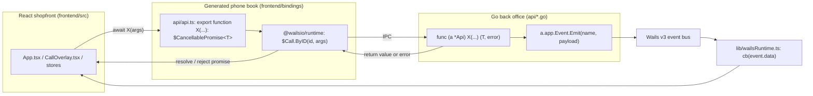

# Wails bindings: phone numbers into Go functions

> **In one line:** A binding is a generated TypeScript function that dials one exported Go method through the Wails v3 runtime; this app has no public HTTP API, so these functions and the event bus are its entire integration surface.

## Why this page exists

There is no REST endpoint to curl in this project. When React needs to log in, send a message, download media or end a call, it calls a **generated function** whose body is a single call into `@wailsio/runtime`. Those functions are not hand-written and must not be hand-edited; they are regenerated from the Go service.

Two facts cause most newcomer mistakes here:

1. The generated file lives under `frontend/bindings/`, not the old v2 `frontend/wailsjs/` path.
2. The Go source and the generated TypeScript are **not** textually identical. A Go `error` becomes a rejected `$CancellablePromise<void>`; a Go `context.Context` parameter disappears from the JS signature. If you read only one side, you will mis-state the contract.

This page gives you both sides for a representative set of real methods. For the other half of the bridge — Go shouting back at React — read [Events](events.md).

## The idea, in plain words

Picture the Go service as a **back office** and React as a **shopfront**:

- A **binding** is a **phone number you dial into a Go function**. You do not know how the call is routed, and you do not need to. The generated file is the phone book: one number (`$Call.ByID(...)`) per exported method.
- An **event** is a **loudspeaker** in the back office. Go announces something happened; nobody in the shop has to poll or ask.
- A **payload** is the **contents of the envelope** passed with the announcement or returned by the phone call. Its exact fields are what [Payload shapes](payload-shapes.md) records.

Dialling is **not** the same as announcing. A binding is a request/response call you `await`; an event is a broadcast you subscribe to and later unsubscribe from.



## The code, line by line

### 1. How the bindings are produced

The task that regenerates them is in `build/Taskfile.yml`, and CI re-runs the command and fails if the tracked output changed.

```yaml
// build/Taskfile.yml:45-60
  generate:bindings:
    label: generate:bindings (BUILD_FLAGS={{.BUILD_FLAGS}})
    summary: Generates TypeScript bindings into frontend/bindings
    deps:
      - task: go:mod:tidy
    sources:
      - "**/*.[jt]s"
      - exclude: frontend/**/*
      - frontend/bindings/**/*
      - "**/*.go"
      - go.mod
      - go.sum
    generates:
      - frontend/bindings/**/*
    cmds:
      - wails3 generate bindings -f '{{.BUILD_FLAGS}}' -clean=true -ts
```

```yaml
// .github/workflows/build.yaml:47-50
      - name: Verify generated bindings are current
        run: |
          wails3 generate bindings -ts
          git diff --exit-code -- frontend/bindings
```

| Line | What it does |
|---|---|
| `build/Taskfile.yml:45` | Declares the `generate:bindings` task. |
| `build/Taskfile.yml:47` | States the output directory: `frontend/bindings`. |
| `build/Taskfile.yml:50-56` | Any Go source, `go.mod`, `go.sum` or non-frontend JS change makes the task out of date. |
| `build/Taskfile.yml:57-58` | Declares `frontend/bindings/**/*` as generated output. |
| `build/Taskfile.yml:60` | The actual command: `wails3 generate bindings ... -clean=true -ts` (`-ts` = TypeScript). |
| `build.yaml:49` | CI regenerates with `wails3 generate bindings -ts`. |
| `build.yaml:50` | `git diff --exit-code -- frontend/bindings` fails the build if regeneration changed a file. |

**Regeneration rules:** never edit a file under `frontend/bindings/` by hand (the header says so), change the Go method instead and regenerate, and do not commit a Go signature change without the matching generated diff. A stale binding is a CI failure, not a runtime warning.

### 2. What the generated file looks like

```ts
// frontend/bindings/github.com/lugvitc/whats4linux/api/api.ts:1-25
// Cynhyrchwyd y ffeil hon yn awtomatig. PEIDIWCH Â MODIWL
// This file is automatically generated. DO NOT EDIT

/**
 * Api struct
 * @module
 */

// eslint-disable-next-line @typescript-eslint/ban-ts-comment
// @ts-ignore: Unused imports
import { Call as $Call, CancellablePromise as $CancellablePromise, Create as $Create } from "@wailsio/runtime";

// eslint-disable-next-line @typescript-eslint/ban-ts-comment
// @ts-ignore: Unused imports
import * as store$0 from "../internal/store/models.js";
// ...
import * as wa$0 from "../internal/wa/models.js";
import * as types$0 from "../../../../go.mau.fi/whatsmeow/types/models.js";
import * as $models from "./models.js";
```

| Line | What it does |
|---|---|
| `api.ts:1-2` | Welsh then English: the file is generated; do not modify it. |
| `api.ts:11` | Imports `Call`, `CancellablePromise` and `Create` from `@wailsio/runtime` (v3's runtime package). |
| `api.ts:15-21` | Imports generated model types from sibling packages (`store`, `wa`, whatsmeow). |
| `api.ts:25` | Imports the `models.ts` file that defines this package's result/argument classes. |

A whole binding is usually two lines. Here is `AcceptCall` on both sides:

```go
// api/calls.go:179-181
// AcceptCall accepts an incoming call by ID
func (a *Api) AcceptCall(callID string) error {
```

```ts
// frontend/bindings/github.com/lugvitc/whats4linux/api/api.ts:27-32
/**
 * AcceptCall accepts an incoming call by ID
 */
export function AcceptCall(callID: string): $CancellablePromise<void> {
    return $Call.ByID(1796833829, callID);
}
```

| Line | What it does |
|---|---|
| `calls.go:180` | Exported Go method: name and `callID string` become the JS function's name and argument. |
| `calls.go:180` | Go's sole return is `error`; there is no data result. |
| `api.ts:30` | JS signature: `callID: string`, returns `$CancellablePromise<void>`. |
| `api.ts:31` | `1796833829` is the generated call ID; `callID` is forwarded as the argument. |
| `api.ts:28-29` | The Go doc comment is carried across verbatim into the generated JSDoc. |

### 3. Exact signatures, by domain

All TypeScript lines below are copied from `api.ts`; all Go lines from `api/*.go`. `void` in TypeScript means "the Go method returns only `error`".

**Auth and connection**

| TS signature (`api.ts`) | Go signature | What it returns to the caller |
|---|---|---|
| `Login(): $CancellablePromise<void>` (:520) | `func (a *Api) Login() error` (`api.go:563`) | Nothing; resolves when the QR loop ends or the existing session connects. |
| `Logout(): $CancellablePromise<void>` (:524) | `func (a *Api) Logout() error` (`auth.go:79`) | Nothing; also emits `wa:status` `"logged_out"` (`auth.go:114`). |
| `PairPhone(phone: string): $CancellablePromise<string>` (:585) | `func (a *Api) PairPhone(phone string) (string, error)` (`auth.go:36`) | The 8-digit pairing code. |
| `IsLoggedIn(): $CancellablePromise<boolean>` (:502) | `func (a *Api) IsLoggedIn() bool` (`client.go:13`) | Connected-and-authenticated flag. |
| `WaitForConnection(timeoutSeconds: number): $CancellablePromise<boolean>` (:935) | `func (a *Api) WaitForConnection(timeoutSeconds int) bool` (`client.go:65`) | `true` if the client connected before the timeout. |
| `ConnectWithContext(): $CancellablePromise<void>` (:73) | `func (a *Api) ConnectWithContext(ctx context.Context) error` (`client.go:90`) | Nothing. Note the Go `ctx` parameter does **not** appear in the TS signature. |

**Messages**

| TS signature (`api.ts`) | Go signature | What it returns to the caller |
|---|---|---|
| `SendMessage(chatJID: string, content: $models.MessageContent): $CancellablePromise<string>` (:698) | `func (a *Api) SendMessage(chatJID string, content MessageContent) (string, error)` (`message.go:258`) | The new message ID. |
| `FetchMessagesPaged(jid: string, limit: number, beforeTimestamp: number, beforeMessageID: string): $CancellablePromise<store$0.DecodedMessage[]>` (:168) | `func (a *Api) FetchMessagesPaged(jid string, limit int, beforeTimestamp int64, beforeMessageID string) ([]store.DecodedMessage, error)` (`message.go:115`) | A page of decoded messages. |
| `EditMessage(chatJID: string, messageID: string, newText: string): $CancellablePromise<string>` (:145) | `func (a *Api) EditMessage(chatJID, messageID, newText string) (string, error)` (`message.go:950`) | The edited message ID. |
| `RevokeMessage(chatJID: string, messageID: string): $CancellablePromise<void>` (:658) | `func (a *Api) RevokeMessage(chatJID, messageID string) error` (`message.go:981`) | Nothing. |
| `GenerateMessageID(): $CancellablePromise<string>` (:192) | `func (a *Api) GenerateMessageID() string` (`client.go:32`) | A random ID usable with `SendMessage`. |

**Media**

| TS signature (`api.ts`) | Go signature | What it returns to the caller |
|---|---|---|
| `DownloadMedia(chatJID: string, messageID: string): $CancellablePromise<string>` (:123) | `func (a *Api) DownloadMedia(chatJID string, messageID string) (string, error)` (`media.go:130`) | A path/result string. |
| `DownloadMediaToFile(messageID: string): $CancellablePromise<void>` (:133) | `func (a *Api) DownloadMediaToFile(messageID string) error` (`media.go:640`) | Nothing; emits `download:complete` with the chosen path. |
| `GetCachedImage(messageID: string): $CancellablePromise<string>` (:236) | `func (a *Api) GetCachedImage(messageID string) (string, error)` (`media.go:199`) | A cached image string. |
| `GetCachedImages(messageIDs: string[]): $CancellablePromise<{ [_ in string]?: string }>` (:245) | `func (a *Api) GetCachedImages(messageIDs []string) (map[string]string, error)` (`media.go:215`) | A string-keyed map. |
| `GetImageThumbnail(messageID: string): $CancellablePromise<string>` (:339) | `func (a *Api) GetImageThumbnail(messageID string) string` (`media.go:99`) | A small JPEG preview string. |

**Calls**

| TS signature (`api.ts`) | Go signature | What it returns to the caller |
|---|---|---|
| `MakeCall(targetJID: string): $CancellablePromise<void>` (:531) | `func (a *Api) MakeCall(targetJID string) error` (`calls.go:232`) | Nothing; emits `call:outgoing`. |
| `MakeGroupCall(groupJID: string): $CancellablePromise<void>` (:538) | `func (a *Api) MakeGroupCall(groupJID string) error` (`calls.go:248`) | Nothing; emits `call:outgoing` with `isGroup: true`. |
| `AcceptCall(callID: string): $CancellablePromise<void>` (:30) | `func (a *Api) AcceptCall(callID string) error` (`calls.go:180`) | Nothing; starts the audio bridge. |
| `RejectCall(callID: string): $CancellablePromise<void>` (:612) | `func (a *Api) RejectCall(callID string) error` (`calls.go:402`) | Nothing. |
| `EndCall(callID: string): $CancellablePromise<void>` (:152) | `func (a *Api) EndCall(callID string) error` (`calls.go:588`) | Nothing. |
| `AddCallParticipant(callID: string, targetJID: string): $CancellablePromise<void>` (:42) | `func (a *Api) AddCallParticipant(callID, targetJID string) error` (`calls.go:378`) | Nothing; emits `call:participant_added`. |
| `GetCallStats(callID: string): $CancellablePromise<$models.CallStats | null>` (:254) | `func (a *Api) GetCallStats(callID string) (*CallStats, error)` (`calls.go:516`) | Diagnostic stats, or `null` when absent. |

**Settings**

| TS signature (`api.ts`) | Go signature | What it returns to the caller |
|---|---|---|
| `GetSettings(): $CancellablePromise<{ [_ in string]?: any }>` (:458) | `func (a *Api) GetSettings() map[string]any` (`misc.go:41`) | The settings map. |
| `SaveSettings(s: { [_ in string]?: any }): $CancellablePromise<void>` (:662) | `func (a *Api) SaveSettings(s map[string]any) error` (`misc.go:37`) | Nothing. |
| `GetNotificationsEnabled(): $CancellablePromise<boolean>` (:401) | `func (a *Api) GetNotificationsEnabled() bool` (`notifications.go:13`) | The global notification switch. |
| `SetNotificationsEnabled(enabled: boolean): $CancellablePromise<void>` (:808) | `func (a *Api) SetNotificationsEnabled(enabled bool) error` (`notifications.go:21`) | Nothing; emits `wa:notifications_toggled`. |
| `GetCustomCSS(): $CancellablePromise<string>` (:306) | `func (a *Api) GetCustomCSS() string` (`misc.go:17`) | User CSS text. |
| `SetCustomCSS(css: string): $CancellablePromise<void>` (:734) | `func (a *Api) SetCustomCSS(css string) error` (`misc.go:21`) | Nothing. |
| `SetProxy(proxyURL: string): $CancellablePromise<void>` (:821) | `func (a *Api) SetProxy(proxyURL string) error` (`account.go:41`) | Nothing. |

The generated file currently exports **144** `export function` declarations; the tables above are a representative cross-section, not the whole phone book.

### 4. How the frontend imports and calls them

```ts
// frontend/src/App.tsx:2
import { Login, GetCustomCSS, GetCustomJS, SetWindowFocused } from "../bindings/github.com/lugvitc/whats4linux/api/api.js"
```

```ts
// frontend/src/App.tsx:186-193
    // Register all status listeners before starting login. Existing sessions
    // can complete quickly enough to otherwise lose the "logged_in" event.
    if (!loginStartedRef.current) {
      loginStartedRef.current = true
      // Never render a raw backend error: it can contain proxy URLs with credentials
      // or filesystem paths. Details stay in the backend logs only.
      void Login().catch(() => setStatus("error: Unable to sign in. Please try again."))
    }
```

```ts
// frontend/src/components/chat/CallOverlay.tsx:11-13
} from "../../../bindings/github.com/lugvitc/whats4linux/api/api.js"
import { GetCachedAvatar } from "../../../bindings/github.com/lugvitc/whats4linux/api/api.js"
import type * as api from "../../../bindings/github.com/lugvitc/whats4linux/api/models.js"
```

| Line | What it does |
|---|---|
| `App.tsx:2` | Imports named call functions from the generated `.js` path (TypeScript resolves the sibling `.ts`/`.d.ts`). |
| `App.tsx:188-190` | Guards with a ref so React re-renders do not start login twice. |
| `App.tsx:192` | `void` marks the promise as intentionally un-awaited; `.catch()` replaces a raw Go error with a safe UI message. |
| `CallOverlay.tsx:11-13` | Relative paths differ by folder depth; the generated `models.js` is imported separately for types. |

### 5. Cancellation and promise behaviour

Every exported function returns a `$CancellablePromise<T>`, because every binding body is a `$Call.ByID(...)` call. The runtime wrapper is a thenable, so the codebase uses `await` and `.catch()`; a Go `error` rejects the promise rather than returning a value.

```ts
// frontend/bindings/github.com/lugvitc/whats4linux/api/api.ts:69-75
/**
 * ConnectWithContext connects to WhatsApp using the provided context.
 * This allows the caller to cancel the connection attempt.
 */
export function ConnectWithContext(): $CancellablePromise<void> {
    return $Call.ByID(1215680988);
}
```

| Line | What it does |
|---|---|
| `api.ts:70-71` | The generated JSDoc repeats the Go comment: the context is the cancellation hook. |
| `api.ts:73` | The JS signature has **no** `ctx` argument — Wails supplies it. Do not try to pass one. |
| `api.ts:74` | No arguments are forwarded; the call is identified only by its numeric ID. |

A search of `frontend/src` finds **no** `.cancel()` call sites: this UI always awaits or catches a binding. Treat cancellation as a capability of the runtime wrapper, not as a pattern currently used by the app. Also note the numeric IDs in `$Call.ByID(...)` are generated internals — do not copy them into application code.

## What can go wrong

> **Stale bindings are the number-one failure.** Changing a Go signature without regenerating means TypeScript still describes the old call; CI fails at `git diff --exit-code -- frontend/bindings` (`build.yaml:47-50`, `build/Taskfile.yml:62-67`).

> **Do not edit `api.ts`, `models.ts` or `index.ts`.** They start with "This file is automatically generated. DO NOT EDIT" (`api.ts:1-2`). The next regeneration overwrites your change.

> **Go parameters are not always JS parameters.** `ConnectWithContext(ctx context.Context)` becomes `ConnectWithContext()` (`client.go:90` vs `api.ts:73`). `DeleteMedia(directPath, _, fileEncSHA256, _ string)` becomes `DeleteMedia(directPath: string, $1: string, fileEncSHA256: string, $3: string)` with generated placeholder names (`account.go:111`, `api.ts:108`). Read the generated file before writing the call.

> **A binding is not a synchronous function.** Calling `GetSettings()` without `await` yields a promise, not settings. Conversely, `void Login().catch(...)` (`App.tsx:192`) is deliberate: the UI listens for `wa:status` instead of using the return value.

> **Errors do not cross as Go errors.** The generated return type only says `$CancellablePromise<T>`; the frontend must guard with `.catch()` and must not surface raw backend text to the user (`App.tsx:190-192`).

> **Do not import from `frontend/wailsjs/`.** That is the v2 path. This repo imports from `frontend/bindings/...` (`App.tsx:2`) and regenerates with `-ts`.

## Where to next

- [Events](events.md) — the other half of the bridge: every name Go emits and who listens.
- [Payload shapes](payload-shapes.md) — the exact envelope contents carried by those events.
- [State and events](../02-components/state-and-events.md) — what the frontend stores do with the announcements.
- [System map](../01-architecture/system-map.md) — where the service, window and generated bindings sit in the boot graph.
- [Quickstart](../00-start-here/quickstart.md) — the tool versions and the regeneration command in context.
- [Index](../index.md) — the full reading order.
