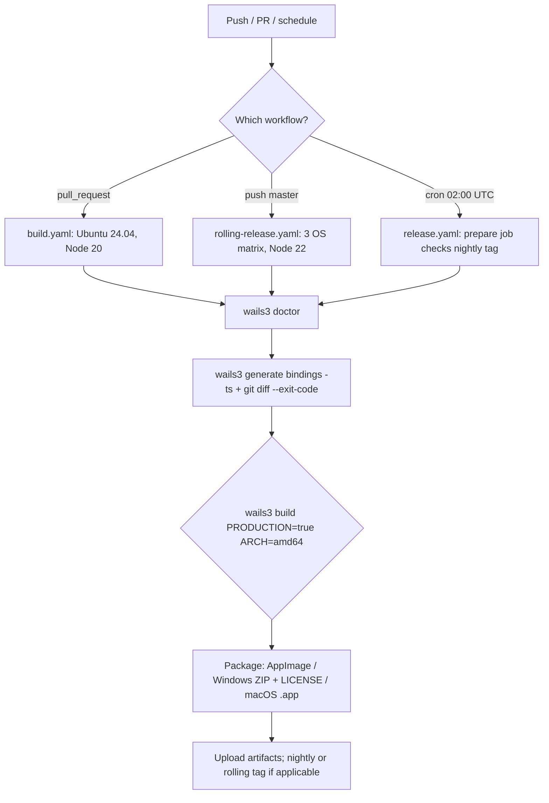

# Build and run: the exact tasks, tools, and gates

> **In one line:** The `wails3` CLI reads the Taskfiles in this repo, so you should run `wails3 task dev`, `wails3 task build`, `wails3 task package`, and `wails3 task run` instead of inventing compiler commands — and the only full verifier is mother-only.

## Why this page exists

[Quickstart](../00-start-here/quickstart.md) gets you to a working toolchain. This page is the next layer: it explains *what the recipes actually do*, *where the outputs land*, and *which checks CI will run against your commit*. Every command, version, flag, and path below comes from a checked-in file. Where a number appears in more than one place and the places disagree, the disagreement is called out rather than smoothed over.

## The idea, in plain words

Think of the build system as a **restaurant kitchen**:

- **The ingredients** are the Go source, the React source under `frontend/`, and the icons under `build/`.
- **The recipe cards** are the Taskfiles (`Taskfile.yml`, `build/Taskfile.yml`, and one per platform). They list the steps in order: tidy modules, generate the callable bridge, build the frontend, then build the binary.
- **The head chef** is the `wails3` CLI. It reads the recipe cards. When you say `wails3 task build`, it looks at your OS and picks the matching card.
- **The three ovens** are Linux, macOS, and Windows. They share most ingredients but need different hardware: Linux needs GTK4 and WebKitGTK 6.0, Windows needs a C compiler for SQLite, and macOS pins a minimum OS version.
- **The health inspector** is CI. Before it accepts a build, it runs `wails3 doctor`, regenerates the bindings, and fails if the tracked output changed.
- **The final taste test** is `tools/verify_central.ps1`. It is deliberately reserved for the swarm mother — a worker agent must not run it.

The key habit: **ask the repo, not your memory**. If a flag is not in a file you can point to, do not type it.

## The code, line by line

These excerpts are the sources of truth for the commands on this page.

```yaml
# Taskfile.yml:5-14
includes:
  common: ./build/Taskfile.yml
  windows: ./build/windows/Taskfile.yml
  darwin: ./build/darwin/Taskfile.yml
  linux: ./build/linux/Taskfile.yml

vars:
  APP_NAME: amazingwhats
  BIN_DIR: bin
  VITE_PORT: '{{.WAILS_VITE_PORT | default 9245}}'
```

```yaml
# Taskfile.yml:16-35
tasks:
  build:
    summary: Builds the application
    cmds:
      - task: "{{OS}}:build"

  package:
    summary: Packages a production build of the application
    cmds:
      - task: "{{OS}}:package"

  run:
    summary: Runs the application
    cmds:
      - task: "{{OS}}:run"

  dev:
    summary: Runs the application in development mode
    cmds:
      - wails3 dev -config ./build/config.yml -port {{.VITE_PORT}}
```

```yaml
# build/config.yml:13-16,30-40
dev_mode:
  root_path: .
  log_level: warn
  debounce: 1000
  # ...
  executes:
    - cmd: wails3 task common:install:frontend:deps
      type: once
    - cmd: wails3 task common:dev:frontend
      type: background
    - cmd: go mod tidy
      type: blocking
    - cmd: wails3 task build
      type: blocking
    - cmd: wails3 task run
      type: primary
```

```yaml
# build/Taskfile.yml:45-67
  generate:bindings:
    label: generate:bindings (BUILD_FLAGS={{.BUILD_FLAGS}})
    summary: Generates TypeScript bindings into frontend/bindings
    deps:
      - task: go:mod:tidy
    sources:
      - "**/*.[jt]s"
      - exclude: frontend/**/*
      - frontend/bindings/**/*
      - "**/*.go"
      - go.mod
      - go.sum
    generates:
      - frontend/bindings/**/*
    cmds:
      - wails3 generate bindings -f '{{.BUILD_FLAGS}}' -clean=true -ts

  verify:bindings:
    summary: Regenerate bindings and fail if tracked output is stale (D-AUD-007f)
    deps:
      - task: generate:bindings
    cmds:
      - git diff --exit-code -- frontend/bindings
```

```yaml
# build/linux/Taskfile.yml:18-30
    cmds:
      - go build {{.BUILD_FLAGS}} -o "{{.OUTPUT}}"
    vars:
      DEFAULT_OUTPUT: '{{.BIN_DIR}}/{{.APP_NAME}}'
      OUTPUT: '{{.OUTPUT | default .DEFAULT_OUTPUT}}'
      LDFLAGS: '{{.LDFLAGS | default "-w -s"}}'
    env:
      GOOS: linux
      CGO_ENABLED: 1
      GOARCH: '{{.ARCH | default ARCH}}'
      PRODUCTION: '{{.PRODUCTION | default "false"}}'
```

```yaml
# build/windows/Taskfile.yml:30-35
    env:
      GOOS: windows
      # mattn/go-sqlite3 requires cgo; CI puts MSYS2 ucrt64 gcc on PATH.
      CGO_ENABLED: 1
      GOARCH: '{{.ARCH | default ARCH}}'
      PRODUCTION: '{{.PRODUCTION | default "false"}}'
```

```yaml
# .github/workflows/build.yaml:44-54
      - name: Verify Wails 3 toolchain
        run: wails3 doctor

      - name: Verify generated bindings are current
        run: |
          wails3 generate bindings -ts
          git diff --exit-code -- frontend/bindings

      - name: Build Wails app
        run: |
          wails3 build PRODUCTION=true ARCH=amd64
```

```yaml
# .github/workflows/release.yaml:12-17,37-40
# D-AUD-009a: nightly status is derived inline from github.event_name at each
# use site. Never read it from a string-valued env var: "false" is truthy in
# expression && chains and would stamp manual runs as nightly.
concurrency:
  group: release-nightly
  cancel-in-progress: false
# ...
          if [ "${{ github.event_name }}" != "schedule" ]; then
            echo "should_build=true" >> "$GITHUB_OUTPUT"
            exit 0
          fi
```

| Line | What it does |
|---|---|
| `Taskfile.yml:5-9` | Pulls in the shared recipe card and one card per OS. This is why `wails3 task build` works without naming a platform. |
| `Taskfile.yml:12-14` | Sets `APP_NAME=amazingwhats`, `BIN_DIR=bin`, and a dev port defaulting to `9245` (overridable via the Task variable `WAILS_VITE_PORT`). |
| `Taskfile.yml:20` | `build` dispatches to `{{OS}}:build` — the current OS decides which card runs. |
| `Taskfile.yml:35` | The real dev command: `wails3 dev -config ./build/config.yml -port 9245`. |
| `build/config.yml:31-40` | The dev pipeline: install deps once, start the frontend dev server in the background, tidy modules, build, then run the primary app. |
| `build/Taskfile.yml:60` | Generates TypeScript bindings with `-clean=true -ts`. |
| `build/Taskfile.yml:67` | The freshness gate: regenerate, then `git diff --exit-code -- frontend/bindings` fails the task if tracked bindings changed. |
| `build/Taskfile.yml:69-72` | Records why legacy v2 NSIS assets are kept: the AGPL license page in `project.nsi` must stay until a v3 NSIS path is regenerated and verified. |
| `build/linux/Taskfile.yml:19` | The final compile step: `go build {{.BUILD_FLAGS}} -o "{{.OUTPUT}}"`. |
| `build/linux/Taskfile.yml:23-24` | Default output path is `bin/amazingwhats`. |
| `build/linux/Taskfile.yml:27-28` | Linux needs `GOOS=linux` and `CGO_ENABLED=1`. |
| `build/windows/Taskfile.yml:32-33` | The comment names the reason: `mattn/go-sqlite3` requires cgo, and CI puts MSYS2 ucrt64 GCC on `PATH`. |
| `build/windows/Taskfile.yml:27` | Windows output is `bin/amazingwhats.exe`. |
| `build/darwin/Taskfile.yml:29-31` | macOS pins `-mmacosx-version-min=12.0` and `MACOSX_DEPLOYMENT_TARGET=12.0`. |
| `build/darwin/Taskfile.yml:46-50` | Packaging creates `bin/amazingwhats.app`, copies the icon/binary/plist, then ad-hoc signs with `codesign --force --deep --sign -`. |
| `build.yaml:45` | CI health check: `wails3 doctor`. |
| `build.yaml:49-50` | CI binding freshness gate, identical to `verify:bindings`. |
| `build.yaml:54` | CI's explicit production build: `wails3 build PRODUCTION=true ARCH=amd64`. |
| `release.yaml:12-14` | Nightly state must come from `github.event_name`, never a string env var (`"false"` is truthy). |
| `release.yaml:37-40` | Manual runs always build; only scheduled runs reach the tag comparison. |
| `package.nix:9-13` | Nix accepts only a v3 `wails3` CLI — there is intentionally no v2 fallback. |
| `package.nix:97-109` | Nix copies prebuilt `dist` and `node_modules` into the tree, sets a temp `HOME`, then runs `wails3 build PRODUCTION=true` so the sandbox stays network-free. |
| `shell.nix:5-6` | Note the contrast: the dev shell still declares `wails3 ? pkgs.wails3 or wails`, so it can fall back to a v2 package. |
| `tools/verify_central.ps1:17` | "Workers never run this script. Only the mother does, one build at a time." |
| `tools/verify_central.ps1:85-107` | The verifier's steps: `go version`, `go build ./...`, `go test ./... -p 1`, `go vet ./...`, optional `wails3` bindings/doctor, then frontend `npm ci`/`npm test`/`npm run build`. |

### Exact tool versions

| Tool | Version / detail | Source |
|---|---|---|
| Go | `1.27.3` | `go.mod:3`, `.github/workflows/build.yaml:37` |
| Node.js (CI build gate) | `20` | `.github/workflows/build.yaml:20` |
| Node.js (release workflows) | `22` | `release.yaml:96`, `rolling-release.yaml:76` |
| `wails3` CLI | `v3.1.0` | `.github/workflows/build.yaml:41`, `release.yaml:125`, `rolling-release.yaml:104` |
| AppImage tool | `1.9.1` | `release.yaml:165`, `rolling-release.yaml:163` |
| npm | must be on `PATH` | precondition `npm version`, `build/Taskfile.yml:19-21` |

> **Node version drift is real, not a typo:** the PR build workflow uses Node 20 while both release workflows use 22. This page reports what each file says; it does not pick a winner.

### Dev, build, package, run

Run these from the repository root.

| Command | What it runs | Source |
|---|---|---|
| `wails3 task dev` | `wails3 dev -config ./build/config.yml -port 9245` | `Taskfile.yml:32-35` |
| `wails3 task build` | `{{OS}}:build` → tidy, build frontend, generate icons, then `go build` | `Taskfile.yml:17-20`, platform Taskfiles |
| `wails3 task run` | `{{OS}}:run` → executes the built binary | `Taskfile.yml:27-30` |
| `wails3 task package` | `{{OS}}:package` → production build, then platform-specific bundling | `Taskfile.yml:22-25` |
| `wails3 task common:verify:bindings` | regenerate bindings + fail on a tracked diff | `build/Taskfile.yml:62-67` |

Production adds `-tags production`, `-trimpath`, `-buildvcs=false`, and `-ldflags` (Linux/macOS: `build/linux/Taskfile.yml:22`, `build/darwin/Taskfile.yml:21`; Windows also appends `-H windowsgui` at `build/windows/Taskfile.yml:26`). Development builds instead use `-gcflags=all="-l"` to disable inlining.

### Output paths

| Context | Path | Source |
|---|---|---|
| Linux local build | `bin/amazingwhats` | `build/linux/Taskfile.yml:23-24` |
| Windows local build | `bin/amazingwhats.exe` | `build/windows/Taskfile.yml:27` |
| macOS bundle | `bin/amazingwhats.app` | `build/darwin/Taskfile.yml:46-49` |
| CI build-gate artifact | `bin/*` (uploaded as `wails-linux-amd64`) | `build.yaml:56-60` |
| Release AppImage | `bin/amazingwhats-linux-x86_64.AppImage` | `release.yaml:69,183` |
| Release Windows binary / zip | `bin/amazingwhats-windows.exe` → `bin/amazingwhats-windows.zip` | `release.yaml:75,145-146,158-160` |
| Release macOS bundle | `bin/amazingwhats-darwin*` | `release.yaml:81,185-194` |
| Nix package output | `$out/bin/amazingwhats` (from `bin/amazingwhats`) | `package.nix:114-119` |

### CI gates, at a glance



**Gate 1 — toolchain:** `wails3 doctor` runs in all three workflows (`build.yaml:45`, `release.yaml:129`, `rolling-release.yaml:108`).

**Gate 2 — binding freshness:** regenerate then diff (`build.yaml:47-50`, `build/Taskfile.yml:62-67`, `release.yaml:131-136`, `rolling-release.yaml:110-115`). In the release workflows this step is guarded to `matrix.os == 'ubuntu-24.04'`.

**Gate 3 — nightly logic (`release.yaml`):** `prepare` emits `should_build=true` for manual runs; for scheduled runs it fetches tags and compares `GITHUB_SHA` with the commit the `nightly` tag points to (`release.yaml:31-57`). The build step only adds nightly `LDFLAGS` when `github.event_name == 'schedule'` (`release.yaml:141-143`). A `concurrency` group of `release-nightly` with `cancel-in-progress: false` prevents overlapping nightlies (`release.yaml:15-17`). The `publish-nightly` job force-moves the `nightly` tag and publishes a prerelease (`release.yaml:225-237`).

**Gate 4 — rolling dedupe (`rolling-release.yaml`):** on a push to `master`, it skips when a tag matching `v*-<short sha>` already exists (`rolling-release.yaml:26-40`), and stamps `v<UTC date>-<short sha>` into `main.version` (`rolling-release.yaml:117-133`).

### Windows: CGO and MSYS2

`mattn/go-sqlite3` is a C-backed driver, so Windows builds need a C compiler. The repo says so at `build/windows/Taskfile.yml:32` and sets `CGO_ENABLED: 1` on line 33. CI puts the compiler on `PATH` with `echo "/c/msys64/ucrt64/bin" >> $GITHUB_PATH` (`release.yaml:112-116`, `rolling-release.yaml:91-95`). The Windows recipe also generates a `.syso` resource file before compiling and removes it afterwards (`build/windows/Taskfile.yml:19-24,37-43`).

### Linux: GTK4 and WebKitGTK 6.0

CI installs `libgtk-4-dev`, `libwebkitgtk-6.0-dev`, `libayatana-appindicator3-dev`, `pkg-config`, and `build-essential` on Ubuntu 24.04 (`build.yaml:24-32`, `release.yaml:100-110`, `rolling-release.yaml:80-89`). The Nix expression mirrors that with `gtk4`, `webkitgtk_6_0`, `libsoup_3`, and the other `.dev` outputs in `buildInputs` (`package.nix:81-93`). The dev shell assembles `PKG_CONFIG_PATH` and `LD_LIBRARY_PATH` from those same dev outputs in its `shellHook` (`shell.nix:63-77`).

### Running the canonical verifier

`tools/verify_central.ps1` is the repository's full gate. Its own header states: **"Workers never run this script. Only the mother does, one build at a time."** (`tools/verify_central.ps1:17`). A worker must not invoke it; the examples below document what the mother runs.

```powershell
powershell -File tools/verify_central.ps1 -LogName gate_demo
powershell -File tools/verify_central.ps1 -LogName gate_clean -Clean
powershell -File tools/verify_central.ps1 -LogName gate_w3 -Clean -Wails3
```

Source: `tools/verify_central.ps1:6-9`. `-LogName` is mandatory and must not contain path separators or `..` (`:21,29-32`). It prepends the Go bin, the CLI bin, and `C:\msys64\ucrt64\bin` to `PATH` and sets `CGO_ENABLED=1` (`:50-53`). Results are written to `%USERPROFILE%\<LogName>.log` and a `%USERPROFILE%\<LogName>.exit` file containing `0` or `1` (`:39-40,117-124`). `-Clean` adds `-count=1` to `go test`; `-Wails3` adds binding generation and an optional doctor step; `-NoFrontend` skips the frontend steps (`:88-98,100-112`). The header warns not to "simplify away" three rules: never set `$ErrorActionPreference = "Stop"`, keep build arguments as an explicit `[string[]]`, and keep the mother-only restriction (`:12-17`).

## What can go wrong

> **Stale bindings fail CI.** `git diff --exit-code -- frontend/bindings` is a hard gate (`build.yaml:49-50`). Regenerate with `wails3 generate bindings -ts` after changing an exported Go method.

> **`wails3` not found locally.** CI appends `$HOME/go/bin` to `PATH` (`build.yaml:42`, `release.yaml:126`). Do the same after `go install`. The verifier hardcodes the equivalent locations for Windows (`verify_central.ps1:50-52`).

> **Windows build fails at the C step.** Without MSYS2 ucrt64 GCC on `PATH`, the failure comes from the cgo/SQLite dependency, not the Go source (`build/windows/Taskfile.yml:32-33`).

> **Doctor green does not mean build green.** The verifier marks `wails3 doctor` as `-Optional` when invoked with `-Wails3` (`verify_central.ps1:97`). Treat the build and test steps as the real signal.

> **Nix may not have `wails3`.** `package.nix:9-13` refuses a v2 fallback and says to pass a v3 CLI derivation instead. The dev shell is more forgiving (`shell.nix:5-6`), so a shell that works is not proof that `package.nix` will.

> **Node 20 vs 22.** The build gate and the release workflows pin different Node versions (see the versions table). Reproducing a release requires the release workflow's 22.

> **Do not run the verifier as a worker.** It is explicitly mother-only (`verify_central.ps1:17`). Use `wails3 task build` plus the documented gates for local work.

> **Legacy NSIS files are intentional.** `build/Taskfile.yml:69-72` explains why `build/windows/installer/project.nsi` and `wails_tools.nsh` are still present even though v3 packaging ships a binary and a LICENSE zip.

## Where to next

- [Quickstart — from a clean machine to a running app](../00-start-here/quickstart.md)
- [Configuration: files, keys, and environment](configuration.md)
- [Security and privacy: what the code actually enforces](security-privacy.md)
- [Known issues: honest, sourced, and unverified where needed](../05-reference/known-issues.md)
- [Landing page and reading order](../index.md)
