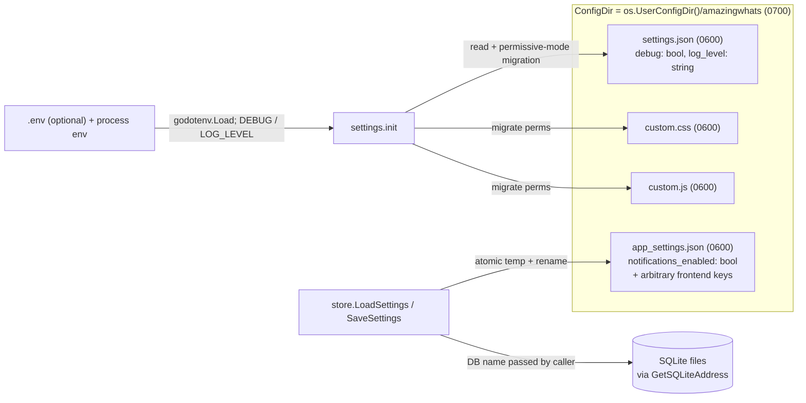

# Configuration: files, keys, and environment

> **In one line:** The app keeps its settings in one per-user config directory created at `0700`, reads exactly two environment variables (`DEBUG` and `LOG_LEVEL`) through `godotenv`, and stores a single backend-owned `notifications_enabled` flag in `app_settings.json`.

## Why this page exists

Configuration questions attract guesses: "is it `XDG_CONFIG_HOME`?", "what is the env var for notifications?", "where do custom styles go?". A wrong guess here produces a setting that silently never applies. This page refuses to guess. It lists only paths, keys, and variables that appear in `internal/misc/misc.go`, `internal/settings/config.go`, `internal/settings/env.go`, and `internal/store/settings.go`. If a knob is not in those files, the page says so.

## The idea, in plain words

Think of the app's settings as a **filing cabinet in your home**:

- The **cabinet** is the config directory. The app builds it from your OS's own "where should apps put user config?" answer and then appends its own name, `amazingwhats`. It locks the cabinet to you (`0700`).
- The **folders inside** are individual files: one for startup/debug settings, one for the big JSON bag of app settings, and two for your custom styling scripts.
- The **sticky note on the cabinet door** is the environment. On startup the app reads a `.env` file if one exists, then looks for exactly two names. A sticky note overrides the paperwork inside.
- The **notifications switch** is special. It is owned by the backend, cached in memory so the busy message path never has to touch the shared settings map, and written to disk atomically.

Two habits follow from this: do not assume a fixed absolute path, and do not invent an environment variable — the list is short and knowable.

## The code, line by line

```go
// internal/misc/misc.go:10-18
const AppName = "amazingwhats"
const AppID = "net.lugvitc.amazingwhats"

// Config files and the session database hold long-lived credentials, so the
// config directory is owner-only and secret files are owner-read/write only.
const configDirPerm = 0700
const secretFilePerm = 0600

var ConfigDir = defaultConfigDir()
```

```go
// internal/misc/misc.go:43-62
func defaultConfigDir() string {
	cdr, err := os.UserConfigDir()
	if err != nil {
		panic(err)
	}
	cdr = filepath.Join(cdr, AppName)
	if !dirExists(cdr) {
		err = os.MkdirAll(cdr, configDirPerm)
		if err != nil {
			panic(err)
		}
	}
	// Migrate directories created by older versions with permissive modes.
	// Chmod is best-effort: no failure if the platform/filesystem does not
	// support it (notably Windows).
	if err := os.Chmod(cdr, configDirPerm); err != nil {
		log.Printf("misc: could not restrict config directory permissions: %v", err)
	}
	return cdr
}
```

```go
// internal/settings/config.go:12-40
type _settings struct {
	Debug    bool   `json:"debug"`
	LogLevel string `json:"log_level"`
}

var s _settings

func init() {
	defer s.setupEnvVars()

	// Migrate config files written by older versions with permissive modes.
	for _, name := range []string{"settings.json", "custom.css", "custom.js"} {
		misc.RestrictFile(filepath.Join(misc.ConfigDir, name))
	}

	path := filepath.Join(misc.ConfigDir, "settings.json")
	b, err := os.ReadFile(path)
	if err != nil {
		return
	}
	// Unmarshal into a temporary value so a malformed file cannot leave the
	// global settings partially overwritten.
	var loaded _settings
	if err := json.Unmarshal(b, &loaded); err != nil {
		log.Printf("settings: malformed %s, ignoring: %v", path, err)
		return
	}
	s = loaded
}
```

```go
// internal/settings/env.go:13-36
func (c *_settings) setupEnvVars() {
	_ = godotenv.Load()
	val := reflect.ValueOf(c).Elem()
	for i := 0; i < val.NumField(); i++ {
		name := toUpperSnakeCase(val.Type().Field(i).Name)

		envVal, ok := os.LookupEnv(name)
		if !ok {
			continue
		}

		switch val.Type().Field(i).Type.Kind() {
		case reflect.Int:
			ev, _ := strconv.ParseInt(envVal, 10, 64)
			val.Field(i).SetInt(ev)
		case reflect.String:
			val.Field(i).SetString(envVal)
		case reflect.Bool:
			ev, _ := strconv.ParseBool(envVal)
			val.Field(i).SetBool(ev)
		default:
			continue
		}
	}
}
```

```go
// internal/store/settings.go:17-29,42-49
// notificationsKey is the app_settings.json key for the global
// notifications on/off switch.
const notificationsKey = "notifications_enabled"

// notificationsEnabled caches the global notification switch so the hot
// notify path can read it without touching the settings map (which is not
// safe for concurrent access).
var notificationsEnabled atomic.Bool

func init() {
	// Default to enabled until LoadSettings reads the persisted value.
	notificationsEnabled.Store(true)
}
// ...
func LoadSettings() {
	path := filepath.Join(misc.ConfigDir, "app_settings.json")
	f, err := os.OpenFile(path, os.O_RDWR|os.O_CREATE, 0600)
	if err != nil {
		panic(err)
	}
	// Restrict as well as create with 0600 so older installs are migrated.
	misc.RestrictFile(path)
```

| Line | What it does |
|---|---|
| `misc.go:10-11` | The two hard-coded names: `AppName = amazingwhats`, `AppID = net.lugvitc.amazingwhats`. |
| `misc.go:15-16` | The two permission constants: directory `0700`, secret files `0600`. |
| `misc.go:18` | `ConfigDir` is computed once at package load by `defaultConfigDir()`. |
| `misc.go:44` | The base path comes from Go's `os.UserConfigDir()` — **not** a repo constant. |
| `misc.go:48` | The app appends its own `amazingwhats` folder to that base. |
| `misc.go:50,58` | Creates at `0700` and re-chmods at `0700` on every start (migration of older, looser dirs). |
| `misc.go:59` | A chmod failure is logged, not fatal — Windows may not support POSIX mode bits. |
| `settings/config.go:12-15` | `settings.json` has exactly two keys: `debug` (bool) and `log_level` (string). |
| `settings/config.go:20` | `defer s.setupEnvVars()` means env overrides are applied **after** the file is read, at the end of `init`. |
| `settings/config.go:23-25` | On every start, `settings.json`, `custom.css`, and `custom.js` have their permissions tightened. |
| `settings/config.go:28-31` | A missing `settings.json` is not an error — the in-memory defaults stand. |
| `settings/config.go:34-38` | Malformed JSON is logged and ignored; the temp variable prevents a half-written global state. |
| `settings/env.go:14` | `godotenv.Load()` loads a `.env` file if present; its error is deliberately ignored. |
| `settings/env.go:17-19` | The env var name is the Go field name in `UPPER_SNAKE_CASE`, looked up with `os.LookupEnv`. |
| `settings/env.go:24-35` | Only three kinds are handled: `int`, `string`, `bool`. The current struct has no int field. |
| `settings/config.go:46-54` | `GetLogLevel`: `debug=true` forces `"DEBUG"`; else `log_level`; else `"INFO"`. |
| `settings/config.go:56-73` | `custom.css` is read/written under the config dir; writes use `0600`. |
| `settings/config.go:75-92` | `custom.js` follows the same read/write pattern with `0600`. |
| `store/settings.go:19` | The only backend-owned JSON key is `notifications_enabled`. |
| `store/settings.go:24-28` | The cached switch is an `atomic.Bool`, defaulting to `true`. |
| `store/settings.go:43-49` | `app_settings.json` is opened/created at `0600` and also tightened via `RestrictFile`. |
| `store/settings.go:83-87` | A frontend save that omits `notifications_enabled` cannot clobber the backend value. |
| `store/settings.go:110-115` | Setting the flag copies the map first, so concurrent readers never see a half-updated map. |
| `store/settings.go:145-186` | Saves are atomic: temp file `0600`, sync, close, rename, then tighten permissions. |

### Where the directory actually is

The repository does **not** hardcode an absolute path. It calls `os.UserConfigDir()` and joins `amazingwhats` (`misc.go:44-48`). Go's standard library resolves `os.UserConfigDir()` per operating system, so the concrete location depends on the machine — the code is deliberately portable. Do not assume any particular dot-directory is universal.

### Files in that directory, from code

| File | Created / written by | Shape | Source |
|---|---|---|---|
| `settings.json` | read in `init`; not created by this code | JSON object with `debug` (bool), `log_level` (string) | `settings/config.go:12-15,27-40` |
| `app_settings.json` | `store.LoadSettings` (`O_RDWR\|O_CREATE`, `0600`) | JSON object (`map[string]any`) with backend key `notifications_enabled` (bool) | `store/settings.go:17-19,42-49` |
| `custom.css` | `SetCustomCSS` (`0600`) | raw CSS text | `settings/config.go:56-73` |
| `custom.js` | `SetCustomJS` (`0600`) | raw JS text | `settings/config.go:75-92` |
| database files | callers of `misc.GetSQLiteAddress(dbName)` | SQLite DSN with `_foreign_keys=on&_busy_timeout=5000&_synchronous=NORMAL` | `misc.go:20-31` |

> The concrete database filenames are supplied by callers of `GetSQLiteAddress`; they are not literal strings in the files on this page. See [Database: three SQLite files, one writer, and a guarded schema](../02-components/database.md) for the names.

### Environment variables actually read

These are the only names the Go settings code looks up (`settings/env.go:13-36`, driven by the fields at `settings/config.go:12-15`):

| Name | Type | Effect | Parsing |
|---|---|---|---|
| `DEBUG` | bool | Sets `debug`; `true` forces the log level to `"DEBUG"` | `strconv.ParseBool` |
| `LOG_LEVEL` | string | Sets `log_level` | used as-is |

Details that matter:

- `godotenv.Load()` is called first (`env.go:14`), so a `.env` file in the working directory can supply either name. Its error is ignored, so no `.env` is required.
- The lookup is `os.LookupEnv`, so a variable that is present but empty still counts as set: an empty `LOG_LEVEL` would yield an empty log level string (`env.go:19-22`).
- Env values are applied last in `init` (`config.go:20`), so **environment beats `settings.json`**.
- Values are read once at startup. There is no watcher or reload in these files.
- `WAILS_VITE_PORT` is **not** a Go environment variable. It is a *Task variable* used only by the Taskfile to choose the dev port (`Taskfile.yml:14`, documented on [Build and run](build-and-run.md)).
- There is no env var for notifications, custom CSS/JS, the config directory, or focus behavior in this source set. If you see one suggested elsewhere, treat it as unverified.

### Custom CSS and JS

`GetCustomCSS`/`SetCustomCSS` and `GetCustomJS`/`SetCustomJS` treat their inputs as opaque strings: read the file, return its text; write the text with mode `0600`, then call `misc.RestrictFile` to tighten an already-existing file (`settings/config.go:56-92`). There is no parsing, validation, or escaping in these functions. Both files are included in the startup permission migration (`settings/config.go:23-25`). How the frontend applies these strings is outside the source set for this page; see [Frontend app: from main.tsx to the window the user sees](../02-components/frontend-app.md) for that side.

### Notifications and focus behavior

**Notifications** are backend-owned. `notificationsKey = "notifications_enabled"` (`store/settings.go:19`); the value defaults to `true` when absent or of an unexpected type (`store/settings.go:120-129`). `notificationsEnabled` is an `atomic.Bool` so the hot notify path reads a single value without locking the shared map (`store/settings.go:21-28,96-100`). `SetNotificationsEnabled` persists through the atomic write path (`store/settings.go:102-118`), and `SaveSettings` carries the key forward when the frontend submits a snapshot without it (`store/settings.go:80-87`) — a fix that prevents a generic save from resetting the switch.

**Focus** has no setting in these files. There is no focus key in `settings.json`, no focus key in `app_settings.json`, and no focus environment variable in `settings/env.go`. Window focus is a frontend/runtime concern (the call is `SetWindowFocused` in `frontend/src/App.tsx`); that wiring is documented on [Frontend app](../02-components/frontend-app.md). If you are hunting for a configuration knob to change focus behavior, this source set does not contain one.



## What can go wrong

> **The path is not portable to assume.** Because the base comes from `os.UserConfigDir()`, a documented `~/.config/amazingwhats` path will be wrong on some machines. Read `misc.go:43-62` instead.

> **Environment silently beats the file.** `defer s.setupEnvVars()` (`config.go:20`) runs after the JSON read, so a stale `DEBUG` in your shell overrides `settings.json`. Check `GetLogLevel()` (`config.go:46-54`) when a log-level change appears to do nothing.

> **A present-but-empty variable is still set.** `os.LookupEnv` returns `ok=true` for an empty value (`env.go:19`), which can produce an empty `LOG_LEVEL`.

> **A malformed `settings.json` is ignored, not reported to the user.** It is logged at `config.go:36` and the defaults are used; the file itself is not rewritten by this code.

> **Custom CSS/JS strings are unvalidated.** The settings functions do no escaping (`config.go:56-92`). Only put content there that you trust, and check the frontend page for the trust boundary.

> **Notification writes depend on atomic rename.** The temp-file/rename dance closes the destination handle first specifically so it works on Windows (`store/settings.go:170-185`). A filesystem that refuses the rename will surface an error rather than a truncated file.

> **Do not look for a focus config key.** It does not exist in this source set. Adding an env var for it would be an invention, not a fix.

## Where to next

- [Build and run: the exact tasks, tools, and gates](build-and-run.md)
- [Security and privacy: what the code actually enforces](security-privacy.md)
- [Database: three SQLite files, one writer, and a guarded schema](../02-components/database.md)
- [Frontend app: from main.tsx to the window the user sees](../02-components/frontend-app.md)
- [Landing page and reading order](../index.md)
