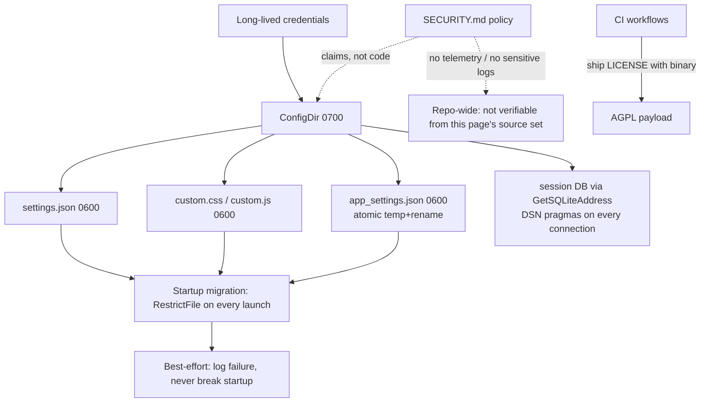

# Security and privacy: what the code actually enforces

> **In one line:** The code in this source set enforces owner-only config files (`0700` directory, `0600` files) and atomic, minimal logging, while the no-telemetry and "never log sensitive data" promises in `SECURITY.md` are policy statements that these files can support but cannot prove on their own.

## Why this page exists

Security pages often mix two very different things: **controls you can point at in code** and **promises written in a policy file**. They look the same in prose, but they are not the same in strength. A `0600` chmod is a line you can read. "We do not collect analytics" is a claim about the absence of code everywhere. This page keeps the two apart, and it is deliberately narrow: it reports only what the listed config, settings, store, policy, CI, Nix, and verifier files show. Claims about logging in other packages are handled on [Known issues](../05-reference/known-issues.md), not asserted here.

## The idea, in plain words

Think of a user's WhatsApp data as **valuable mail delivered to their house**:

- The **front door lock** is the config directory permission (`0700`): only the owner can enter.
- **Each locked drawer** is a secret file (`0600`): only the owner can read or write the session database, settings, and custom scripts.
- **The moving van** is the settings write: it packs the new data in a sealed temp box, locks it, and only then swaps it in — so a crash never leaves the old file torn open.
- **The label on the box** is logging. A good label says "permission denied on file X"; a bad label prints the content of the box. This page shows exactly what the labels in these files say.
- **The notice pinned to the door** is `SECURITY.md`. It tells reporters how to reach the maintainer and tells contributors what *should* be true. A notice is not a lock.
- **The shipping department** is CI. It must include the AGPL license text in every distributed artifact; the workflows show where that happens.

The habit to learn: when someone says "the app is secure because X", ask *which file enforces X*. If the answer is a policy document, label it as a policy.

## The code, line by line

```go
// internal/misc/misc.go:10-18
const AppName = "amazingwhats"
const AppID = "net.lugvitc.amazingwhats"

// Config files and the session database hold long-lived credentials, so the
// config directory is owner-only and secret files are owner-read/write only.
const configDirPerm = 0700
const secretFilePerm = 0600

var ConfigDir = defaultConfigDir()
```

```go
// internal/misc/misc.go:33-41
// RestrictFile best-effort tightens a file to owner-only permissions. It is
// safe to call on every start: existing files are migrated and platforms that
// do not implement POSIX mode bits (e.g. Windows) simply ignore the mode, so
// a failure here must never break startup.
func RestrictFile(path string) {
	if err := os.Chmod(path, secretFilePerm); err != nil && !os.IsNotExist(err) {
		log.Printf("misc: could not restrict permissions for %s: %v", filepath.Base(path), err)
	}
}
```

```go
// internal/settings/config.go:22-25,66-72
	// Migrate config files written by older versions with permissive modes.
	for _, name := range []string{"settings.json", "custom.css", "custom.js"} {
		misc.RestrictFile(filepath.Join(misc.ConfigDir, name))
	}
// ...
func SetCustomCSS(css string) error {
	path := filepath.Join(misc.ConfigDir, "custom.css")
	if err := os.WriteFile(path, []byte(css), 0600); err != nil {
		return err
	}
	misc.RestrictFile(path) // migrate an existing permissive file
	return nil
}
```

```go
// internal/store/settings.go:42-49
func LoadSettings() {
	path := filepath.Join(misc.ConfigDir, "app_settings.json")
	f, err := os.OpenFile(path, os.O_RDWR|os.O_CREATE, 0600)
	if err != nil {
		panic(err)
	}
	// Restrict as well as create with 0600 so older installs are migrated.
	misc.RestrictFile(path)
```

```go
// internal/store/settings.go:140-186 (abridged: the atomic write)
	buf, err := json.Marshal(s.data)
	// ...
	tmp, err := os.CreateTemp(filepath.Dir(s.path), ".app_settings-*.tmp")
	// ...
	if err := tmp.Chmod(0600); err != nil { /* clean up and return */ }
	// ...
	if err := tmp.Sync(); err != nil { /* clean up and return */ }
	// ...
	// Close the destination handle first so the replacement also works on
	// Windows, where renaming over an open file can be refused.
	// ...
	if err := os.Rename(tmpName, s.path); err != nil { /* restore handle; return */ }
	misc.RestrictFile(s.path)
```

```markdown
<!-- SECURITY.md:54-64 -->
## 🔒 Data & Privacy Considerations

- amazingwhats does **not** collect analytics or telemetry
- All user data is stored **locally**
- Encryption and protocol handling rely on the upstream `whatsmeow` library
- Sensitive information should never be logged or exposed

Contributors must take care to:
- Avoid logging message contents, keys, or identifiers unnecessarily
- Avoid weakening cryptographic or protocol-related code
- Follow the principle of least privilege
```

```yaml
# .github/workflows/release.yaml:152-160 (Windows payload)
      - name: Package Windows binary with AGPL license (zip)
        if: matrix.os == 'windows-latest'
        shell: pwsh
        run: |
          # D-AUD-009d: AGPL-3.0 requires the license text to ship with the binary.
          Copy-Item LICENSE bin/LICENSE
          $zipName = [System.IO.Path]::GetFileNameWithoutExtension('${{ matrix.binary }}') + '.zip'
          Compress-Archive -Path "bin/${{ matrix.binary }}", "bin/LICENSE" -DestinationPath "bin/$zipName"
```

| Line | What it does |
|---|---|
| `misc.go:13-16` | States the threat model in a comment: config and the session DB hold long-lived credentials, hence `0700`/`0600`. |
| `misc.go:50,58` | Creates the config dir at `0700` and re-chmods it at every start. |
| `misc.go:37-40` | `RestrictFile` tightens a file to `0600` best-effort; a failure is logged, not fatal. |
| `misc.go:39` | The only file detail logged here is `filepath.Base(path)` — a basename, not a full path or content. |
| `settings/config.go:23-25` | Migrates `settings.json`, `custom.css`, `custom.js` from older permissive modes at startup. |
| `settings/config.go:68,87` | New CSS/JS files are created with `0600` and then tightened again. |
| `store/settings.go:44,49` | `app_settings.json` is opened/created at `0600` and tightened. |
| `store/settings.go:150` | The atomic-write temp file is explicitly `Chmod(0600)` before any data is written. |
| `store/settings.go:171-186` | The destination handle is closed before rename (Windows compatibility), then the result is tightened again. |
| `misc.go:30` | The SQLite DSN forces `_foreign_keys=on`, `_busy_timeout=5000`, `_synchronous=NORMAL` on every pooled connection — an integrity guard, not a secrecy control. |
| `SECURITY.md:56-59` | Policy claims: no telemetry, local data, encryption via `whatsmeow`, sensitive data never logged. |
| `SECURITY.md:61-64` | Contributor duties: avoid logging contents/keys/identifiers, do not weaken crypto, least privilege. |
| `SECURITY.md:7-13` | Reporting policy: no public issue; use a private advisory or contact the maintainer. |
| `SECURITY.md:68-74` | Limitation: unofficial client, possible ToS violation, possible bans outside the project's control. |
| `release.yaml:156-159` | Windows release zips the binary **with** `LICENSE` — an enforced AGPL payload step. |
| `release.yaml:174-176` | AppImage ships `LICENSE` under `usr/share/licenses/amazingwhats`. |
| `release.yaml:188-190` | macOS `.app` ships `LICENSE` in `Contents/Resources`. |
| `rolling-release.yaml:154-157,172-174,189-191` | The rolling workflow repeats the same three license-payload steps. |
| `build/Taskfile.yml:69-72` | Explains why legacy NSIS assets remain: the AGPL license page must not be removed until a v3 NSIS path is verified. |
| `package.nix:150` | Declares `license = lib.licenses.agpl3Plus` in package metadata. |
| `verify_central.ps1:39-40,82` | The verifier writes its own log under `%USERPROFILE%` and records the full `PATH` there — operational logging, not app telemetry. |

### What this source set logs

An honest inventory of `log.Printf` calls in the files above:

| File:line | What is logged | Sensitive? |
|---|---|---|
| `misc.go:39` | `misc: could not restrict permissions for <basename>: <error>` | File basename only; no contents, no full path. |
| `misc.go:59` | `misc: could not restrict config directory permissions: <error>` | No path, no contents. |
| `settings/config.go:36` | `settings: malformed <path>, ignoring: <error>` | Full settings path, but **not** the file contents. |
| `store/settings.go:65` | `store: could not decode <path>, using defaults: <error>` | Full settings path, but **not** the file contents. |

**JID and phone redaction:** none of these four files logs a JID, a phone number, a message body, a key, or a token. That is a statement about *this source set only*. The repo-wide claim that such logging was remediated lives in the audit register's closure section and is **not verifiable from the files on this page** — see [Known issues](../05-reference/known-issues.md) for the labelled historical record. When you add a log line yourself, follow `SECURITY.md:61-64`: log counts and identifiers only when needed, never message content or secrets.

### Code-enforced vs policy-only

| Claim | Strength | Evidence |
|---|---|---|
| Config dir is owner-only (`0700`) | **Enforced in code** (best-effort on filesystems without POSIX bits) | `misc.go:50,58` |
| Secret files are owner-read/write (`0600`) | **Enforced in code** (same caveat) | `misc.go:16,37-40`, `settings/config.go:68,87`, `store/settings.go:44,150,186` |
| Older permissive files/dirs are migrated | **Enforced in code**, best-effort | `misc.go:55-60`, `settings/config.go:23-25`, `store/settings.go:49` |
| Settings writes cannot leave a truncated file | **Enforced in code** (temp + `Sync` + rename) | `store/settings.go:135-194` |
| Notification flag survives a frontend save | **Enforced in code** | `store/settings.go:83-87` |
| AGPL license text ships in release artifacts | **Enforced in CI** | `release.yaml:152-194`, `rolling-release.yaml:150-195` |
| AGPL declared in package metadata | **Enforced in code** | `package.nix:150` |
| No analytics or telemetry | **Policy claim** (`SECURITY.md:56`); no telemetry code appears in this source set, which is supporting evidence, not proof about the whole repo | `SECURITY.md:56` |
| All user data stored locally | **Policy claim** (`SECURITY.md:57`) consistent with `os.UserConfigDir()` storage in `misc.go:43-48` | `SECURITY.md:57`, `misc.go:43-48` |
| Encryption relies on `whatsmeow` | **Policy claim** about an upstream library, not implemented here | `SECURITY.md:58` |
| Sensitive information is never logged | **Policy claim** (`SECURITY.md:59`); true for these files, unverified repo-wide here | `SECURITY.md:59`, log inventory above |
| Private vulnerability reporting | **Policy only** — a process, not a control | `SECURITY.md:7-21` |
| Unofficial client / ban risk | **Policy limitation** | `SECURITY.md:68-74` |



## What can go wrong

> **Permissions are best-effort on Windows.** The comment at `misc.go:33-36` is explicit: platforms without POSIX mode bits ignore the mode, so a failure must never break startup. `0600` is a POSIX guarantee, not a Windows ACL guarantee.

> **A chmod failure is only logged.** `RestrictFile` does not return an error (`misc.go:37-41`), so a restrictive policy that expects a hard failure will not get one.

> **The full config path appears in two log lines.** `settings/config.go:36` and `store/settings.go:65` log the path on a decode error. No contents are logged, but the path itself is environment information.

> **Policy is not enforcement.** "No telemetry" (`SECURITY.md:56`) cannot be proven by reading these files. Absence of evidence in a subset is not evidence of absence in the whole repository.

> **Do not treat the log inventory as repo-wide.** Other packages may log differently; those claims are tracked on [Known issues](../05-reference/known-issues.md) with explicit "verify in source" labels.

> **AGPL payload is a CI step, not a local build guarantee.** A local `wails3 task build` produces a binary without the workflow's packaging steps; the LICENSE payload is added in `release.yaml`/`rolling-release.yaml`.

> **Legacy NSIS assets are deliberate.** Do not delete `build/windows/installer/project.nsi` to "clean up" — `build/Taskfile.yml:69-72` says its AGPL license page must stay until a v3 NSIS path is regenerated and verified.

## Where to next

- [Configuration: files, keys, and environment](configuration.md)
- [Build and run: the exact tasks, tools, and gates](build-and-run.md)
- [Known issues: honest, sourced, and unverified where needed](../05-reference/known-issues.md)
- [Database: three SQLite files, one writer, and a guarded schema](../02-components/database.md)
- [Landing page and reading order](../index.md)
