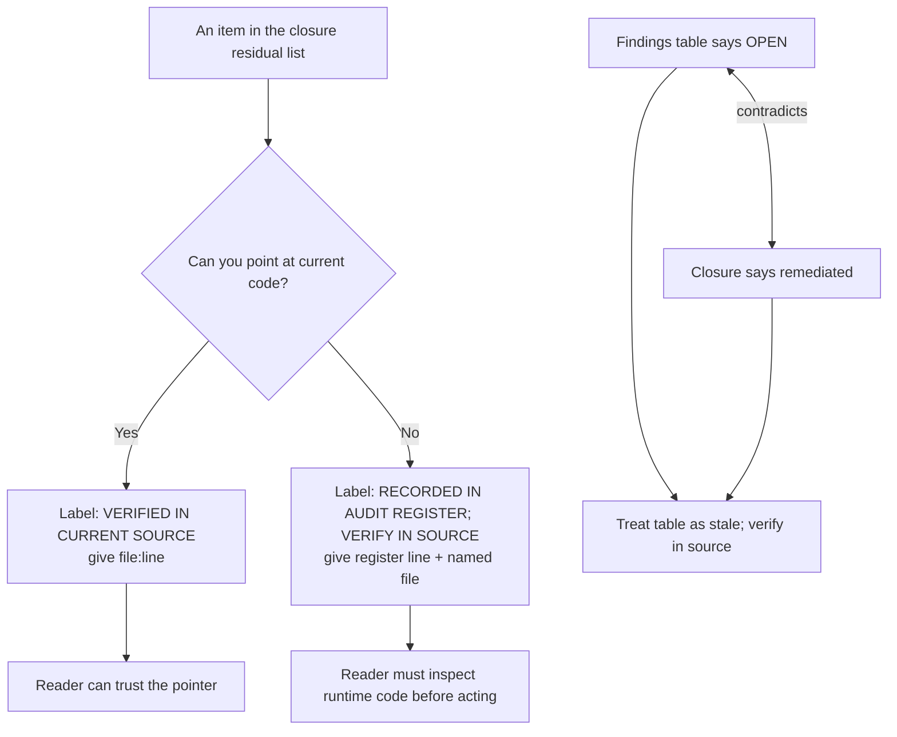

# Known issues: honest, sourced, and unverified where needed

> **In one line:** The only list used here is the audit register's closure section and residual list, treated as historical evidence; every item is labelled either "verified in current source" with a file pointer or "recorded in audit register; verify in source".

## Why this page exists

A "known issues" page is where documentation most often becomes fiction: a bug is described as fixed because a report says so, or as open because a table was never updated. Both are dishonest if you cannot point at the code. This page takes the stricter route. It uses one historical source — `provenance-docs/APP_AUDIT_REGISTER.md`, closure section at lines 19–23 — and separates:

- **Verified in current source** — the claim is confirmed by a file you can open today.
- **Recorded in audit register; verify in source** — the claim is historical only; this page did not inspect the runtime code, and neither should you assume it is still true.

> **Scope of this page:** no verifier was run and no build was performed while writing it. The closure section's claims (remediation commits and a GREEN final gate) are reported as **the register's claims**, not as independently reproduced results.

## The idea, in plain words

Think of the audit register as an **old inspection report** pinned to a wall:

- The **closure section** is the inspector's final note: "all ten waves were executed and remediated; here are the residual risks we chose to live with."
- The **residual list** is the short list of things still imperfect. These are the candidates for this page.
- The **findings table** below that note is an older, detailed log. Think of it as the inspector's scratch sheets — useful for file pointers, but stale as a status record.
- **Current source** is the building itself. A note about a locked door is only as good as your turning the handle.

So the rule is simple: if you can see the door in code, say "verified". If all you have is the note, say "recorded in audit register; verify in source" and hand the reader the pointer.

## The code, line by line

These are the provenance excerpts this page relies on.

```markdown
<!-- provenance-docs/APP_AUDIT_REGISTER.md:19-23 -->
## Closure (2026-11-23)
All 10 audit waves executed; findings remediated, Critic-audited, and committed. Per-wave remediation commits:
- 001 -> `6a69e33` (auth/session) // 002 -> `dfe363c` (database) // 003+005 -> `0e902ac`, `30efade` (media/message) // 004 -> `8e0b22a` (VoIP) // 006 -> `056346c` (frontend) // 007+008 -> `db2f965` (events/privacy/group) // 009 -> `4c88aa3` (CI/Nix) // 010 -> `30efade` (secrets/licensing).
- Final gate `gate_last` (-Clean, -Wails3) GREEN: go build/test/vet, wails3 bindings/doctor, frontend test/build all exit 0. Real `wails3 build` succeeded on the migrated tree.
- Residual accepted risks (non-blocking, documented): wa:error still renders backend user-error strings; history progress bar receives only start/end events (no intermediate emits); caller JID choice for group calls is the call creator; legacy v2 NSIS assets retained but documented; Nix pinned nixpkgs may lack `wails3` (fails loudly); Outlook-style 1:1 disappearing-timer getter unavailable so control hidden; blocklist Active flag needs live verification.
```

```yaml
# build/Taskfile.yml:69-72 — current source, verifies the NSIS residual
  # NOTE (D-AUD-009f): build/windows/installer/{project.nsi,wails_tools.nsh}
  # are legacy v2 NSIS assets. v3 packaging ships a plain binary + LICENSE zip
  # from CI; the AGPL license page in project.nsi is retained and must not be
  # removed until a v3 NSIS path is regenerated and verified.
```

```nix
# package.nix:9-13 — current source, verifies the Nix/wails3 residual
  # D-AUD-009b: Wails v3 CLI only - there is intentionally no v2 `wails`
  # fallback. If the pinned nixpkgs does not provide `wails3`, pass a v3 CLI
  # derivation explicitly (overlay / override input, or `wails3 = <drv>` at
  # the callPackage site) instead of falling back to the v2 package.
  wails3 ? pkgs.wails3,
```

```nix
# shell.nix:3-6 — the dev shell is more forgiving than package.nix
  nodejs ? pkgs.nodejs_latest,
  go ? pkgs.go,
  wails ? pkgs.wails,
  wails3 ? pkgs.wails3 or wails,
```

| Line | What it does |
|---|---|
| `APP_AUDIT_REGISTER.md:19-22` | The closure claim: ten waves remediated and committed, with a list of commit hashes and a GREEN gate. Historical evidence only. |
| `APP_AUDIT_REGISTER.md:23` | The authoritative residual list for this page — seven accepted risks. |
| `APP_AUDIT_REGISTER.md:27-117` | The detailed findings table; every row still reads `PENDING` / `OPEN`. See the inconsistency note below. |
| `build/Taskfile.yml:69-72` | Current source confirming the "legacy v2 NSIS assets retained" residual. |
| `package.nix:9-13` | Current source confirming "Nix may lack `wails3` and must fail loudly, no v2 fallback". |
| `shell.nix:5-6` | A nuance the residual does not mention: the dev shell still has `wails3 ? pkgs.wails3 or wails`. |

## The residual accepted risks

### 1. `wa:error` still renders backend user-error strings

**Label: recorded in audit register; verify in source.**

The closure list names it at `provenance-docs/APP_AUDIT_REGISTER.md:23`; the related findings are D-AUD-010g (`:46`, raw backend errors rendered in UI) and D-AUD-007h (`:100`, `wa:error` raw strings accepted/deferred). The register points at `frontend/src/App.tsx` among other files, but this page did not inspect that code and cannot confirm the current behavior. Verify at the emit site and the UI sink before acting.

### 2. History progress bar receives only start/end events

**Label: recorded in audit register; verify in source.**

Closure at `APP_AUDIT_REGISTER.md:23`; related finding D-AUD-007a at `:93` ("`wa:history_progress` handler reads wrong keys → progress bar dead") names `frontend/src/App.tsx:189-200` and `api/api.go:1091-1097`. Both files exist in the checkout, but their current contents were not inspected here. The residual's wording ("only start/end events, no intermediate emits") is the register's, not a verified runtime observation.

### 3. Caller JID choice for group calls is the call creator

**Label: recorded in audit register; verify in source.**

Closure at `APP_AUDIT_REGISTER.md:23`; related findings D-AUD-004j at `:78` (group incoming peerJID inviter vs creator inconsistent) and D-AUD-008b at `:111` (group admin controls hidden because JID normalization differs). The register points at `api/calls.go` (which exists) and at a `ChatInfo.tsx`. Treat the exact selection rule as unverified until you read the call path.

### 4. Legacy v2 NSIS assets retained but documented

**Label: verified in current source.**

`build/Taskfile.yml:69-72` carries the explicit `D-AUD-009f` note, and the named files `build/windows/installer/project.nsi` and `build/windows/installer/wails_tools.nsh` are present in the checkout. The note is a deliberate retention decision: the AGPL license page in `project.nsi` must not be removed until a v3 NSIS path is regenerated and verified. Do not "clean up" these files. Related closure finding: `APP_AUDIT_REGISTER.md:106` (D-AUD-009f).

### 5. Nix pinned nixpkgs may lack `wails3` (fails loudly)

**Label: verified in current source.**

`package.nix:9-13` implements exactly this: `wails3 ? pkgs.wails3` with a comment saying there is intentionally no v2 fallback and that a v3 CLI derivation must be passed explicitly if the pin lacks it. Related closure finding: `APP_AUDIT_REGISTER.md:102` (D-AUD-009b, HIGH).

**Nuance worth knowing:** `shell.nix:5-6` declares `wails ? pkgs.wails` and `wails3 ? pkgs.wails3 or wails`, so the *dev shell* can still fall back to a v2 package. A working `nix develop` shell is therefore not proof that `package.nix` will build.

### 6. Outlook-style 1:1 disappearing-timer getter unavailable, control hidden

**Label: recorded in audit register; verify in source.**

Closure at `APP_AUDIT_REGISTER.md:23`; related finding D-AUD-008c at `:112`. The register points at `PrivacySettingsScreen.tsx` and `api/privacy.go:178-196`. In this checkout the screen file lives at `frontend/src/screens/settingscreens/PrivacySettingsScreen.tsx` (path verified; contents not inspected here). Do not assume the control's current visibility without checking.

### 7. Blocklist `Active` flag needs live verification

**Label: recorded in audit register; verify in source.**

Closure at `APP_AUDIT_REGISTER.md:23`; related finding D-AUD-008g at `:116` ("Blocklist LID/PN + Active flag comparison unverified"), pointing at `api/privacy.go:99-118` and a `ChatInfo.tsx`. A related type-string concern is D-AUD-008d at `:113`. "Needs live verification" means exactly that — this page did not run the app or inspect the current comparison.

## A provenance inconsistency you should know about

**Label: verified in current source (this is a documentation defect, not a runtime bug).**

The closure section (`APP_AUDIT_REGISTER.md:19-23`) says all findings were remediated, Critic-audited, and committed, with a GREEN final gate. The findings table in the *same file* (`:27-117`) still marks every row `PENDING` in the Critic column and `OPEN` in the Status column. Those two statements cannot both be current.

How to read it: treat the closure section and residual list as the **newer** statement, and the table as a **stale** scratch record that is still useful for file pointers. If you need certainty about a specific D-ID, read the current source it names — do not rely on either section's status word. This page did not re-run the verifier, so the GREEN claim itself remains the register's claim.



## What can go wrong

> **Do not promote a residual into a fixed fact.** "Remediated" in the closure section does not prove a specific behavior today. Keep the label until you have read the code.

> **Do not copy the findings table's `OPEN` status as current truth either.** It contradicts the closure section (`APP_AUDIT_REGISTER.md:19-23` vs `:27-117`). Both are historical records.

> **Paths in the register may have moved.** For example the register's `PrivacySettingsScreen.tsx` is now under `frontend/src/screens/settingscreens/`. Verify a path exists before citing it.

> **This page is not a security audit.** It records accepted risks; it does not assess their severity or confirm the absence of other issues. See [Security and privacy](../04-operations/security-privacy.md) for what the current source actually enforces.

> **Never turn a residual into a silent code change.** If you do verify one and fix it, update the source and the register in the same change — do not just edit this page.

## Where to next

- [Security and privacy: what the code actually enforces](../04-operations/security-privacy.md)
- [Configuration: files, keys, and environment](../04-operations/configuration.md)
- [Build and run: the exact tasks, tools, and gates](../04-operations/build-and-run.md)
- [Decisions: why the code looks like this](../01-architecture/decisions.md)
- [Landing page and reading order](../index.md)
