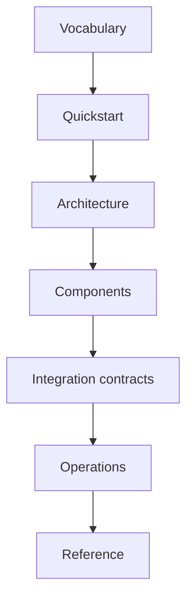

# Junior-docs: start here

> **In one line:** This is the map: read the two starter pages first, then follow the sections in order, and check every explanation against the source file it points to.

## Why this page exists

The repository is a desktop app with two halves that are easy to confuse: a compiled program that talks to WhatsApp and a web-style page that the user sees. The code is large, and much of it is protocol and sync machinery. Without a reading order, a newcomer either stares at the entry point and cannot find the UI, or jumps into a long event handler and cannot find where events come from.

This page gives you that order. Every page listed here is ready and linked, so you can follow the arrows with no gaps to guess at.

## The idea, in plain words

Treat these docs like a museum floor plan. The entrance has two rooms: one teaches you the words on the signs, the other teaches you how to open the building. Past the entrance are themed wings — how the app is put together, what each part does, how the halves agree on messages, how it is built and kept safe, and finally a list of known rough edges. You can wander, but the arrows run in one direction: names first, then setup, then the big picture, then the details.



## The code, line by line

The two-halves idea is visible in four lines. The frontend directory is declared in the project config, its built output is baked into the binary, the Go service is registered with the framework, and the frontend imports generated functions to call it.

```json
// wails.json:2-5
{
  "name": "whats4linux",
  "frontend": {
    "dir": "frontend",
```

```go
// main.go:12-13
//go:embed all:frontend/dist
var assets embed.FS
```

```go
// cmd/run.go:92-93
api := apiPkg.New(app, window)
app.RegisterService(application.NewService(api))
```

```ts
// frontend/src/App.tsx:2
import { Login, GetCustomCSS, GetCustomJS, SetWindowFocused } from "../bindings/github.com/lugvitc/whats4linux/api/api.js"
```

| Line | What it does |
|---|---|
| `wails.json:4` | Names `frontend/` as the web half of the app. |
| `main.go:12` | Embeds the built frontend output into the executable. |
| `main.go:13` | Holds those assets as a file system passed into the command layer. |
| `cmd/run.go:92` | Builds the Go service that owns the app's long-lived work. |
| `cmd/run.go:93` | Registers it so its methods become callable from the page. |
| `App.tsx:2` | Imports those generated call functions from `frontend/bindings/`. |

## Reading order

| Step | Page | Status | What you get |
|---|---|---|---|
| 1 | [Vocabulary](00-start-here/vocabulary.md) | Ready | Every term defined before use, with a file:line pointer. |
| 2 | [Quickstart](00-start-here/quickstart.md) | Ready | Exact tool versions and commands from this repo. |
| 3 | [Architecture](01-architecture/system-map.md) | Ready | [System map](01-architecture/system-map.md), [Data flow](01-architecture/data-flow.md), [Decisions](01-architecture/decisions.md). |
| 4 | [Components](02-components/backend-bootstrap.md) | Ready | [Backend bootstrap](02-components/backend-bootstrap.md), [Message pipeline](02-components/message-pipeline.md), [Database](02-components/database.md), [Frontend app](02-components/frontend-app.md), [State and events](02-components/state-and-events.md), [Chat UI](02-components/chat-ui.md). |
| 5 | [Integration](03-api-integration/wails-bindings.md) | Ready | [Wails bindings](03-api-integration/wails-bindings.md), [Events](03-api-integration/events.md), [Payload shapes](03-api-integration/payload-shapes.md). |
| 6 | [Operations](04-operations/build-and-run.md) | Ready | [Build and run](04-operations/build-and-run.md), [Configuration](04-operations/configuration.md), [Security and privacy](04-operations/security-privacy.md). |
| 7 | [Reference](05-reference/known-issues.md) | Ready | [Known issues](05-reference/known-issues.md), [llms.txt](llms.txt). |

> **Every entry is a real link.** All six wings have been authored and checked in; the section names below link straight to their files. The reading order still runs top to bottom — names first, then setup, then the big picture, then the details. The D-ID for each wing stays recorded in `docs/DRIFT_REGISTER.md`.

### Architecture — ready

- [System map](01-architecture/system-map.md) — the real boot, service, event, and database graph.
- [Data flow](01-architecture/data-flow.md) — how a WhatsApp event becomes something on screen.
- [Decisions](01-architecture/decisions.md) — why the code is shaped this way.

### Components — ready

- [Backend bootstrap](02-components/backend-bootstrap.md) — `cmd/` and service startup.
- [Message pipeline](02-components/message-pipeline.md) — live and history messages.
- [Database](02-components/database.md) — the Go store.
- [Frontend app](02-components/frontend-app.md) — `App.tsx` and screens.
- [State and events](02-components/state-and-events.md) — the frontend stores and event shim.
- [Chat UI](02-components/chat-ui.md) — the virtualized list and media/call overlays.

### Integration contracts — ready

- [Wails bindings](03-api-integration/wails-bindings.md) — exported method names and arguments.
- [Events](03-api-integration/events.md) — every emitted name and its payload.
- [Payload shapes](03-api-integration/payload-shapes.md) — the exact keys crossing the bridge.

### Operations — ready

- [Build and run](04-operations/build-and-run.md) — recipes and flags in full.
- [Configuration](04-operations/configuration.md) — env vars, paths, settings.
- [Security and privacy](04-operations/security-privacy.md) — credential storage and disclosure rules.

### Reference — ready

- [Known issues](05-reference/known-issues.md) — honest limitations from the audit register.
- [llms.txt](llms.txt) — a compact index of the finished docs.

## What can go wrong

> **Do not trust a README promise over a source line.** Project reports describe intent and outcomes; the code describes what actually happens. Every page here is built from checked-in source, and the vocabulary page is the habit-forming step (`00-start-here/vocabulary.md`).

> **Do not start in the middle.** The main event handler is a very long function (`api/api.go:641`). Reading it before the Vocabulary and System map pages makes the event names look arbitrary rather than intentional.

> **Stale v2 assumptions are the most common trap.** This is a v3 codebase: bindings come from `frontend/bindings/` (`frontend/src/App.tsx:2`) and events go through the v3 runtime shim (`frontend/src/lib/wailsRuntime.ts:7`). The integration report records checks that these old patterns are absent (`provenance-docs/INTEGRATION_REPORT.md:8`).

> **A broken link is a drift signal.** Every section is linked now; if a target ever moves or disappears, check `docs/DRIFT_REGISTER.md` for its D-ID rather than guessing at a path.

## Where to next

- [Vocabulary](00-start-here/vocabulary.md) — first.
- [Quickstart](00-start-here/quickstart.md) — second.
- Then the first wing: [System map](01-architecture/system-map.md).
